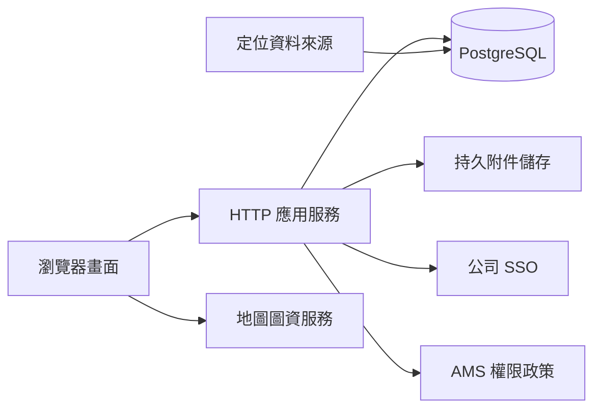

# POLIMAX 系統功能、畫面與 API 規格

版本：1.0，2026-10-12。語言：繁體中文。業務時區：Asia/Taipei。

本文件供沒有原網站、原始程式或其他規格文件的 AI 重新實作系統。預設資料庫為 PostgreSQL；語言、前後端框架、套件、模組分層、元件拆分、資料表、儲存方式與演算法由實作者決定。畫面結構、元件相對位置、比例、欄位順序、使用者操作結果及本文件明訂的 HTTP 契約必須一致。

本文件不包含專案壓縮包、完整程式、解壓成品步驟或強制沿用現有 SQL 結構。附錄只有 Logo 圖檔與行政區選項資料，用來讓單份文件足以重建素材及選項。

## 目錄

1. 規格效力、實作自由與證據
   - 1.1 如何閱讀
   - 1.2 實作自由的範圍
   - 1.3 最終範圍與修訂
2. 系統責任與邏輯資料架構
   - 2.1 業務實體與關係
3. 頁面、路由與浮層清單
4. 共用框架、側欄與登入
   - 4.1 尺寸與捲動
   - 4.2 選單順序
   - 4.3 登入及登出
5. 主日曆
   - 5.1 固定排列
   - 5.2 工具列與小日曆
   - 5.3 篩選與顏色
   - 5.4 四種視圖及互動
6. 表單共用規則
   - 6.1 樣式、摘要及操作
   - 6.2 未保存與忙碌狀態
   - 6.3 查看／編輯浮層
7. A 車輛使用需求單
8. B 發車、C 還車與各自抵達
   - 8.1 父申請與流程
   - 8.2 B 發車布局
   - 8.3 C 還車布局與照片
   - 8.4 B／C 抵達
   - 8.5 草稿
9. D 作業區預約
10. E 儀器設備外借
11. A／D／E、歷史及 B／C 查詢
   - 11.1 共用外框
   - 11.2 A 車輛使用查詢
   - 11.3 D 與 E
   - 11.4 歷史
   - 11.5 發車／還車查詢
   - 11.6 列表狀態
12. 申請詳情與相容直達頁
   - 12.1 主申請詳情
   - 12.2 B／C詳情
   - 12.3 通用借用清單直達
13. 資產、Beacon 及附屬紀錄
   - 13.1 三個清單
   - 13.2 車輛與儀器詳情
   - 13.3 新增與完整編輯
   - 13.4 五類附屬紀錄
   - 13.5 Beacon 編輯
14. 四種定位畫面
   - 14.1 共用外框
   - 14.2 即時車輛
   - 14.3 軌跡
   - 14.4 設備最新位置
   - 14.5 場內掃描
15. 權限、版本、時間與資料一致性
   - 15.1 權限動作與入口
   - 15.2 版本與競爭操作
   - 15.3 時間
   - 15.4 保存與檔案一致性
16. HTTP 共通契約及資料物件
   - 16.1 HTTP
   - 16.2 User 與 Permissions
   - 16.3 Resource
   - 16.4 Booking、content、detail、slot
   - 16.5 Stage 與階段內容
   - 16.6 附屬紀錄與 File
   - 16.7 定位與掃描
17. API 端點
   - 17.1 登入與基本資料
   - 17.2 資源及附屬紀錄
   - 17.3 主申請與車輛流程
   - 17.4 附件
   - 17.5 Beacon 與定位
   - 17.6 排除頁面與相容服務邊界
18. 請求、回應及錯誤範例
   - 18.1 A 新增
   - 18.2 E 新增與讀回
   - 18.3 B 發車
   - 18.4 D
   - 18.5 摘要、權限與錯誤
19. 環境設定、部署及交付
   - 19.1 必要配置與外部邊界
   - 19.2 啟動及發版結果
   - 19.3 合成驗收資料
20. 尚待確認的規則
21. 驗收案例與文件檢查
   - 21.1 畫面驗收
   - 21.2 功能及 API 驗收
   - 21.3 本文件自足檢查
22. 自足素材與選項附錄
   - 22.1 Logo
   - 22.2 縣市及行政區

## 1. 規格效力、實作自由與證據

### 1.1 如何閱讀

| 標記 | 效力 |
| --- | --- |
| 必須 | 已明訂的產品要求；以功能、HTTP 契約或畫面結果驗收 |
| 基準 | 已確認專案的布局數值或呈現行為；重建用此數值，細微字型渲染差異可以接受 |
| 現況 | 研究時觀察到的架構或行為，供理解；單獨的現況敘述不構成新實作要求 |
| 待確認 U-xx | 尚不足以判定為正確業務需求；不得把它描述成使用者已同意 |

未另標記的畫面、欄位、互動及 API 定義視為必須。第20章列出的例外優先於一般敘述；其現況及相容基準已明確列出，AI 可以先實作已確定部分，保留可替換的業務政策。

本文件固定目前已確認的重建版。研究依據包含使用者修訂、來源靜態布局，以及隔離預覽的畫面／操作驗證；沒有原正式站全部實機截圖，不能宣稱原正式站逐像素一致。實作者不需取得這些研究檔案才能理解下文。

### 1.2 實作自由的範圍

資料庫預設 PostgreSQL，未指定版本。可依定位需要選用 PostGIS，但擴充套件不是強制要求。現行系統使用 React／TypeScript 與 Python／FastAPI，並將部分表單內容及附件保存在持久檔案；這是現況資訊，新實作可用其他框架、正規化資料表、JSONB、物件儲存或其他設計達成相同結果。

不指定 CSS 類名、元件檔名、ORM、鎖的種類、ID 產生演算法、快取函式庫或日曆／地圖套件。可以改善冗餘查詢、錯誤處理與內部結構。不得因自行選擇技術而少一個畫面、改欄順序、把表格改卡片、丟失保存資料或改變對外 API。

登入頁、英文小標、介紹文案及裝飾圖示沿用使用者允許的自由。圖示可換，但操作意義、尺寸級距與位置必須保留。主要頁面的排列及配色依本文件基準；原本沒有的宣傳卡、統計卡、步驟 wizard 或右側摘要不能插入日曆／A／D／E，擠壓既定元件。

### 1.3 最終範圍與修訂

| 項目 | 最終要求 |
| --- | --- |
| 左上角 | 使用附錄 Logo，取消文字佔位與虛線框，保持品牌區及圖片框尺寸 |
| 側欄 | 移除「借用紀錄」「出回程紀錄」「資料來源與通知」「歷史封存」四個入口 |
| 後台資訊管理 | 僅 BeaconList／CarList／EquipmentList；沒有可見子項時隱藏群組 |
| A、E 基本資料 | 不顯示「申請緣由」輸入；保留使用需求／類別；查詢中的既有 reason 欄仍顯示 |
| D 查詢 | 表頭整列灰底，與 A 相同 |
| E 查詢 | 使用 D 同類表格，十欄、灰表頭、查看／編輯／刪除；沒有分類 tabs 或通用車牌／緣由篩選列 |
| E 功能 | 七類用途均能新增、保存、刷新回讀與編輯；不套車輛 B／C 流程 |
| 原有正常功能 | 路由直達、重新整理、側欄、權限、保存、附件與既有資料讀取保留 |
| 排除產品 | 資料來源與通知管理頁、歷史封存管理頁、未掛載的分析頁；不要求製作或重新加回選單 |
| 歷史缺陷 | E 固定500、同值更新404、保存失敗假成功、設備失敗鎖死、錯誤時忽略衝突均不重現 |

## 2. 系統責任與邏輯資料架構

系統管理車輛、作業區、儀器的預約與使用，及資產資料、附件、車輛使用流程、定位。身分登入與授權分開：SSO 確認身分，AMS 政策決定可操作範圍。



圖中的框是責任，可在同一程序或分開服務實作，不要求此部署拓樸。定位匯入可透過獨立程序、服務或接收器完成；網站提供查詢結果，不因重新整理合成新報告。新系統不依賴舊網站或舊工作區才能啟動。

### 2.1 業務實體與關係

| 實體 | 必須承載的業務資訊與關係 |
| --- | --- |
| 使用者 | 身分識別、姓名、email、角色、有效權限；正式身份來自 SSO |
| 資源 | 車輛／設備／作業區；對外資源 ID、顯示名、種類、停用狀態及個別資產資料 |
| 主申請 | A／D／E；申請人、日期、用途、明細、時段、版本、狀態及歷史資源顯示資訊 |
| 需求明細 | 對應案件、地點、人員或廠商；類別決定可見欄位 |
| 借用時段 | 指向資源、開始／結束、需求明細；一申請可有多時段 |
| 車輛階段 | B／C 指向 A 父申請；各有出發 start 及可選抵達 arrival |
| 修訂／歷程 | 何人、何時、何操作、舊內容；不因當次取消或本地移除而消失 |
| 附件 | 穩定 ID、名稱、MIME、大小、上傳者及可讀原始內容；表單／資產／紀錄引用附件 |
| 附屬資產紀錄 | 車輛保險、成本、維護、保養廠檔案、管理人員；指向車輛 |
| Beacon | 四位十六進位 ID、擁有者、可視化／燒錄狀態、MAC；可有設備關聯 |
| 定位報告 | 車輛或 Beacon、來源、座標、觀測時間、接收時間；可有 RSSI／電量 |
| 站點掃描 | 站點識別、major／minor、最後出現時間、訊號與電量 |
| 權限政策 | AMS 模組、版本、角色動作、欄位讀寫、owner 限制及 UI 狀態 |

以上是邏輯模型，沒有指定表名、欄型或外鍵實作。API 用的 ID 當作穩定識別，不得由前端推算資料庫主鍵。是否採單表、拆表或 JSONB 自行決定。以既有資料接替運行時須另交遷移及相容轉換；不能藉換表結構丟掉未呈現欄位、照片或舊申請。

## 3. 頁面、路由與浮層清單

所有應用畫面均需登入；未登入時可在原 URL 顯示登入畫面。載入深層路徑及重新整理仍回到同一功能，不得一律回首頁。未知前端路徑回首頁；未知 `/api` 路徑回 JSON 404。

| ID | 路徑／入口 | 畫面 |
| --- | --- | --- |
| P01 | `/` | 主日曆及右側篩選 |
| P02 | `/bookings/new/A` | A 車輛使用需求單 |
| P03 | `/bookings/new/D` | D 作業區申請 |
| P04 | `/bookings/new/E` | E 儀器設備外借 |
| P05 | `/bookings?kind=A` | 車輛使用查詢，11欄 |
| P06 | `/bookings?kind=D` | 作業區使用查詢，8欄 |
| P07 | `/bookings?kind=E` | 儀器使用查詢，10欄 |
| P08 | `/bookings?history=1` | 車輛使用歷史，11欄 |
| P09 | `/stages?kind=B` | 發車紀錄查詢，5欄 |
| P10 | `/stages?kind=C` | 還車紀錄查詢，5欄 |
| P11 | `/bookings/:id` | 主申請詳情、階段及修訂 |
| P12 | `/bookings/:id/edit` | A／D／E 編輯，依申請種類顯示 |
| P13 | `/stages/:id` | B／C 詳情及修訂 |
| P14 | A「下一階段」 | B發車、B抵達、C還車、C抵達四種浮層 |
| P15 | `/vehicles` | 車輛清單 CarList |
| P16 | `/vehicles/:id` | 車輛五分頁 |
| P17 | `/equipment` | 儀器清單 EquipmentList |
| P18 | `/equipment/:id` | 儀器基本／管理資訊 |
| P19 | `/beacons` | BeaconList |
| P20 | `/positions` | 車輛即時位置 |
| P21 | `/positions?view=history` | 車輛軌跡 |
| P22 | `/findmy` | 設備最新位置 |
| P23 | `/scans` | 設備場內資訊 |
| P24 | `/bookings` | 保留的通用借用清單直達頁，沒有側欄入口 |
| P25 | `/stages` | 相容直達，預設 B 查詢，沒有側欄入口 |

補充 query：`/bookings?kind=A&resource=ID` 只列指定車輛，`kind=E&resource=ID` 只列指定設備；`/vehicles?create=1`、`/equipment?create=1` 載入清單並開新增浮層，取消清除 create，之後可以再次開啟。定位 `resource`／`start`／`end` 可由借用時段帶入；是否 history 模式以深層時間條件和 view 判斷，帶起訖的借用軌跡連結必須開啟軌跡查詢。

浮層還包括：新增類型選擇、時段選擇卡、事件摘要、查詢查看／編輯、資產新增／快速編輯／完整編輯、五類附屬紀錄編輯、Beacon 編輯、檔案預覽、刪除確認、登出確認、離頁確認、手機左側導覽／右側日曆篩選／右側定位查詢。

`/integrations`、`/archive` 為舊實作保留的相容路徑，排除於新產品頁面驗收；不能據此恢復選單。若接替既有部署而需保留相容路徑，可提供受權限保護的相容處理，所需範圍見第17章。

## 4. 共用框架、側欄與登入

### 4.1 尺寸與捲動

所有數值為 CSS px。基準桌面1440、平板900、斷點兩側769／768、手機390。

| 元件 | 桌面 >768 | 手機 ≤768 |
| --- | --- | --- |
| 左側導覽 | 寬250，全視窗高；主內容扣此寬 | 寬280左抽屜、遮罩；不占內容寬 |
| 頂欄 | 高85，左右內距16 | 高60，左右內距16 |
| 導覽收合 | 全部移出，主內容占滿 | 由左側選單鈕開啟 |
| 品牌區 | 高80、白底、底框1px #d9d9d9 | 高60、同樣配色 |
| Logo 圖片框 | 220×55.1、居中 | 160×40.1、居中 |
| 使用者區 | 外距8，高140 | 外距8，高140 |
| 使用者區背景 | 上半高70、cover；未有圖使用#718490 | 相同 |
| 頭像 | 40×40，區內left15／top45，圓形 | 相同 |
| 導覽中段 | 占剩餘高度、上距4，只此段縱捲 | 相同 |
| 手機關閉列 | 無 | 高50、內距8、右34×34關閉鈕 |

側欄底部的料件管理與登出固定可見，不被資產清單推走；品牌、使用者、底部不縮小。側欄不得橫向溢出。頁面內容的捲動依各章，不讓日曆篩選、表格或長名稱造成整頁橫向捲動。

Logo 使用236×100原圖，框比例1928:483，居中 cover，只裁素材上下白邊；不得裁掉紅標或文字，不顯示虛線。替代文字為「台灣波力梅 TAIWAN POLIMAX」。背景與頭像缺素材時維持既定位置，頭像用姓名首字，不捏造照片。

頂欄左為桌面收合或手機開選單，中間為當前頁名；手機隱藏頁名以保留右側空間。右依序：日曆頁「新增預約」（有create才出現）、使用者首字／姓名／email、登出。姓名過長截斷並可讀全名；不能擠走選單鈕。使用者區保留姓名，tooltip可讀姓名、email、ID。

一般管理頁主內容基準內距上／左右34、底30，上限1800；≤1250改上下28／左右24，≤760手機18。查詢頁所有寬度統一20px；日曆及定位主區另依各章使用零外距；表單內 panel 依第6章。一般頁標題左、操作右，說明在標題下，不任意換到表格中。

### 4.2 選單順序

| 順序 | 主項 | 子項由上至下 |
| --- | --- | --- |
| 1 | 日曆 | 單一連結到 `/` |
| 2 | 借用申請 | 車輛借用新增、作業區借用新增、儀器借用新增 |
| 3 | 借用中 | 車輛使用查詢、作業區使用查詢、儀器使用查詢、發車紀錄查詢、還車紀錄查詢 |
| 4 | 公務車使用管理 | 車輛即時資訊查詢、車輛使用歷史紀錄、車輛行駛軌跡查詢 |
| 5 | 設備管理 | 設備即時位置、設備場內資訊 |
| 6 | 後台資訊管理 | BeaconList、CarList、EquipmentList |
| 7 | 資產設備資訊\|管理 | 公務車巢狀群組 → 新增車輛資料／各有效車牌；儀器設備巢狀群組 → 新增儀器設備資料／各有效設備名稱 |
| 固定底部 | 料件管理、登出 | 料件管理開 `https://materials.54ucl.com` 新分頁；登出開確認 |

主群組初始收合，點擊後在該列下展開子項，使後續群組下移；同層群組可同時展開。公務車及儀器巢狀可同時開啟。外層收合後再次展開，巢狀回到收合；這是可觀察的狀態要求，不指定元件卸載方式。刷新保持 URL，群組回初始收合。

每列至少48px；字16、行高24；內距上下8／左右16。主圖示24×24，圖示欄56，文字距側欄左72；箭頭24靠右。子項文字左80，巢狀新增左96，新增藍#1976d2粗體。動態車牌／設備列從左16起，按 API 順序顯示，不任意排序；長名換行增加列高。停用／刪除項目不得用於新增借用，已刪除資產不列側欄。

側欄底#f8f9fa、字#374957、hover#edf0f2、當前入口#e1e8ec；料件藍outline、登出紅outline。底部桌面左右16、按鈕至少42高／字14；手機左右8、至少32高／字12。沒有可見子項的群組整個隱藏，不能只依 Administration.read 留一個空後台群組。

手機開啟焦點移至關閉鈕，Tab／Shift+Tab留在抽屜；主內容暫時不能操作。Esc、遮罩、關閉鈕與葉項導航關閉，群組展開不關閉。跨到桌面斷點關閉手機抽屜；關閉後焦點回開啟控制。桌面收合的選單也不能被鍵盤聚焦。

### 4.3 登入及登出

登入頁外觀可由 AI 決定；必須提供公司 SSO 登入及配置失敗／登入中／失敗可重試狀態。SSO未配置不可偽造成功。登入成功按安全站內 return_to 返回；沒有有效返回路徑則首頁。

可操作示範環境提供四種身分按鈕及「進入工作空間」：管理員、借用人、唯讀使用者、可新增但不可送出的草稿測試員；示範身份與資料不可當正式公司授權。模式由 auth/config 告知，不強制任何具體正式人名。

登出先顯示取消／確認；取消保持登入。表單有未保存變更時再依第6章保護，不能靜默丟資料。成功清本站身分；若 API 回 logout_url，依它完成 SSO 登出。失敗顯示錯誤，不假裝上游也成功。

## 5. 主日曆

### 5.1 固定排列

```text
250px側欄 | 85px頂欄（手機60）
           | 工具列：上一期／下一期／今天  日期標題  月／週／天／活動列表／假日
           | 日曆占剩餘寬                       | 300px右篩選
           |                                   | 日期＋小日曆
           |                                   | 車牌（初始收合）
           |                                   | 作業區
           |                                   | 儀器設備
```

日曆直接接頂欄，無主頁外距、卡片圓角、卡片間隙或介紹統計卡。桌面右篩選300寬，底#f8f9fa、左1px #ddd、內距16；900仍兩欄。日曆主區高為可用視窗減頂欄，內容需要時在區內捲動。

手機隐藏常駐右篩選，右下距16放56圓形篩選鈕，開300寬右抽屜；順序同桌面，上排標題左／關閉右，內距16。遮罩、Esc與關閉可用，焦點限制及返回控制同左抽屜。

### 5.2 工具列與小日曆

工具列內距上下10／左右20，至少64高；標題24／行高1.2。按鈕底#2c3e50、白字、1px框、圓角4，桌面至少34高；手機至少40高。≤1100在主欄不足時視圖按鈕折至第二行；≤768內距上下8／左右10、標題17.6；≤480導航與標題第一列，視圖及假日第二列。

初始為台北當月、週一開始、顯示週末。上一期／下一期按目前視圖移動月／週／日／列表週；今天回台北今日。切視圖保留日期及篩選。小日曆月份與主日期同步；點小日曆某日切資源日，單純選日不寫資料。

右側「日期」標題20／行高1.6、下距16；小日曆滿寬、1px #aeaeae框、圓角4。灰月份列36高、左右箭頭、週一開始七欄，日格約34×30均分。選中藍底白字、今天有框、非本月灰字。

### 5.3 篩選與顏色

小日曆後16為「車牌：」收合列，至少48高、內距8、底#00000005、1px #e0e0e0框、圓角4、箭頭右。展開後依序已選 chip、全選、車牌勾選清單；清單最大200高縱捲，個別列為勾選框 → 12px色點 → 車牌。chip刪除只取消該車。收合不清選擇，初始全選有效車輛。

之後「作業區」（上距16／下距8）：勾選框、橘色12px點、「作業區預約」。再後「儀器設備」同樣勾選與紫色點。初始作業區、設備顯示；取消後相應事件與資源欄消失，不能出現無意義假欄。

車輛依 API 順序循環八色：#90caf9、#a5d6a7、#ffcc02、#ce93d8、#ffab91、#cceeff、#ffcccc、#d7ccc8。資源日車牌按文字排序但保留原配色。作業區#FF9800，設備#ce93d8，假日#C8E6C9。事件字黑色、不加時間前綴；顯示申請人及資源識別，完整內容可由摘要讀取。

假日開關需 UI 授權 Enabled 或 Visible；無授權隱藏，載入中禁用。API真無資料才顯示沒有假日，失敗顯示錯誤；不得用合成假日填正式畫面。

### 5.4 四種視圖及互動

| 視圖 | 必須呈現 |
| --- | --- |
| 月 | 七欄、日期居中、跨日分段、超量「顯示更多」；桌面月格至少98高，手機60且日曆至少500高 |
| 週 | 00:00～24:00、半小時格、沒有全天列；08:00～18:00營業背景、現在時間指示 |
| 資源日（天） | 左時間欄58；各車輛／作業區／設備至少120寬，手機140；半小時30高；表頭黏頂；不足只在時間表內橫捲 |
| 活動列表 | 目前週的事件按日及時間排列，日期標頭及可點事件；無資料有提示；切視圖保留日期／篩選 |

資源日事件依開始／結束定位，跨日裁切；同資源重疊並列，結束端點不多占下一格。繪圖採半開區間是畫面幾何規則，不能拿來自行決定預約衝突政策（U-01）。

點空白／拖選保留開始、結束及資源；23:30最後格結束為翌日00:00。出現種類選擇，只列有create的A／D／E；選擇後開對應新增表。A保留車輛與起訖初值；D／E清除不相容的車輛預選。選取和開表單不能自動建立申請。

事件點擊開摘要：ID／狀態、標題、申請人／類型、各資源時段、右下完整申請入口。detail_allowed=false只呈現允許摘要，不開完整詳情；假日不開申請。資料載入／錯誤／空篩選分清楚，錯誤可重試。

## 6. 表單共用規則

ABCDE是七份畫面：A、B出發、B抵達、C出發、C抵達、D、E。每份為同頁一般表單，按下文垂直排列；不改成多步 wizard。

### 6.1 樣式、摘要及操作

| 部位 | 基準 |
| --- | --- |
| 主區 | 100%可用寬、沒有額外摘要側欄、正常縱捲 |
| 標題 | 24、字重500、下距20；手機22／下距16 |
| 基本文字 | Arial／Noto Sans TC／sans-serif，16／行高1.5，#212529 |
| panel | 白底、1px #dee2e6、圓角5、下距16，初始展開 |
| panel標題 | 底#f7f7f7、下框1px；16／24、字重500、內距10 16 |
| panel內容 | 16內距；手機12，標題左右也12 |
| 欄位 | 標籤在上、距控制6、下距16；除指定表格外上下排列、全寬 |
| 輸入／選單／時間 | 至少38高、內距6 12、圓角6、1px #ced4da、16／24 |
| 核取／radio | 16×16、右距6、頂距3、強調#0d6efd |
| 唯讀 | 底#e9ecef、不可改值；沒有read的欄位不顯示 |
| 按鈕 | 至少38高、內距6 12、圓角6；主要藍#0d6efd白字、一般底#f8f9fa |
| 全表操作 | 最下方左側「送出／保存、取消」，間距8、窄時折行 |
| 錯誤 | 列內錯誤在該編輯區操作前；全表錯誤在最下方操作前，保留輸入 |

重複列四種狀態：空表顯示「尚無資料，請新增一筆」及左下新增；新增／編輯在摘要表下、新增鈕位置展開白色編輯區（1px框、16／手機12內距），欄位依摘要順序上下排，左下保存／取消；保存後為摘要格；失敗留在編輯區。取消新增不加入列，取消編輯回原列，列保存只改本地，整表送出才寫伺服器。

摘要表標題底#f8f9fa、字重600；格內距10 12、靠左靠上、底1px框；最後為並列編輯／刪除。空值「—」。明細最小720；時段最小720，以「對應明細／資源／開始／結束／操作」2:2:3:3:2分配。A每筆時段前重複標頭；E只在表頂一次。窄時局部橫捲，保持欄序，捲動區可用鍵盤。

有未保存編輯列時，禁止整表提交及切換用途。刪明細使引用時段失效，提示重選；不能默默把時段移到別的案件。切換用途可以保留不同用途本地草稿，切回恢復；只有目前類別的資料參與驗證及建立預約。

### 6.2 未保存與忙碌狀態

欄位改動或未保存資料列存在時，路由、返回／前進、取消、側欄、登出、浮層關閉鈕／Esc／遮罩，均先顯示「尚未保存的內容」。提供「繼續編輯」及「放棄變更並離開」。繼續保留URL和值；放棄只丟未保存本地變更，不自動送出或物理刪檔。

保存／上傳中停用重複提交及放棄離開；失敗保留內容、釋放busy，讓使用者修正重試；成功清保護。完整刷新／關閉分頁使用瀏覽器原生提醒，其文字及是否出現依瀏覽器能力，不要求偽造固定原生文字。

### 6.3 查看／編輯浮層

查詢中的A／D／E與B／C查看或編輯：800寬，上限視窗減40、外距20、max-height90vh、圓角8、內容20；右上關閉、內部縱捲。正常點擊原查詢頁開浮層，保存回原表格；連結可另開分頁／直接刷新。唯讀不可寫、隱藏列增刪、上傳及保存，關閉保持可用。

A下一階段浮層基準最大900寬、左右32外距，手機按可用寬收縮，內容內捲；不指定Dialog套件。既有B／C查看同時顯示出發及抵達；未有抵達顯示「尚未填寫抵達紀錄」，不能偽造一份空的已提交抵達。

共用浮層基準：一般確認／附屬紀錄最大600寬，寬版最大900寬，桌面外距32、圓角15；標題列左右26、上22下18內距，左18字標題、右20關閉圖示，下有分隔線；內容內距24 26並可縱捲。760以下外距16、可用寬為視窗減32，標題內距18 20、內容20；420以下內容17。特定查詢浮層的800寬／圓角8規格優先。

刪除確認依序為標題、說明、右下操作列；左「返回」、右紅色「確認刪除」，按鈕間距10、操作列上距25。未保存離開確認使用同布局，左「繼續編輯」、右「放棄變更並離開」。busy時禁止重複確認或關閉；任何失敗顯示錯誤並恢復可操作。

附件預覽為寬版浮層：標題「預覽：檔名」及右上關閉，內容依序錯誤／載入、預覽、右下「下載」「關閉預覽」。圖片置中、維持比例、最大內容寬／65vh高；PDF占全寬及65vh高。其他格式顯示下載提示。多附件先選檔，檔名下載連結右側是18預覽圖示；空附件顯示「無附件」。

## 7. A 車輛使用需求單

同頁順序：預約基本資訊 → 車輛借用用途及細項 → 車輛借用資訊 → 需求選項清單 → 補充資訊 → 送出／取消。

基本資訊只有申請日期及申請人，均唯讀全寬；新增由可信登入身分與台北日期決定。沒有「申請緣由」輸入。API的title新增自動使用需求名稱，舊單編輯保留既有title，不能增加額外必填輸入。

用途panel依序總使用人數（至少1整數）、使用需求單選、目前需求明細。七類單選的欄序如下，摘要左右與編輯上下相同，最後操作欄不省略：

| 使用需求 | 明細欄序 | 必填及條件 |
| --- | --- | --- |
| 工案 | 工案編號、縣市、行政區、工程組長、工案業務 | 工案編號、縣市必填 |
| 材料送貨 | 縣市、行政區、業主名稱、送貨業務 | 縣市必填；業主名稱可空 |
| 新開發案 | 開發案編號與名稱、縣市、行政區、新開發案業務 | 名稱、縣市必填；沒有額外組長 |
| 客戶拜訪 | 縣市、行政區、客戶名稱 | 縣市、客戶名稱必填 |
| 成交案回訪 | 工案編號、縣市、行政區、工程組長、工案業務 | 工案編號、縣市必填 |
| 參展 | 縣市、行政區、展覽名稱 | 縣市、展覽名稱必填 |
| 其他 | 縣市、行政區、備註 | 縣市、備註必填 |

縣市／行政區依附錄及options；換縣市清掉不再有效的行政區。第一位業務帶登入者，第二位可填；組長文字可填。使用人員區第一位為登入者唯讀，第二位手填，兩欄上下排列，至少一名有效人員。

時段編輯依序對應明細／類別、車輛、借用開始、借用結束；日曆帶入車輛及完整起訖作初值。至少一明細與一時段；一明細可多時段，多明細須與時段一對一。明確detail_index不得為負值或超出明細範圍。資源須為有效車輛；時間規則與衝突邊界見U-01。

需求清單為四列五欄，每欄20%、最小750寬，不拆卡。17項目的欄位位置固定：

| 列 | 1 | 2 | 3 | 4 | 5 |
| --- | --- | --- | --- | --- | --- |
| 1 | 廠內 | 廠外施工 | 廠外出差 | 量測 | 材料送貨 |
| 2 | 載回工件 | 送回工件 | 動平衡去 | 動平衡回 | 加工去 |
| 3 | 加工回 | 五金採買 | 廠務 | 工件備品採購 | 每月消耗品採購 |
| 4 | 其他 | 其他文字（條件） | 其他加工 | 加工文字（條件） | 空白 |

勾「其他／其他加工」在相鄰格出現必填文字；取消勾選保留本地字串，但不再驗證或顯示為作用中用途。補充資訊在清單後、全寬三列高文字區。新建成功進申請詳情、顯示單號及成功訊息；編輯A成功可能回新ID，須使用回傳ID，不繼續寫舊ID（U-02）。

## 8. B 發車、C 還車與各自抵達

### 8.1 父申請與流程

只有A可走以下流程；D／E沒有B／C。B／C新增必須有有效A父申請，不能直接創建孤立階段。多車A目前共用一條主流程（U-03），階段車輛只能選父單內車輛。

| 目前狀態 | 下一個表單 | API操作成功後狀態 |
| --- | --- | --- |
| PENDING | B發車start | DEPARTURE |
| DEPARTURE | B抵達arrival | DEPARTURE_ARRIVED |
| DEPARTURE_ARRIVED | C還車start | RETURN |
| RETURN | C抵達arrival | RETURN_ARRIVED |
| RETURN_ARRIVED | 無 | 已完成，不再推進 |

推進送expected_status及父revision；伺服器重新核對，重複／過期／跳步409，不寫半份資料。修訂已存在的B／C內容不倒退父流程，也不能藉修訂新增尚未存在arrival。

### 8.2 B 發車布局

基本資訊panel：預約帶入時間 → 車輛 → 駕駛／副駕一列各50% → 去程發車地點 → 使用人員。單車父單可預選，多車須明確選；帶入所選車預約時間。駕駛預填登入者、副駕可帶另一使用人員；保存後submitted_at、車輛識別與原預約時間唯讀。

外層「安全檢查」包內層「發車確認」與「補充資訊」。確認表三欄各1/3，最小660寬：

| 列 | 第1欄 | 第2欄 | 第3欄 |
| --- | --- | --- | --- |
| 1 | 擋風玻璃清潔 | 照後鏡清潔 | 油量檢查 |
| 2 | 輪胎檢查 | 正常／異狀radio | 異狀說明（條件） |
| 3 | 內部清潔 | 正常／異狀radio | 異狀說明（條件） |
| 4 | 外部檢查 | 正常／異狀radio | 異狀說明（條件） |
| 5 | 隨車設備檢查 | 正常／異狀radio | 異狀說明（條件） |
| 6 | 里程確認 → 去程開始里程 | 空 | 空 |

所有七個檢查勾選須確認；四種狀況radio必選「正常」或「異狀」，異狀說明必填。補充資訊只有備註。

### 8.3 C 還車布局與照片

基本資訊panel：預約時間 → 車輛 → 駕駛／副駕50:50 → 使用人員 → 回程發車地點。窄螢幕駕駛列最小480局部橫捲。

安全檢查／發車確認三欄等寬、最小660：

| 列 | 第1欄 | 第2欄 | 第3欄 |
| --- | --- | --- | --- |
| 1 | 內部清潔勾選 | 內部照片上傳／縮圖 | 同照片預覽連結 |
| 2 | 物品歸位 | 鑰匙歸位 | 油量檢查 |
| 3 | 外部檢查勾選 | 正常／異狀；異狀說明在下 | 外部異狀照片（異狀時） |
| 4 | 設備檢查勾選 | 正常／異狀；異狀說明在下 | 設備異狀照片（異狀時） |

表格後為里程確認、回程開始里程；補充資訊panel第一項停放地照片，之後備註。所有六項檢查須確認，外部及設備異狀說明必填。照片控制一直可見與照片必填是不同概念；本版四種照片可上傳，不把全部照片擅自設必填（U-07）。

照片槽：內部表第1列第2格、外部第3列第3格、設備第4列第3格、停放地在補充panel全寬。槽滿可用寬，至少120高；上傳鈕虛線框，縮圖160×120 contain，旁有檔名、預覽／下載、移除。照片必須為已上傳有效圖片引用；取消異狀隱藏控制但保留引用，重新勾選恢復，唯讀仍能讀既有照片。

### 8.4 B／C 抵達

「抵達確認」panel：里程確認 → 結束里程 → 途中異常勾選「維修、違規、事故」 → 按相同順序插入作用中報備panel → 附件 → 備註。

| 異常panel | 左到右欄位 | 比例 |
| --- | --- | --- |
| 維修 | 車輛問題部位、故障地點、維修廠、備註 | 各25% |
| 違規 | 地點、事由、備註 | 各1/3 |
| 事故 | 地點、原因、內部受傷、對方受傷、備註 | 各20% |

異常表最小780、格內距8、標籤至少48高。取消勾選隱藏panel但保留本地內容，重新勾選恢復。未確認每一細項是否必填，不以顯示條件推導強制驗證（U-07）。

里程為有限非負數並confirmed=true；抵達不得小於同階段出發。駕駛／副駕不可同人；至少兩位不同使用者時需副駕；人員姓名非空、最長100。B發車及B抵達需原申請本人，最高管理員可代填但仍須階段動作權限。

### 8.5 草稿

B／C有「儲存草稿」；本分頁、目前使用者／父ID／狀態／revision隔離，24小時內重開或刷新可載入。草稿不改父流程、不正式提交；不要求跨裝置同步或特定儲存API。

儲存草稿後以該草稿為已保留基準，可關閉；後續新修改仍受離頁保護，放棄只回已存草稿。正式提交成功清草稿，失敗保留。草稿儲存失敗須告知，不能宣稱保存成功。

## 9. D 作業區預約

唯一panel「申請資料」，上下全寬欄序：申請人 → 開始時間 → 結束時間 → 樓層地點 → 1F區域 → 該區編號 → 2F辦公區。核取選項逐項上下排，沒有A用途／明細／需求清單或wizard。

樓層和區域可複選；關掉樓層／區域移除其選中資源時段，只選區域而沒有必要編號不能送出。所有選中資源共用頂部時間。編輯不同時段的舊D資料，初次載入保留各slot；使用者改頂部時間才同步。

1F區域順序：批覆區、拆組裝區、裝載區、汞浦試壓區、噴砂室、研磨與氣動除鏽區、產品說明室。編號條件區依拆組裝、批覆、研磨順序插入；選項由資源floor／area／unit決定，不從單純label猜樓層。2F順序會議室、會客室。缺floor歷史區域列「其他」。

基準資源：批覆1-1／1-2；拆組裝整區；裝載、汞浦、噴砂、產品說明均整區；研磨6-1／6-2／6-3；2F會議室、會客室整間。來源重複編號意圖待確認U-04；單份spec提供此基準，但連到既有部署時使用其API實際資源，不自行重編ID。

至少一有效room時段，結束晚於開始；衝突則不保存。申請人可信帶入。reason／title目前系統回「工作間租用」；畫面稱作業區，同一業務不得以名稱不同創造兩份資料。新增／編輯保存後可查詢、刷新回填。

## 10. E 儀器設備外借

同頁：借用人資料 → 外借需求 → 使用時段登記 → 備註 → 提交／取消。

借用人資料為日期、申請人唯讀，沒有「申請緣由」。外借需求依序：外借項目名稱選單 → 儀器設備編碼唯讀 → 位置編碼唯讀 → 類別單選 → 作用中明細。項目選擇只提供有效未停用equipment，名稱與編碼分清楚。新增title自動使用類別，舊單保留title。

| 類別（傳輸值） | 明細欄序與條件 |
| --- | --- |
| 開案 | 工案編號、縣市、行政區、業務；工案編號必填，縣市選填 |
| 成案（施工前量測） | 工案編號、縣市、行政區、工程組長、業務、備註；編號／縣市必填 |
| 成案（完工量測） | 同上 |
| 成案（服務回訪） | 同上 |
| 儀器設備保養／校正 | 廠商；廠商必填，沒有縣市／組長 |
| 儀器設備維修 | 廠商；廠商必填，沒有縣市／組長 |
| 其它 | 縣市、行政區、備註1、備註2；縣市／備註1必填，備註1對應detail.name |

七類都可選且正常保存，不能因舊來源把「開案」隐藏、保養名稱不一致或缺時段而拒絕E。對外類別文字固定上表；第一業務預填登入者，第二可手填。

使用時段panel：使用人員在上 → 時段表；編輯欄序對應明細／類別、設備、開始、結束，最下方設備位置及保管人唯讀。人員至少一名，明細至少一筆、時段至少一筆，equipment_id為主選項，slots包含實際時段資源。選定主設備與各slot設備關係見U-08；不得把equipment_id當唯一資料而遺漏slot。

維修／保養也提供正常時段。結束須晚於開始，設備有效、未停用，detail_index有效，衝突不保存。備註為最後全寬文字區。E成功後查詢／再開／刷新／編輯都保留類別、人員、設備、明細、時間及備註，沒有B／C下一階段。

## 11. A／D／E、歷史及 B／C 查詢

### 11.1 共用外框

內容四邊20、占滿主區，沒有通用34內距或1800上限疊加。順序標題列 → 有條件來源提示 → 篩選卡（A／歷史／B／C）→ 錯誤／載入 → 表格。D／E標題後直接表格，沒有分類tabs、裝飾介绍、統計卡或通用篩選列。

標題24粗700／行高1.3，與操作gap12，可折行；A下距20，D／E10。D／E「新增」緊接標題右側，藍#007bff白字14、內距6 10、圓角4，不推到最右。

查詢表滿寬、合併邊框、14字；每格1px #ccc、內距6 8、至少120寬、靠左垂直中、可換行；A操作約132寬以容四圖示。表頭整行#f0f0f0、粗體#212529，包含D／E，不能僅標題有灰底。A hover#f8f9fa、D／E #fff8f0。窄時表內橫捲，頁面無水平溢出，不改卡片。

時段依API順序，一個slot一列，同申請連續。沒有slot的歷史申請留一列顯示缺值。篩選後合併格只跨實際留下的列。A／歷史N是不同表單數；D／E N是展開後時段列數。這是畫面計數差異，不能都改成資料列或都改成申請數。

### 11.2 A 車輛使用查詢

標題「借用紀錄表（共 N 筆）」；若篩後N與總M不同加「 / 總共 M 筆」。11欄固定：

| 序 | 欄名 | 值與合併 |
| --- | --- | --- |
| 1 | 表單編號 | id，跨同單所有時段，詳情連結 |
| 2 | 車牌 | slot資源label；不可拿content.title當車牌 |
| 3 | 申請緣由 | 已保存reason／需求，不恢復輸入欄 |
| 4 | 地點 | slot.detail_index對應city＋district |
| 5 | 開始時間 | slot.start，台北YYYY-MM-DD HH:mm:ss |
| 6 | 結束時間 | slot.end，同上 |
| 7 | 業務人員 | 對應detail.sales；缺時才employees；多人逗號分隔 |
| 8 | 申請人 | content.applicant |
| 9 | 狀態 | 合併；名稱及色彩下表 |
| 10 | 申請時間 | created_at，完整台北秒數 |
| 11 | 操作 | 合併；編輯、刪除、下一階段、軌跡 |

現行資源缺少時先用resource_snapshots，再用「歷史資源 #ID」；舊detail_index缺少時按對應或最後一明細顯示，新的資料須明確有效引用。

| API狀態 | 查詢顯示 | 前景／背景 |
| --- | --- | --- |
| PENDING | 預約單已提交 | #0288d1／#e1f5fe |
| DEPARTURE | 發車單已提交 | #2e7d32／#e8f5e9 |
| DEPARTURE_ARRIVED | 發車已抵達 | #ed6c02／#fff3e0 |
| RETURN | 還車單已提交 | #9c27b0／#f3e5f5 |
| RETURN_ARRIVED | 已完成 | #1976d2／#e3f2fd |

圖示22、外框24×28、gap6、無框底；編輯藍#007bff、刪除紅、下一階段#17a2b8、軌跡#28a745。A僅PENDING可編輯；完成無下一階段。開下一階段前讀最新revision。軌跡需CarUpdate＋carMap，帶首筆顯示車輛與起訖，操作同單一次。

篩選卡底#f8f9fa、1px #e9ecef、圓角8、內距16、下距20。首行24圖示＋粗「篩選條件」、gap8／下距8；次行各控制gap12、居中可折行，順序：類別 → 狀態快選 → 動態輸入 → 清除。

類別順序：全部顯示、依開始時間、依結束時間、依申請時間、依車牌、依申請緣由、依地點、依業務人員、依申請人、依狀態。日期選項顯示開始日期／至／結束日期；緣由顯示全部類型＋A七需求；狀態顯示全部狀態＋五狀態；四個文字類顯示200寬搜尋。控制35高、字14、內距6 8、框1px #ccc、圓角4。

五個狀態快選位於類別後，gap8、24高、字13、左右8、圓角16，選中#1976d2白字；選「依狀態」時隐藏快選。點快選回全部顯示類別並套該狀態。清除為灰底白字、6 8內距，清掉類別、狀態、日期、文字及需求。卡底12提示找到N及所選狀態，無結果紅#dc3545。

文字不分大小寫、按slot匹配；日期按台北日期含兩端整日，不能把迄日當午夜。需求「其他」含不屬前六種的舊需求。來源resource條件與使用者篩選交集，清除不移除URL的resource。

指定車輛時標題前灰「返回車輛管理」回該車詳情，標題「車輛使用紀錄 - 車牌（共 N 筆…）」；下方提示卡底#e3f2fd、1px #2196f3、圓角8、內距12 16、下距16，24車圖示與正在顯示該車紀錄文字。

### 11.3 D 與 E

D標題「作業區預約紀錄（共 N 筆）」、新增依Room_form.create。8欄：表單編號、申請原因、使用空間、開始時間、結束時間、申請人、建立時間、操作。編號及操作合併，原因reason、空間slot資源label；三個時間完整台北秒數。操作查看深色、編輯藍、刪除紅。

E標題「儀器借用紀錄（共 N 筆）」、新增依Equipment_form.create。10欄：表單編號、借用類別、儀器設備、開始時間、結束時間、使用人員、申請人、狀態、建立時間、操作。編號／狀態／操作合併。設備第一行name，第二行編碼label為12灰字；缺資源按snapshot／ID。使用人員employees，不能誤用業務sales。操作同D，沒有車輛流程及軌跡。

D／E正常查看／編輯開800浮層，唯讀限制、未保存保護及深層href保留。空資料跨8／10欄，置中20內距、#666。E不顯示「全部預約／車輛借用／作業區／儀器借用」小字，也沒有通用分類或篩選列。

### 11.4 歷史

只列RETURN_ARRIVED的A，20內距，標題後篩選卡再表格，無狀態快選。11欄：表單編號、車牌、申請緣由、地點、開始時間、結束時間、業務人員、申請人、申請時間、總里程數、操作。編號／總里程／操作合併。

總里程為C抵達減B出發；缺階段顯示缺資料／N/A，負值顯示資料異常，讀失敗可重試，不以0冒充。操作主表藍、B綠、C紫、軌跡橘，依read顯示，缺階段不能開假表單。篩選同A相關欄位，日期含迄日。

### 11.5 發車／還車查詢

各為獨立B／C頁，標題與新增同列，篩選卡在下，再五欄：表單編號、日期、駕駛人、車牌、操作。篩選全部顯示／依日期／依車牌／依駕駛人；日期含起迄台北日，文字不分大小寫，清除回全部。

日期取content.start.submitted_at（真正送出時間），缺時created_at，顯示YYYY-MM-DD HH:mm；不能以預約時間代替。操作查看／編輯／刪除；B本人父單或最高管理員限制依第15章。新增先選可操作A父單，B要求PENDING、C要求DEPARTURE_ARRIVED，進入相應階段。修訂不倒退流程，刪除政策待確認U-05。

### 11.6 列表狀態

載入、失敗、真空資料分開；錯誤可重試，失敗不得被描述成暫無資料。刪除先取消／確認，取消不送DELETE，失敗留紀錄及錯誤，成功重讀。detail_allowed=false只顯示摘要，不提供完整詳情、編輯或推進；被遮罩欄不從其他快取補回。

## 12. 申請詳情與相容直達頁

### 12.1 主申請詳情

上方返回借用紀錄 → 頁標題（單號小標／title／建立及更新時間）與右側編輯／刪除／下一階段 → 保存成功或錯誤提示 → A五狀態流程列 → 內容區。

桌面內容左可伸縮主卡、右235歷程欄，間距23；≤1250右欄200，≤1000主卡在上、歷程及說明雙欄在下，≤760歷程單欄並隱藏說明卡。主卡上分頁：申請內容、存在的「發車與抵達」「還車與抵達」、修訂版本。內容內距28，≤760為上下21／左右17。

申請內容順序：基本資訊（標題左／狀態右）→ 六摘要欄（申請人、需求、總人數、使用人員、申請日期、總里程）→ 需求明細 → 資源時段 → 用途及補充 → 有previous_id時舊版內容。摘要桌面三欄、gap25，≤760兩欄，≤420仍兩欄但gap上下20／左右14。D總人數「—」、未有里程N/A；不得改成零。

明細每列左兩位序號、右案件／地點／組長／業務／備註；時段逐筆資源名、起訖、允許時軌跡連結。A流程橫向五節點，完成段標示已到達；窄時可局部捲動，不能丟節點。右側歷程顯示操作、行為者、時間，下面資料保存說明可自由改文案。流程不完整顯示原因並停止推進。

階段分頁顯示B／C出發及抵達，並有查看／修正入口。版本分頁以可展開條目呈現時間、行為者、舊內容；缺版本顯示空態，不虛構版本。是否要求每次修訂完整提供歷程見U-06；API已有的版本必須可讀。

### 12.2 B／C詳情

有返回與階段ID／父單識別，依已保存內容顯示start／arrival，未存在arrival有提示。可修訂時打開同樣欄位，唯讀submitted_at／資源／車牌／reservation_start，不藉修訂新增arrival。保存帶revision，成功重讀；過期409保持輸入。

### 12.3 通用借用清單直達

此頁僅保留 `/bookings` 相容入口，不加側欄。標題「借用紀錄」、右新增預約；卡上分類全部預約／車輛借用／作業區／儀器借用，後為緣由、車牌、地點、人員、搜尋、狀態、日期欄位／起迄及清除篩選。這些分類只限此直達頁，禁止出現在A／D／E查詢。

六欄：申請／緣由、使用資源、預約時間、申請人、狀態、查看操作。每申請一列，多slot在同格上下列；標題、ID及種類在首格，資源為標籤，時段上下起迄。摘要無完整權限時不開詳細。手機表內橫捲，篩選可折行。`/stages`以B查詢呈現。

## 13. 資產、Beacon 及附屬紀錄

### 13.1 三個清單

一般頁頭、標題左／新增右 → 搜尋工具列及總數 → 錯誤／載入 → 白底表格。搜尋車牌／名稱／型號／保管人／位置，不分大小寫；不把清單改資產卡片。

| 頁面 | 表格欄序 | 快速編輯欄位 |
| --- | --- | --- |
| CarList | 編號、車牌號碼、車輛類型、持有人、備註、操作 | 車牌、類型、持有人、備註 |
| EquipmentList | 編號、工具位置編號、工具名稱、保管人、操作 | 位置、名稱、保管人 |
| BeaconList | 編號、可視化、擁有者、操作 | 可視化、擁有者，另保留MAC／設備關聯 |

表格滿寬、14字、白色標頭、格內距16、下框1px #ddd，文字可換行，表外框1px #ddd；窄時容器橫捲。資產編號顯示source_id，缺時id；連結路由用API id。車牌／設備名可點詳情。Beacon programmed為y顯示true、n顯示false。編輯藍#1976d2、刪除紅#d32f2f，gap6；刪除確認與失敗保留依共用規則。read-only沒有新增、編輯、刪除。

### 13.2 車輛與儀器詳情

車輛五分頁從左到右：車輛基本資料、車輛保險紀錄、車輛使用成本、保養維護記錄、車輛使用紀錄。底線分隔、選中#1976d2；窄時水平捲，所有標籤仍可達。使用紀錄開指定車輛的A查詢，提供返回該車。

基本資料內距24。藍#1976d2標題卡：左48圖示、中車牌或設備名稱／副文字、右完整編輯；內距24、圓角4、主字32、下距24。資訊卡桌面等寬双欄gap24；≤899單欄。卡白底、圓角4、內距24、輕陰影；標題20／字重500／下距24，欄位標籤14灰、值16，值相較標籤左縮16，欄位距16。

| 詳情 | 左卡由上至下 | 右卡由上至下 |
| --- | --- | --- |
| 車輛 | 車牌號碼、廠牌型號、車主、購買日期、金額、乘客數 | 聯絡人、電話號碼、管理人 |
| 儀器 | 設備編碼、位置編號、品牌廠商、購買廠商、維修廠商、數量、用途 | 保管人、列管建議、預估價值、委外校正日期、有效期限 |

資訊雙卡後各滿行：隨車設備或設備配件 → 備註 → 相關檔案。車輛另有可展開「資產管理資訊」，顯示保管人及追蹤器client_id。儀器無車輛五分頁。

相關檔案桌面三等欄，≤899上下排。車輛依序行照／車籍資料／合約；儀器使用手冊／保固書／採購文件。缺檔顯示無附件，不拿車輛欄名代儀器文件。≤600內容及標題卡16、資訊卡20、主字25。金額用NT$及千分位；缺值「—」，不捏造人名、文件或數值。

### 13.3 新增與完整編輯

兩種資產新增浮層1200寬、上限viewport減64、max-height90vh；手機隨寬縮，不溢出。完整及快速資產編輯基準900、附屬紀錄浮層基準600；右上關閉、內容內捲、下方保存／取消。新增成功開新資產詳情；編輯成功回原頁重讀；失敗釋放busy且保留內容。

主要欄位桌面雙欄、gap16；目前基準≤420單欄，421～760維持雙欄，按表格順序逐列從左到右填。資產輸入圓角4。車輛九欄位：

| 欄位 | API鍵 | 必填／型態 |
| --- | --- | --- |
| 車牌號碼 | label | 必填文字、唯一 |
| 廠牌型號 | model | 必填文字 |
| 車主 | owner | 必填文字 |
| 購買日期 | purchase_date | 必填日期 |
| 金額 | amount | 必填有限非負數 |
| 乘客數 | passengers | 必填非負數；整數政策見U-10 |
| 聯絡人 | contact_person | 選填文字 |
| 電話號碼 | phone | 選填文字 |
| 管理人 | manager | 選填文字 |

後為可展開管理資訊（holder、client_id）、隨車設備、備註、三類文件。隨車設備基準跨接電纜、汽車行動電源、電子設備、備胎與既有值，核取可複選；下方自訂文字／加入，去重且保留自訂值。

儀器欄位：

| 欄位 | API鍵 | 必填／型態 |
| --- | --- | --- |
| 工具位置編號 | location | 必填文字 |
| 工具名稱 | name | 必填文字 |
| 儀器設備編碼 | label | 選填；空時伺服器給穩定唯一編碼 |
| 品牌廠商 | brand | 選填，可輸入既有／自訂值 |
| 購買廠商 | purchase_manufacturer | 同上 |
| 維修廠商 | fix_manufacturer | 同上 |
| 數量 | quantity | 預設1、非負數；整數政策見U-10 |
| 用途 | purpose | 選填文字 |
| 保管人 | holder | 選填文字 |
| 預估價值 | estimated_amount | 選填有限非負數 |
| 委外校正日期 | fix_date | 選填日期 |
| 有效期限 | valid_period | 選填日期 |

後為列管建議（列管／不列管／停用，預設列管）、配件、備註、三類文件。廠商提示值順序：德偉 DEWALT、美沃奇 Milwaukee、MONTI、QNIX、東訊 TECOM、HIKOKI、SIEMENS、MICRONICS、其他；允許其他文字，不要求外部廠商API。

配件選項19項：主機、20V鋰電電池、10.8V鋰電電池、電池、固定件、充電座、充電器、防護罩、校正模具、電源線、感測線、磁性座、鍊條、螺絲攻、鋼刷、轉接頭、輔助固定架、壓接頭、鉤錶，另「其他」。自訂名稱以`其他:名稱`傳輸。選中項直排，每行名稱／減少／數量／增加／移除，底顯總數；數量1減少禁用，同名再次加則數量+1。

快速編輯只提交或合併更動欄位，保留其他欄位與附件。沒有寫權限的欄位不可變更，不能以空值清掉被遮罩欄。刪資產後不可再新借用，但舊申請的歷史顯示仍可讀。

### 13.4 五類附屬紀錄

車輛詳情分頁內距24，≤600改16，標題左、新增右；維護分頁按維護表 → 保養廠檔案卡 → 車輛管理人員卡排列。紀錄表最小700寬，局部橫捲；管理卡桌面三欄gap16，≤899兩欄，≤600單欄，卡內距16、1px框、圓角4。

| 類別 | 表格欄序／卡片內容 | 編輯欄序及必填 |
| --- | --- | --- |
| insurance | 保險公司名稱、公司電話、有效期限、業務人員、業務人員電話、道路救援、保單檔案、出險資料、操作 | 公司*、電話、有效期限*、業務、業務電話、道路救援、保單檔案、出險檔案、備註 |
| cost | 類型、緣由、金額、備註、附件、操作 | 類型*、金額*、緣由*、備註、附件 |
| maintenance | 記錄類型、記錄日期、備註、附件、操作 | 類型*、日期*、備註、附件 |
| garage | 附件／備註卡、修改／刪除 | 備註、附件 |
| manager | 人員／備註卡、新增／修改／刪除 | 姓名*、備註 |

`*`為必填。成本類型保費／保養／維修；維護驗車／定期保養／維修。金額有限非負；日期有效。多附件各自預覽／下載。insurance由Insurance權限，其他由Cost權限；這是對外權限鍵相容，不要求共用某個內部模組。

### 13.5 Beacon 編輯

新增欄位ID → 擁有者 → 可視化／燒錄狀態 → MAC → 設備關聯（若整合可用）。ID四位十六進位、標準化小寫、範圍0000～ffff、唯一；新增默認programmed=n。編輯ID唯讀，owner必填，programmed只y／n。major為ID對應十進位顯示資料，不用它當設備資源ID。

正式與示範的設備關聯寫入能力不同，見U-11；不得宣稱一個未保存的關聯已成功。Beacon刪除不物理刪掉歷史定位資料。

## 14. 四種定位畫面

### 14.1 共用外框

四種用途為獨立入口，不合併同頁tabs。桌面左350白面板、右占剩餘地圖或列表；左16內距、右框1px #ddd、可捲，地圖至少500高。主區高基準視窗減85、最小600；不因圖層而遮住全站頂欄或選單。

≤768左面板隱藏，右下16的56圓形查詢鈕開右90vw／max400抽屜；抽屜上標題及關閉、下為同一套查詢控制，關閉回地圖及選中提示。769仍保留350左欄；回桌面關手機抽屜。控制縱排gap16，卡片內距16／圓角8／1px #e0e0e0，選中2px #2196f3、底#e3f2fd。

地圖可選任一套件／圖資供應者，保留平移、縮放、marker、popup、聚焦及軌跡顯示。圖資失敗有提示，資料卡仍可查；初始地圖中心不代表設備座標。所有座標須有限，緯度±90、經度±180，缺值不畫點或補0。

### 14.2 即時車輛

左搜尋、車輛卡，卡內車牌、最後更新、資料來源、無有效座標提示；選中卡及地圖點相互同步。右marker、popup及選中狀態。每10秒重讀、手動刷新；刷新不能把顯示報告時間改現在。沒有報告顯示缺資料，過期但有座標仍需顯示原觀測時間，不宣稱即時位置。

### 14.3 軌跡

左車輛、開始、結束、查詢、回傳點卡；右折線及起終點。默認台北今日00:00:00～23:59:59；30／60／90天與自訂快捷放可收合區。帶resource／start／end的URL可重查並刷新保留條件。

起點綠、終點紅、其他點藍；點卡聚焦popup。缺坐標前後不得直接連成假軌跡，分段顯示。起迄錯誤提示且保留值；單次最多90天，查詢來源保留時間範圍政策見U-12。回傳count為抽樣點數、total為原符合條件總數，不能將抽樣後總點數假報為完整資料量。

### 14.4 設備最新位置

左搜尋／選設備 → ID／Major／擁有者／MAC／最後更新／建立時間／座標 → 六位小數精確座標 → 清除。右顯示選中設備點。每10秒刷新，顯示即時更新狀態；手機關抽屜仍有設備名／時間提示。無定位明確顯示，不使用地圖中心冒充，刷新不生成報告。

### 14.5 場內掃描

左站點搜尋／站點列表；右選中站點、總數／在線／離線／更新時間，再三欄「設備名稱／更新時間／設備狀態」。同設備只取該站最新報告。RSSI／電量在可展開格呈現；缺名稱可用major／ID，不創造設備名稱。

每10秒更新；觀測距當前小於300秒在線，恰300離線。站點未選提示選擇，空站點列表／站無設備／讀取失敗分清楚。負age或來源時鐘不一致的判定見U-12。

## 15. 權限、版本、時間與資料一致性

### 15.1 權限動作與入口

角色名稱不直接等於權限。有效授權由各文件read／write／create／delete／submit、欄位read／write、owner_only、permlevel及allow_list決定。多角色授權合併；無有效政策或未映射身份不能預設管理員。

| 合併項目 | 相容基準 |
| --- | --- |
| 文件動作／各permlevel | 對同一文件、層級及動作，任一角色授權即有效；文件動作採第0層 |
| 欄位read／write | 每個角色先取該欄明訂值，未明訂則繼承該角色對應permlevel，再對各角色取任一授權；未宣告欄位仍受文件動作及服務端驗證限制 |
| owner_only | 有授權且所有授權該動作的角色都限制本人時才為true；任一授權角色不限制本人時為false |
| UI狀態 | 多角色依Enabled、Visible、Hidden、Disabled由高到低選；無宣告為Disabled。Enabled可操作、Visible可見；個別操作仍須文件授權 |
| allow_list | 相同維度的值取去重聯集並保留於權限回應；各維度如何限制資料尚待U-09確認，不宣稱現況已完整執行 |

| 功能 | 有效權限鍵／動作 |
| --- | --- |
| A／D／E查詢 | Lending_form／Room_form／Equipment_form.read |
| A／D／E新增畫面 | 對應create；可以沒有read或submit |
| A／D／E正式新送出 | create＋submit，欄位限制及owner校驗 |
| A／D／E編輯、刪除 | write／delete＋owner及明細資格 |
| B列表 | Departure_query.read＋departure_form.read |
| C列表 | Departure_query.read＋back_form.read |
| B出發／抵達 | departure_form.create／departure_arrive.write，原父申請本人或最高管理員 |
| C出發／抵達 | back_form.create／back_arrive.write；owner_only按政策 |
| 車輛、儀器、Beacon清單 | VehicleManagement／EquipmentManagement／BeaconList.read |
| 資產新增 | 對應read＋create；直達create=1仍校驗 |
| 資產CRUD | 對應create／write／delete及欄位權限 |
| 保險／其他車紀錄 | Insurance／Cost，各動作 |
| 即時車輛／軌跡 | CarUpdate.read；軌跡另carMap.read |
| 設備位置／場內資訊 | FindMy／Latest_Device.read |
| 假日切換 | ui.calendar.options.holidayToggle為Enabled／Visible |

只有還車read且有Departure_query時只出C入口；只Administration.read時後臺群組不出現。借用人可手填姓名，但不能用該文字取得另一使用者身份。

有任何可用權限才取得工作資料；零權限只顯示空首頁、身分及登出，不查預約、資源、假日或通知。側欄及按鈕不顯示僅為UX，直接URL及API同樣須授權，未授權返回403。

原申請owner以可信身分ID保存，後續代填者不取代它；B／C的applicant_owner始終指原申請owner。本人可用可信id／email／username／name別名辨識，email不分大小寫、opaque ID區分大小寫。最高管理員可代填，仍須具體動作授權。

工程人員對他人申請僅可看資源、時段、申請人摘要；detail_allowed=false，完整詳情、階段修訂及推進403。field.read=false不在API洩露，field.write=false不接受修改，舊值保留。各嵌套明細欄位同樣校驗。

### 15.2 版本與競爭操作

主申請PUT、階段PUT及advance必須帶目前revision；revision為不透明整數令牌，前端不加1、不推算。舊revision409，顯示重新讀取／確認資料，保留本地輸入，不靜默覆蓋。

同時提交相同資源衝突時段必須最多一筆成功，其餘409。衝突預檢不是保存承諾，正式保存必再檢查。編號唯一、流程不可重複推進；AI自行選交易、資料庫約束或鎖達成，不要求全站單一鎖。

申請種類不可修改。A已發車不可重新排預約；D／E編輯保留ID。A改期改ID現況U-02。刪除取消不寫；刪除成功後新查詢不再列，歷史關係／附件保留政策見U-05／U-07。

### 15.3 時間

業務時間Asia/Taipei，datetime-local代表台北時間；即使瀏覽器在其他時區，預約和顯示都不漂移。無offset業務時間按+08:00解讀，帶Z／offset依實際時刻轉台北。API業務時間使用ISO8601帶offset，日期YYYY-MM-DD。

查詢完整時間YYYY-MM-DD HH:mm:ss，B／C列表分鐘；日期篩選含迄日整日。定位上游UTC依UTC解析，不按台北naive錯讀；持久存UTC或帶時區型態自由，輸出契約一致。

### 15.4 保存與檔案一致性

成功回應後刷新、重新登入及服務重啟都應讀回保存內容。失敗不得顯示成功或留半份索引／主內容／階段狀態。主資料、時段、歷史及附件引用要一致；資源改名／刪除後保存的歷史識別仍可呈現。

備份涵蓋PostgreSQL、全部附件位元組、引用、政策及必要的配置。若採額外JSON檔或sidecar，它也必須在備份／恢復範圍；新實作可用DB儲存這些關係，不強制sidecar或特定目錄。

## 16. HTTP 共通契約及資料物件

### 16.1 HTTP

API基底`/api`、UTF-8 JSON、同源cookie認證；JSON請求`Content-Type: application/json`。非GET／HEAD／OPTIONS帶`X-AMS-Client: preview`，這是相容操作來源標記，不是身份憑證。對外保留標記，但實際授權必須另做。跨站SSO用redirect。

成功JSON直接回物件或陣列，沒有統一data包裝。除SSO303及附件串流，現有端點成功為200。錯誤至少含`detail`文字，欄位錯誤可加結構資訊；不要求Python驗證器特有錯誤格式。內部錯誤或資料庫SQL不可直接洩露。

| 狀態碼 | 契約 |
| --- | --- |
| 400 | SSO授權等請求條件無效（回呼也可303回帶錯誤的登入頁） |
| 401 | 未登入／已過期，恢復登入流程 |
| 403 | 動作、欄位、owner或來源標記不允許 |
| 404 | 申請／階段／資產／檔案不存在、未知API |
| 409 | 預約、編碼、版本、流程衝突或該相容寫操作未提供 |
| 413 | 檔案大小超限 |
| 422 | 必填、型態、時間、人員、里程、種類等驗證失敗 |
| 503 | 必要儲存或來源不可用，操作未完成 |

已登入敏感API回應不以公開共享快取保存，提供no-store與nosniff等同效果。列表更新成功應同步其他畫面，不能因選擇快取技術而長期看到舊結果。查詢錯誤讓用戶重試，不無限重送寫操作。

### 16.2 User 與 Permissions

| User鍵 | 型態／含義 |
| --- | --- |
| id | string，穩定身分 |
| name、email | string，顯示及身份對應 |
| role、role_label | string，角色顯示；不是授權捷徑 |
| permissions | 下述有效AMS物件 |
| auth_source | 可選string，sso或示範 |

Permissions包含module="AMS"、version正整數、roles陣列；forms為文件鍵到動作0／1或布林；fields為文件到欄位read／write；ui到Enabled／Visible／Hidden／Disabled；levels、owner_only、allow_list可提供對應政策細節。未有的權限預設拒絕，不把undefined視為全授權。

文件鍵固定：Lending_form、Room_form、Equipment_form、departure_form、departure_arrive、back_form、back_arrive、Departure_query、CarUpdate、carMap、FindMy、Latest_Device、VehicleManagement、EquipmentManagement、BeaconList、Insurance、Cost。現有政策還可能帶Submission_query、Room_query、Back_query、HistoryRecords、Carinformation、EquipmentList、CarList、Administration；可相容接收，不以舊查詢鍵取代實際頁面鍵，也不因Administration恢復已刪頁面。

動作可有read、write、create、delete、submit、cancel、export、import、print。後四項是政策資料相容，未在畫面定義的功能不因此增加按鈕或宣稱提供。

### 16.3 Resource

| 鍵 | 型態／含義 |
| --- | --- |
| id | number整數，穩定對外ID |
| kind | vehicle／equipment／room |
| label | string，車牌／設備編碼／空間名稱 |
| source_id | 可選number／string，顯示原資料編號，不要求推算方式 |
| deleted／isdelete | 可選停用刪除資訊，已刪除不供新增選擇 |
| 各資產欄位 | 第13章API鍵；已無read欄位不回傳 |
| floor／area／unit | room的樓層、區域及編號；缺floor可歸其他 |
| license_files／vehicle_files／contract_files | 車輛三類File陣列 |
| manual_files／warranty_files／purchase_files | 設備三類File陣列 |
| equipment | 車輛隨車設備string陣列 |
| accessories | `{name:string,quantity:number}`陣列 |

資產type_code及其他既有擴充欄位可回傳並保留，不必強制寫進新實體欄位；更新不得無意清空。vehicle.phone為對外電話欄位，舊phone_number可相容；內部列名自行决定。

### 16.4 Booking、content、detail、slot

| Booking鍵 | 型態／含義 |
| --- | --- |
| id、kind | string；kind為A／D／E |
| status | 五種流程狀態之一；D／E沒有車輛流程 |
| revision | integer，不透明版本令牌 |
| owner | string，原申請身分；摘要可省略 |
| created_at、updated_at | ISO8601帶offset |
| content | 完整內容，或權限允許摘要 |
| slots | slot陣列，與content.slots一致 |
| detail_allowed | 可選boolean，false不得讀完整內容 |
| previous_id／previous_version | 可選上一版識別及內容 |
| stages | 詳情可有B／C陣列 |
| history | `{action,actor,time}`陣列 |
| versions | `{id,actor,time,data}`陣列，data為舊內容 |
| incomplete | 可選boolean，必要階段缺失時true |

| content鍵 | 型態／含義 |
| --- | --- |
| title | string，API標題；A／E新增由需求／類別填入，不是額外輸入 |
| applicant、application_date | string；可信身分與日期，編輯保持原值 |
| reason | A七需求／E七類／D工作間租用 |
| total_people | A人數integer，至少1；E可保留，D不使用 |
| employees | 使用人員string陣列，A／E至少一人 |
| details | detail陣列，D可空 |
| slots | slot陣列，至少一個 |
| equipment_id | E主選設備number；A／D不使用 |
| purposes | A需求清單string陣列；API值動平衡（去／回）、加工（去／回）使用括號形式 |
| other_purpose、other_processing、notes | string，條件文字與備註 |
| reason_drafts | 可選object，不同需求草稿；只有作用中需求建立預約 |
| resource_snapshots | 可選Resource摘要陣列，歷史顯示fallback |

detail固定可用name、city、district、leader、sales(string陣列)、notes、notes2。A的name是案件／客戶／展覽／其他備註；E可為案號、廠商或備註1，notes2可放備註2；具體欄位可見性及必填依第7／10章。slot為`{resource_id:number,start:string,end:string,detail_index?:integer}`；A／E指有效明細，D不需要detail_index。

### 16.5 Stage 與階段內容

Stage包含id、kind(B／C)、parent_id、owner（階段提交者）、applicant_owner（原A申請人）、revision、created_at、updated_at、content。content有start及可選arrival，未保存arrival不回空的已提交對象。status如有屬相容欄，父單流程以Booking.status為準。

| start鍵 | 型態／含義 |
| --- | --- |
| resource_id、plate、reservation_start | 父單內車輛及預約時間；伺服器核對並提供可信值 |
| submitted_at | 真正送出時間，伺服器填，既有修訂唯讀 |
| driver、codriver、place | string，駕駛必填、地點必填、副駕條件必填 |
| employees | string陣列，至少一個 |
| mileage、confirmed | 有限非負number、必須true |
| checks | 第8章檢查完整文字string陣列 |
| tires、interior、exterior、equipment | 狀況正常／異狀；B四項，C外部／設備 |
| tires_note、interior_note、exterior_note、equipment_note | string，相應異狀說明 |
| interior_files、exterior_files、equipment_files、parking_files | File陣列，C四種照片 |
| notes | string |

arrival有submitted_at、mileage、confirmed、anomalies、anomaly_details、attachments、notes。anomalies僅維修／違規／事故；anomaly_details用中文類別鍵：維修{reason,place,repair_shop,notes}，違規{place,reason,notes}，事故{place,reason,internal_injury,external_injury,notes}；所有欄位string。僅勾選的異常表示作用中報備，隐藏草稿不當已發生事件。

### 16.6 附屬紀錄與 File

Record回應為`{id,category,created_at,...data欄位}`。insurance為company、phone、expiry、employee、employee_phone、roadside、policy_files、claim_files、notes；cost為type、reason、amount、notes、attachments；maintenance為type、date、notes、attachments；garage為notes、attachments；manager為name、notes。文件陣列均為File；不公開現有SQL欄名作強制規格。

File為`{id:string,uuid?:string,name:string,mime:string,size:integer,owner?:string}`；uuid可為id的相容別名。原始內容由files端點讀取，不要求某個實體檔名或磁碟路徑。已保存引用須能在刷新後取得同一檔案。

### 16.7 定位與掃描

| 物件 | 欄位 |
| --- | --- |
| Beacon | id、major、owner、programmed(y／n)、ble_mac；可選equipment_resource_id |
| Position | resource_id、label、source／position_source、lat、lng、time、record_time、created_at、latest_report_time、missing、test_data |
| Trajectory | points(Position陣列)、count、total；可選test_data |
| FindMyResult | Beacon基本信息及beacon，可有point／position／latest、points及根層lat／lng／time；缺定位point=null／points=[] |
| Scan | major、minor、client_id、rssi、power、created_at、age_seconds、online；可有name |
| Holiday | title、date(YYYY-MM-DD)，可有allDay |

現有FindMy多個位置別名值必須一致；新內部可只存一份。position觀測時間與接收時間不混為一談。sample/test_data為可選來源標記，正式資料不能冒充測試資料或反之。

## 17. API 端點

路徑變數`:id`／`:rid`／`:ident`表示單一ID，URL需編碼；表中不用現有函式名稱或框架簽名。不存在的GET `/api/resources/:rid`不列必要端點：目前資產詳情由GET集合取相應ID，新內部實作可以有私有查詢方式，但不能讓所列功能必須依賴新增端點才能運作。

### 17.1 登入與基本資料

| 方法／路徑 | 請求 | 成功回應／效果 | 授權 |
| --- | --- | --- | --- |
| GET `/api/health` | 無 | object至少ok／database／mode；只真可用才ok=true | 公開，不輸出密鑰 |
| GET `/api/auth/config` | 無 | `{mode,configured,login_url}`；mode=sso或demo／test | 公開 |
| GET `/api/auth/me` | cookie | User，失效401 | 已登入 |
| POST `/api/auth/login` | `{role:"admin"或"borrower"或"viewer"或"draft"}` | User並設示範cookie | 只明確允許的示範／測試模式；正式403 |
| POST `/api/auth/logout` | cookie | `{ok:true,idp_logout_success?,logout_url?}`並清session | 能處理過期session |
| GET `/api/auth/sso` | return_to可選、retry可選 | 303至公司SSO／正確公開入口 | 公開，state校驗 |
| GET `/api/callback` | code／state或error | 303回安全return_to；失敗回登入錯誤 | SSO回呼 |
| GET `/api/auth/sso/callback` | 同上 | callback相容別名 | 同上 |
| GET `/api/SSO`、GET `/api/Login` | 同sso | 舊客戶端入口別名，不新增畫面 | 同上 |
| GET `/api/permissions` | cookie | Permissions | 已登入及工作資格 |
| GET `/api/options` | 無 | `{cities,employees,reasons,equipment_reasons,test_data?}` | 已登入及工作資格 |
| GET `/api/holidays` | 無 | Holiday陣列 | 已登入；UI開關另授權 |

SSO使用authorization code、state防偽且一次性、過期拒絕；token只在後端，cookie HttpOnly及相同效果的跨站保護。return_to只允許安全站內路徑。session有效期及重新驗證節奏是可配置運維政策（現況12小時／60秒／state10分鐘），不要求照寫文件鎖或原token儲存方式。

options.cities為縣市到行政區陣列；employees至少可提供當前姓名，不依賴外部HR才可手填。reasons／equipment_reasons按第7／10章固定順序；行政區完整基準收在第22章，部署可提供受控選項更新。

### 17.2 資源及附屬紀錄

| 方法／路徑 | 請求 | 成功回應／效果 | 授權 |
| --- | --- | --- | --- |
| GET `/api/resources` | 無 | Resource陣列，包含可用車輛、設備、作業區；按可讀資料遮罩 | 資產或借用必要選項資格；耦合現況U-09 |
| POST `/api/resources` | `{kind,label,data}`；kind=vehicle／equipment | 完整Resource含id／label | 對應create＋fields |
| PUT `/api/resources/:rid` | 同上，kind不變 | 更新後Resource，保留未改欄位 | 對應write＋fields |
| DELETE `/api/resources/:rid` | 無 | `{ok:true}`；不再可選，但舊單仍可辨識 | 對應delete |
| GET `/api/resources/:rid/records` | 無 | Record陣列，created_at新到舊 | VehicleManagement及各紀錄read遮罩；U-09 |
| POST `/api/resources/:rid/records` | `{category,data}` | `{id}` | Insurance或Cost.create |
| PUT `/api/records/:ident` | `{category,data}`，category不變 | `{id}` | 相應write＋fields |
| DELETE `/api/records/:ident` | 無 | `{ok:true}` | 相應delete |

作業區是選項資源，本版沒有新增／修改／刪除room的管理畫面及CRUD要求。車牌／設備編碼重複409；無效數值／日期422；缺資產404。

### 17.3 主申請與車輛流程

| 方法／路徑 | 請求 | 成功回應／效果 | 授權 |
| --- | --- | --- | --- |
| GET `/api/bookings` | 無 | Booking陣列；按種類read、field及detail_allowed限制 | 對應主表read |
| POST `/api/bookings/check` | `{kind,content,revision?}` | `{ok:true}`，只驗證、不建立申請 | 對應create；編輯預檢問題U-13 |
| POST `/api/bookings` | `{kind,content}` | 保存後Booking，原申請人可信帶入 | create＋submit＋fields |
| GET `/api/bookings/:id` | 無 | Booking詳情，含可讀stage／history／versions | 對應read＋owner／明細資格 |
| PUT `/api/bookings/:id` | `{kind,content,revision}` | 保存後Booking；使用回傳id及revision | write＋owner＋fields |
| DELETE `/api/bookings/:id` | 無 | `{ok:true}`，移出正常查詢／占用 | delete＋owner／明細資格 |
| POST `/api/bookings/:id/advance` | `{expected_status,revision,content}`；content為本次start或arrival的欄位 | 更新後父Booking | 階段create或write，必要owner |
| GET `/api/stages` | query kind=B或C，預設B | Stage陣列，須為有效父單及允許明細 | 對應B／C read |
| GET `/api/stages/:id` | 無 | Stage，含已存在start／arrival，可有versions | 對應read＋父明細資格 |
| PUT `/api/stages/:id` | `{revision,content:{start?,arrival?}}` | 更新Stage，父狀態不倒退 | write＋fields＋必要owner |
| DELETE `/api/stages/:id` | 無 | `{ok:true}`，流程完整性須重新判斷 | delete＋必要owner，U-05 |

單號相容顯示為民國年三位＋月兩位＋A／B／C／D／E＋至少四位流水，例如11510A0001。序號生成實作自由，既有ID可讀且不可被重用。B／C建立使用advance，不另規定POST /stages。列表分組／篩選可在前端或服務層做，已規定的API響應與查詢結果不得變。

### 17.4 附件

| 方法／路徑 | 請求 | 成功回應 |
| --- | --- | --- |
| POST `/api/files` | 原始檔位元組body；Content-Type為檔案MIME、X-File-Name為URL編碼檔名、X-File-Purpose為attachment或stage-photo | File；取得id後才可把引用保存到表單 |
| GET `/api/files/:ident` | query preview=true可選、cookie | 原始內容，安全Content-Type及Content-Disposition |

一般附件上限10MiB、階段照片1GiB；超限413，伺服器清部分上傳、不假回ID。圖片JPEG／PNG／WebP／GIF與PDF，明確preview=true才inline；其他格式下載，HTML不可作站內可執行頁面。PDF預覽可用瀏覽器或套件，不能為換框架丟下載入口。

檔案索引及內容缺少404；讀失敗顯示可關閉錯誤，不永久loading。上傳有授權及用途檢查，校驗適用照片類型，細粒度現況U-07。沒有物理DELETE檔案端點要求；畫面移除只改引用，取消恢復引用，歷史版本仍可讀。

### 17.5 Beacon 與定位

| 方法／路徑 | 請求 | 成功回應 | 授權 |
| --- | --- | --- | --- |
| GET `/api/beacons` | 無 | Beacon陣列 | BeaconList.read；FindMy必要選項資格U-09 |
| POST `/api/beacons` | `{id,owner,programmed?,ble_mac?,equipment_resource_id?}` | `{id}`，新增n預設 | BeaconList.create |
| PUT `/api/beacons/:ident` | `{owner,programmed,ble_mac?,equipment_resource_id?}`，ID不變 | `{ok:true}` | BeaconList.write |
| DELETE `/api/beacons/:ident` | 無 | `{ok:true}` | BeaconList.delete |
| GET `/api/positions` | 無 | Position陣列，每車最新報告；缺報missing | CarUpdate.read |
| GET `/api/trajectory/:rid` | start、end必填；limit可選1000，允許2～10000 | Trajectory；按時間順序、有效範圍及抽樣 | carMap.read；UI另CarUpdate |
| GET `/api/findmy/:ident` | Beacon ID | FindMyResult，缺Beacon404、缺定位正常缺值 | FindMy.read |
| GET `/api/stations` | 無 | 站點ID string陣列 | Latest_Device.read |
| GET `/api/scans` | station query | Scan陣列，同站每major最新一筆 | Latest_Device.read |

limit不足／超出可按相容基準收至2～10000，不能回大量資料與宣稱全部。沒有報告是空集合／缺值，不能拿隨機座標當成功結果。SSO、Apple、GPS接收器、圖資為外部環境，只有假資料測試通過不代表正式上游已接通。

### 17.6 排除頁面與相容服務邊界

現有服務還有permissions/health、permissions/sync、notifications、notifications/check、reports/sync、reports/import及archive相關端點。這些不構成要新作「資料來源與通知」或「歷史封存」畫面的理由，主框架不能為已刪選單請求archive/status。

若既有客戶端仍依賴它們，可另保留相容層；本產品核心驗收不要求archive、通知發送或資料匯入管理。現有正式notifications/check及reports/sync／import回409表示網站不負責寫入，不應偽造外部發送／匯入成功。新增整合或封存功能需另有產品需求。

## 18. 請求、回應及錯誤範例

以下ID、姓名及日期為合成例子，部署從resources／可信身分取實值。JSON展示HTTP契約，不是要求採相同資料表或某個程式模型。

### 18.1 A 新增

```json
{
  "kind": "A",
  "content": {
    "title": "工案",
    "reason": "工案",
    "applicant": "示範借用人",
    "application_date": "2026-10-12",
    "total_people": 2,
    "employees": ["示範借用人", "示範同事"],
    "details": [{"name": "CASE-001", "city": "高雄市", "district": "前鎮區", "leader": "示範組長", "sales": ["示範借用人"]}],
    "slots": [{"resource_id": 101, "start": "2026-10-13T09:00:00+08:00", "end": "2026-10-13T10:00:00+08:00", "detail_index": 0}],
    "purposes": ["量測"],
    "other_purpose": "",
    "other_processing": "",
    "notes": "示範申請"
  }
}
```

回應Booking有id如11510A0001、kind=A、status=PENDING、revision、owner、時間、content及slots。申請人／日期以伺服器可信值為準。編輯帶原revision；成功回傳可能新ID，前端以回應為准。

### 18.2 E 新增與讀回

```json
{
  "kind": "E",
  "content": {
    "title": "儀器設備維修",
    "reason": "儀器設備維修",
    "equipment_id": 201,
    "employees": ["示範借用人"],
    "details": [{"name": "示範維修廠"}],
    "slots": [{"resource_id": 201, "start": "2026-10-14T09:00:00+08:00", "end": "2026-10-14T11:00:00+08:00", "detail_index": 0}],
    "notes": "送修"
  }
}
```

```json
{
  "id": "11510E0001",
  "kind": "E",
  "status": "PENDING",
  "revision": 7,
  "owner": "example-user",
  "created_at": "2026-10-12T10:00:00+08:00",
  "updated_at": "2026-10-12T10:00:00+08:00",
  "content": {
    "title": "儀器設備維修",
    "applicant": "示範借用人",
    "application_date": "2026-10-12",
    "reason": "儀器設備維修",
    "equipment_id": 201,
    "employees": ["示範借用人"],
    "details": [{"name": "示範維修廠"}],
    "slots": [{"resource_id": 201, "start": "2026-10-14T09:00:00+08:00", "end": "2026-10-14T11:00:00+08:00", "detail_index": 0}],
    "notes": "送修"
  },
  "slots": [{"resource_id": 201, "start": "2026-10-14T09:00:00+08:00", "end": "2026-10-14T11:00:00+08:00", "detail_index": 0}]
}
```

示例revision=7沒有序號含義，不要求從1起每次加1；它只用於下次版本比較。

### 18.3 B 發車

POST `/api/bookings/11510A0001/advance`：

```json
{
  "expected_status": "PENDING",
  "revision": 7,
  "content": {
    "resource_id": 101,
    "driver": "示範借用人",
    "codriver": "示範同事",
    "employees": ["示範借用人", "示範同事"],
    "place": "公司",
    "mileage": 10000,
    "confirmed": true,
    "checks": ["擋風玻璃清潔", "照後鏡清潔", "油量檢查", "輪胎檢查", "車輛內部清潔", "車體外部檢查", "隨車設備檢查"],
    "tires": "正常",
    "interior": "正常",
    "exterior": "正常",
    "equipment": "正常",
    "notes": ""
  }
}
```

成功父Booking.status=DEPARTURE。GET父詳情可取得新增B，B.content.start包含submitted_at／plate／reservation_start；它們不由用戶任意指定。

### 18.4 D

```json
{
  "kind": "D",
  "content": {
    "title": "工作間租用",
    "reason": "工作間租用",
    "slots": [
      {"resource_id": 301, "start": "2026-10-15T09:00:00+08:00", "end": "2026-10-15T10:00:00+08:00"},
      {"resource_id": 302, "start": "2026-10-15T09:00:00+08:00", "end": "2026-10-15T10:00:00+08:00"}
    ],
    "details": [],
    "employees": [],
    "notes": ""
  }
}
```

### 18.5 摘要、權限與錯誤

沒有他人完整明細資格的列表項：

```json
{
  "id": "11510A0002",
  "kind": "A",
  "status": "PENDING",
  "detail_allowed": false,
  "created_at": "2026-10-12T11:00:00+08:00",
  "updated_at": "2026-10-12T11:00:00+08:00",
  "content": {"title": "借用紀錄", "applicant": "其他申請人"},
  "slots": [{"resource_id": 101, "start": "2026-10-16T09:00:00+08:00", "end": "2026-10-16T10:00:00+08:00"}]
}
```

有效權限最小形狀（其他文件可用同結構補齊，缺少則拒絕）：

```json
{
  "module": "AMS",
  "version": 1,
  "roles": ["example-borrower"],
  "forms": {"Lending_form": {"read": 1, "write": 1, "create": 1, "delete": 0, "submit": 1}},
  "fields": {"Lending_form": {"applicant": {"read": 1, "write": 0}, "application_date": {"read": 1, "write": 0}}},
  "owner_only": {"Lending_form": {"write": true}},
  "ui": {"calendar.options.holidayToggle": "Visible"},
  "levels": {},
  "allow_list": {}
}
```

422例：`{"detail":"借用時段須對應有效需求明細"}`。409例：`{"detail":"資料已更新，請重新載入"}`。503例：`{"detail":"資料服務暫時不可用，變更未儲存"}`。文字可更清楚，但不得用200及ok=true假裝寫入成功。

## 19. 環境設定、部署及交付

### 19.1 必要配置與外部邊界

| 配置 | 需要達成的結果 |
| --- | --- |
| 資料庫連線 | 預設PostgreSQL，host／port／database／user／password或等效連線字串；機密不進前端 |
| 對外網址 | SSO註冊公開URL及callback，反向代理後仍正確生成URL |
| SSO設定 | 公司server、client id／secret、authorize／token／userinfo／logout配置 |
| 授權來源 | 有效AMS政策、版本與用戶對應；無資料不默認全權限 |
| 附件儲存 | 可持久寫入、授權讀取、備份與恢復；磁碟或物件儲存自由 |
| 定位資料 | 合法GPS／FindMy／站點來源及時間定義；服務邊界明確 |
| 地圖圖資 | 合法使用的圖資服務、必要憑證及載入失敗提示 |
| 示範模式 | 明確開關、隔離資料、四種測試身分；預設正式配置不得開匿名測試登入 |
| 業務時間 | Asia/Taipei、定位UTC轉換、系統時鐘 |

環境參數名稱、設定檔格式、埠、建置工具及服務管理方式由AI決定。公司密鑰、真實資料、SSO註冊及Apple登入狀態由部署者配置，本文件無法也不應提供有效帳密。缺上游時顯示未配置／資料不可用，不假造公司連線成功。

新專案預設PostgreSQL，不能保留舊實作未指定模式就用MySQL的預設。示範可用獨立PostgreSQL資料庫／schema或其他隔離測試儲存，這不改正式預設。正式資料庫錯誤不得自動切示範，讓用戶誤以為資料還在。

### 19.2 啟動及發版結果

AI需交付自行撰寫的新專案，以及符合所選技術的安裝、資料初始化、啟動、測試與部署文件。不能要求讀原程式、原規格包或原SQL dump才知道如何建立空資料庫。

提供自己的PostgreSQL migration／初始化流程，先空庫驗證，不把現有25張表列為必須照搬。既有資料接替另作轉換並保留ID／附件／申請／權限相容；不以重新建立空庫稱完成搬機。

HTTP服務或反向代理須讓前端深層URL正常返回畫面；`/api`未知路徑必須維持JSON404，不落前端首頁。附件限制與代理body限制相符（stage-photo1GiB），處理長上傳與失敗，不因代理預設較小而讓合法檔案不可用。

提供桌面及手機可操作預覽：主日曆、七份表單、查詢、資產與定位；正式外部資料不可用時可以明確示範資料測試。預覽成功不等於正式SSO、定位或部署已驗收。

### 19.3 合成驗收資料

至少兩輛車、一個設備、兩個作業區、兩個站點、兩個Beacon；使用者管理員／借用人／唯讀／草稿，另有零權限及僅C-read政策。資料全為合成，不需要與現有正式人的姓名相同。

需覆蓋A多時段、多明細、五狀態，D多資源，E七用途，B／C四步，缺階段／缺附件／刪除資源snapshot／錯誤／空集合。定位有有效、缺值、範圍錯誤、過期及大於1000點軌跡；掃描距現在299／300／450秒。

合成例：車resource.id=101、102；設備201；room301、302；Beacon000b（major11）；站點DEMO-STATION-01。ID僅為示例，不規定資料庫主鍵或算術編碼。時間以可重現測試時鐘或台北當日生成，不依賴本文示例的過去／未來日期才能通過。

## 20. 尚待確認的規則

本章使「目前如此」與「正確需求」分開。它們不是要求新AI重現缺陷，也不代表本文件已審查完所有後端邏輯。以下提供觀察及相容基準，便於先完成已確定部分；在沒有後續決議時，不可把待確認政策寫成正式業務已驗收。

| ID | 未確認內容 | 目前觀察／相容基準 | 新實作的處理 |
| --- | --- | --- | --- |
| U-01 | 相接時段是否衝突；A零長度預約是否允許 | 現況同資源start≤另一end且end≥另一start視衝突，含相接；A允許start=end，D／E嚴格end>start | 中間確實重疊必拒絕；邊界及A零長度独立為可替換政策，相容測試先列現況，不能以绘圖半開區間偷改業務 |
| U-02 | A所有內容修改是否都應產生新單號、改單後歷史引用如何保留 | A只在PENDING可改；PUT成功回新id及previous_id，舊單從有效查詢移除；D／E保留id | HTTP及前端必接受回傳ID；是否按修改類別決定換號另確認，不要求復制舊號生成與軟刪實作 |
| U-03 | A多車是否每車應有獨立B／C流程 | 現況同A共一條流程，階段選一個父單車輛；歷史總里程僅Carrival減Bstart | 本版單流程可先相容；不能宣稱另車同時已有完整使用紀錄，增加每車流程屬需求修訂 |
| U-04 | D來源批覆與拆組裝重複1-1／1-2的操作意圖 | 目前批覆1-1／1-2、拆組裝整區；以resources為準 | 用floor／area／unit辨識；不依相同label建立碰撞ID，不擅自重編正式資源 |
| U-05 | 刪B／C或A後保留、回退、修復父流程的政策 | 現況刪階段不自動倒退；父詳情可能incomplete並停止推進。刪A的階段及歷史保存沒有完整使用者決議 | 成功刪除不顯示仍存在；缺必要資料要明確且不继續流程。保留、恢復或禁止刪除的業務政策待確認 |
| U-06 | 每次修改的完整版本／真實行為者、保留期限 | 部分正式stage.versions為空；history可能由已存階段重組，不等於完整審計 | 不宣稱沒有保存的事件；已有版本可讀。保留可記錄真正操作人的能力，正式完整性驗收另確認 |
| U-07 | 照片必填、途中異常欄位必填、附件細粒度授權及清理期限 | UI照片可見不代表必填；正式與示範的圖片引用驗證及檔案讀權限細度不同；未引用上傳未自動清理 | 有效圖片／大小／保存引用／取消回復及歷史不誤刪必須驗證；額外必填、跨用戶文件讀取與清理時機另確認，不照搬寬鬆漏洞 |
| U-08 | E主equipment_id與各slot設備是否必須唯一一致 | 現況同表可含slot設備，主選項用於帶值及回填 | 每slot設備正確保存／衝突校驗；未確認前不丟slot或偷偷換主設備，禁止自稱僅單設備已確認 |
| U-09 | 借用選項與定位選項是否應依賴資產後台read、附屬紀錄如何按各read限制，以及allow_list各維度的資料範圍語義 | 正式resources會受VehicleManagement／EquipmentManagement read影響，FindMy選項可能需BeaconList read，正式與示範存在授權差異；allow_list已合併輸出，但沒有足夠證據證明核心資料查詢完整執行各維度限制 | 核心頁面資格依第15章；需要的選項只給足夠摘要，不洩露資產／他人明細。保留政策資料，釐清維度及耦合，不能複製「可新增卻無合法選項」缺陷 |
| U-10 | 乘客數、設備數量是否允許小數／0，與總人數的關係 | 資產目前接受非負數；A人數至少1，沒有完整capacity關係決議 | 不允NaN／Infinity／負值；整數與載客上限獨立政策，不憑目前型態轉換推導正確需求 |
| U-11 | 正式Beacon設備關聯寫入是否屬必要對外功能 | 示範支持equipment_resource_id，正式部分API僅存owner／programmed／MAC | 顯示可保存的欄；不静默丟參數或假顯成功。設備關聯需額外明訂，不把schema缺欄當功能要求 |
| U-12 | 定位保留窗、采樣缺點、上游時間／品質規則 | 現況單次最多90天、查詢開始會裁至最近90天；扫描age<300在線；負age與少量可疑坐標的政策未完整驗證 | 保留10秒刷新、90天查詢及合法數值；不得跨缺點假連線或改原報告時間；實際保留與異常来源需明訂 |
| U-13 | 只有write沒有create時的編輯預檢、排除本單衝突 | 現有POST bookings/check偏新增，沒有路徑ID可明確排本單，若直接拿來預檢編輯可能被本單或create權限挡住 | PUT必須自己做正確權限、revision與排本單衝突校驗；編輯可直接依PUT驗證，不能要求為了修改取得create，改預檢契約須另定版本 |
| U-14 | 原站最終像素、字體與尚未提供背景／頭像 | 只有靜態來源與重建版驗證，Logo已提供，背景／頭像未提供 | 以本文件幾何數值為基準；留槽不捏造素材，不宣稱原正式站逐像素已核對 |

原站E不保存／固定500、同值更新404、忽略衝突查詢錯誤、保存錯誤假成功、重複資產浮層及失敗鎖不释放已明確排除，不列為等待重現的U項。新實作必須能正常恢復錯誤及保存已驗證內容。

## 21. 驗收案例與文件檢查

### 21.1 畫面驗收

至少測1440、900、769、768、390 CSS px。在相同資料、日期、權限與視圖下比較，不把不同姓名、當日或地圖瓦片當布局偏差。測主要容器框尺寸、順序、固定區及局部捲動；元件不能缺漏，表格不能少欄或被改卡片。允許字型渲染及小數捨入差異，不要求逐像素原站一致；欄數、斷點、固定250／280／300／350等布局不可任意改。

| 案例 | 操作及預期 |
| --- | --- |
| V01 框架 | 桌面左250／上85；手機抽屜280／上60；收合主內容補滿，Logo220／160寬且文字完整 |
| V02 側欄 | 展開所有群組及巢狀、長名稱、空集合、讀取錯誤；底部仍可見。四個移除項都不存在；只有Administration不出空群組 |
| V03 鍵盤 | 抽屜Tab循環／Esc／遮罩／關閉及葉項正常；隱藏選單不可聚焦，關閉回開啟鈕 |
| V04 主日曆 | 四視圖、日期同步、選車／全選／chip、作業區／設備／假日，事件與資源欄一致；900篩選不跑到下方 |
| V05 選取 | 月／週／資源日選空白開對應表，起訖與車帶入；23:30跨午夜正確；取消沒有新增申請 |
| V06 表單 | 七份一般同頁表、panel順序、A七需求／E七類、D樓層區域；無額外申請緣由或wizard |
| V07 重複列 | 新增／編輯／取消／保存／刪除、錯誤留值、detail_index重新選；時段比例2:2:3:3:2及需求清單4×5 |
| V08 表格 | A11／D8／E10／歷史11／B5／C5欄，灰表頭、合併格及數量；篩後rowSpan只跨可見列，手機局部橫捲 |
| V09 查詢浮層 | 正常查看／編輯800，唯讀不改資料，未保存保護；深層href另開及刷新可用 |
| V10 資產 | Car6／Equipment5／Beacon4欄；車五分頁、雙卡及三類文件、900／600變欄，新增1200 |
| V11 附件 | C四處照片位置及條件、160×120完整縮圖；圖片／PDF預覽、下載、讀失敗可關閉 |
| V12 定位 | 四用途獨立、左350、769／768斷點、右90vw抽屜、固定查詢鈕、缺座標／缺點提示 |
| V13 直達 | 每個第3章必需路徑直接輸入／刷新；create=1取消清參數，之後可以再開；unknown API是JSON404 |

### 21.2 功能及 API 驗收

| 案例 | 操作及預期 |
| --- | --- |
| F01 A／D／E | 各新增有效資料，成功回ID，刷新／重登入／重啟仍同內容；E逐一七類可用 |
| F02 B／C | A→Bstart→Barrival→Cstart→Carrival四步；父狀態正確，缺步骤／重復409，修订不倒退 |
| F03 必填 | A人數0、姓名空、無時段、負detail_index、無效資源、負里程、未勾確認、漏檢、異狀無說明，均拒絕且保留可修正輸入 |
| F04 版本 | 兩客戶端讀同revision，第一保存成功，第二409，無覆蓋；advance同樣 |
| F05 衝突 | 兩用戶同一有效資源重疊區間並發寫，最多一成功、其他409；其他資源不誤擋；相接／零長度列U-01獨立驗證 |
| F06 權限 | admin／borrower／viewer／draft／零／僅C、owner與fields；隐藏按鈕及直接API均受限制，summary不洩露 |
| F07 未保存 | 表單、開列、B／C浮層、資產、附件上傳；跳頁／關閉／登出確認，繼續留值，busy不能重複提交，保存失敗仍可操作 |
| F08 草稿 | 同分頁刷新恢復、不同人／父單／狀態／版本隔离、24h過期、提交成功清除，不造成流程前進 |
| F09 檔案 | 上傳→取得ID→保存引用→刷新預覽，圖片／PDF／下載；10MiB／1GiB邊界、超限413；本地移除取消恢復、歷史引用不誤刪 |
| F10 CRUD | 資產三清單及五紀錄新增改刪；同值更新成功、重複編碼409、失敗留資料、快速編輯不清未知欄位／文件 |
| F11 查詢 | 台北日期含迄日、文字不分大小寫、多slot逐列篩選、A按單數D／E按slot數、來源resource交集、歷史總里程正確或缺值 |
| F12 定位 | 真觀測時間不因刷新重寫、無座標不畫、六位小數、90天上限、pointcount／total、缺點不連；299在線300離線 |
| F13 錯誤 | 401恢復登入、403無權、404缺資料、409可重讀、422可修改、503不假成功；來源錯誤不得當空資料 |
| F14 部署 | 新空PostgreSQL初始化、深層URL、附件代理限制、重啟持久、備份恢復、正式不fallbackdemo |
| F15 真實整合 | 用部署者的合法SSO／政策／來源驗證；與匿名fixture結果分開報告，不捏造公司成功 |

測試可使用任何工具，但要驗證真實HTTP結果與保存後讀回，不能只有「標籤存在」或以實作函式輸出互相比較。至少記錄每頁代表截圖、關鍵幾何、各案例結果及U項處置。

### 21.3 本文件自足檢查

交付的新AI只讀本文件即能找到所有核心頁面、七份表單欄位條件、表格欄序、路由、API輸入輸出、權限、部署責任、驗收與待確認項。附錄Logo可解碼成原圖，行政區可讀JSON；無需原工作區或另一份.md補文義。

本輪編寫屬文件整理，核對當前畫面／欄位／HTTP宣告及既有驗證紀錄，沒有重新驗證正式SSO或審核全部後端業務正確性。待確認清單明確保留此界限。原快照型文件保留供歷史存檔，不能用它覆蓋本文件的實作自由或代替本文件驗收。

## 22. 自足素材與選項附錄

### 22.1 Logo

本段只有使用者提供的圖片資料，不是專案程式。檔名Logo.jpg、MIME image/jpeg、尺寸236×100；第4章規定框與裁切。將下方Base64文字解碼為圖片即可使用，網站執行時不需要解析本spec。也可用相同位元組的data URL載入，資產管理方式自由。

SHA-256：cf12e08949670143d60bfc790a38003e6b1dc02b9d92ae167092248784d5d64c；大小：6483 bytes。

```asset-jpeg-base64
/9j/4AAQSkZJRgABAQAAAQABAAD/2wCEAAUFBQUFBQUGBgUICAcICAsKCQkKCxEMDQwNDBEaEBMQ
EBMQGhcbFhUWGxcpIBwcICkvJyUnLzkzMzlHREddXX0BBQUFBQUFBQYGBQgIBwgICwoJCQoLEQwN
DA0MERoQExAQExAaFxsWFRYbFykgHBwgKS8nJScvOTMzOUdER11dff/CABEIAGQA7AMBIgACEQED
EQH/xAAzAAEAAgMBAQAAAAAAAAAAAAAABQYCAwQHAQEBAAMBAQEAAAAAAAAAAAAAAAECAwUEBv/a
AAwDAQACEAMQAAACuQAAAAAAAAAAAAAACh8uPS9Gef8AUrdnnPYm9MctecU2a1pMKbcqyVOMvW/v
P/kvQUPA1m7PPlo9BRWjO04offettQ+qtp1Toa9fSlNsdLVHm6ebwfTOrl3GOvdpTaNuEv6+D59v
5e/3+DmstYuGdoeDsURMc2vd9vWxxFmq+V+HLl37UuUZZNHl2oktF3/XOhyfB1WcOj7heu280K25
XgObp5uT9V05SMHOefflFplLdSrztzPNO669Hs5nnFyk8a2pnZafpR8LznMV6ueiIed/b/stELWb
/wDa2j6f6BrhVpKawKtxXjKY8zvnXtTQuaa0c/6Lpg7RFWz+xdi4ItpvNWtOvPq0u+6+GLx7Oggt
0n9OXDpwIuxc/eV/CXkyvR0zkSNekPpDfJXM4JvhzIW5QksbQkAAAAAAAAAAAAAAAAAAAAAAAAAA
AAD/xAAC/9oADAMBAAIAAwAAACHzzzzzzzzzzzzzzzTbnfHb/bXbrfDr7yhSUxTL824y9yjzw7a9
1xSQd0ys2eTPBLe1GHl31HEUFXzzzzzzzzzzzzzzzzzzzzzzzzzzzzzz/8QAKRAAAgICAQMEAgID
AQAAAAAAAwQBAgAFEhETFAYQFTQhNRYkIzBgM//aAAgBAQABBwL/AInrH59uVZmY/wBzn3G/YJyr
3i56DOKWcUdOnfkuejIaFzfvd88A1ax1UJIDetiatI70LSt2Dbeu0wDTQWTZUBOVcVaOse07dhnw
a4DYbNVSCubRl6laKbRpKtq6t8zSZ2P5Ijm3eE+Yd9ZuFEVYELfqGKMXqE4/GgSGxonrWZAyQBK3
/kj2apwry0ld+437qF7R64WkiIQeen7z22ab7yOyDPAftng7W+E1r46WJoBuiFeGHthdtkVB8r3y
hBU7V6/m9s2Dtk9crRplhnVgmTB8KAjIr4/a1AK/GXz+Mkx1bw2LhHoCXWqfVx12CmeoxTDQyqJe
UJogyMVpbJM5FKk1HWdevZ37jfuAfdMOhyd05iZrZhEK9XI6qNQsFlm/a+H2+NKup8M0P60ePvsB
3FaEPwOXIMOJ6iZN5Q53R+whfHX4aQVH0mvCzNwFLGJB8dRcT+yCgOcAIuxcirfQSLOaavLZK56h
oSHuQV2LjKWlCSItr0LABX0Y7wj1d+437VVNNYvYlBUsOgyEnoIa6v8AkWORnZgI5PRRqVysCJy8
7cY0dw3DND+tFgxMsbmcB6eag0y1/UOQKFXHWaU9QgaJQOEQaoFcrFXK2okbWvLUqXTiYIhaxdc7
5ll9ZraIDnHWHKGYX9PKE8ix/UVa+FSyFCm0bgl9G8xF8OCwC2Fp1SqJxR37jftsvoar2V/XbT21
33lsvNIrOVMhWetb0vXlW65876tOUSRfpU1jhpFZL40dLcxUHz7wZpN6SO9YyxVKEnKEGT8yQI+l
bEGOItExaInmpzvlDgJPSTKknhN1l/xa9Bxy/p/+9L0JHV37jftsvoar2V/XbT2133lsKOph2GRQ
NdnVdzghr7D1/JRwVRj7z+wH3JImFes+XbWB2fJtyi9DdzTHoI1xLGFqPo0x7tfKkwF4E0e+vRG6
Exe7eU7CR+mtlfubTES+MYZlIt5itn+TjTOJ2q4hWv57niDHUVK0Z1T5GWL/AA+xx1BoyiA/h9jg
Nc5RJ8fw+xxLWPCaBfCIltsas7BI7lw4XS8ZpZVA4XSsB1dxu95DWEVYkldPYpSk+JYpDNL6u90Q
hRXusvURNdcmw8iAiilqfFNC51vqJhSBBS2YpHEa08HcJ8QbxIFbWHgq9w6SJi0gQeXCwL4X+rxV
qcYa0/5r/8QAAv/aAAwDAQACAAMAAAAQ8888888888888882z+/d3nqy+/z510qXBmwpdu54MduT
mqBoK7Gm/JjtcAxOmPEtddZxtVphh9h888888888888888888888888888888//EADERAAIBAwMD
AQYEBwAAAAAAAAECAwAEEQUSIRMxQVEUFSIyM2FScoGxMEJQYpGhwf/aAAgBAgEBPwD+O2q7WYdD
sSPmpdTDKSIfiHJXd4pdWUsA0JA8kHNAhgCDkEZBqSwMVrDM8oDyEbUI9fvV1ZTWhTqAEMOGHIpN
Jd03C4jJ2BgBz3o6NlX2XGSBwCuP+moNNlnh6iyICX2hSea9x3HS3dRep+Hx/mvYboySxrEXKHDb
afSJ1t0lG5pCeY9vIpLGczxQyIUL+ozgetJosrmcdTAQ4Ulfmq4065tY+pIF25A4NSfUk/MajLB0
298jFNjc2O2TitIk6Ps2QGZDyD/dUs3Tba9zbqfRhg/vWqSObDJeKRXcAFRx+nJq03LGm2FE3xKR
tLf7wK+IByF52nuWrTh1I4HFsM9diZCcntRRchQHwWLFgeAaS7u/apxasSZZD4ByB2q/vJ7b2SFJ
R1WxvOBUhzq0A3AYgJx6813aXMisNygKR8tauiG0BBQYl8DGe4xUn1JPzGpVEDbF77QSx+4zXwxC
J9u5mXcM9hyRWkudru2Serk1JrETtk2KN92IJ/arvUVubZYVtxHht3B4qTVpyAIlVB0whGM9q97Y
hKiAGQrjccYB9QAKttWktoY4hEpCk/qDQ1x12BbdAO7/AHJ74qHVJIZriRY1xJ2X0q21ExTSzTRi
Vnx38EU+oNJfJdMmNpGFB8Cve8yNOYo1XqPv55Iq91NruFItmPLH1NSW9wXfEEnzH+U1dQTtNkQu
RtTsp9KlgnKW+IX4Qg/CfxGtMR44pA6Mp3+Rj+lf/8QANBEAAgEDAgQDBQYHAAAAAAAAAQIDAAQR
BRITITFRIjJBBgcUFTQjQmFzgbIwM0NQcXLx/9oACAEDAQE/AP48Hu+40MMvzfG9FbHA7j/apfYN
oJ4kk1TEMmFWUQ9HPRWG7ln0NXHu8nSF2g1NZZAMqjRbAf13GpY5IZJIpEKujFWU9QRyIpbnfM8a
pkL1aobiOfdt6jqDTXqq2DE3mIJNfHc13RYBPUHNSXSRvtKMRtzkV8wi342nb3r4iEKjF8BhkZpb
6MyshwFHRs9aa4j4burBgtNfooj8PmGTz6VFdRTNtQnNWX0Vp+Sn7au1ie1uRMcR8Ntx7DHWoDIY
YTKMSFF3j8cc69r1E+q38yLthmb7Nh97h+BiP1BpE3DKxSkdx/yrRALnG11IXOCamwWbMjNtcg5x
XLwgn19AKujtaRTKf5YwuOVbj15cgBgjqKaCDgxmYY2L3xVtBHLx3ZPAPKM0v0Uhx/UFdAmFIODz
71ZMwmI5nKetWX0Vp+Sn7a06V9Vt1uZ8BBNIFiXy/ZuVBbv0omXUJb+3MpihhlETbOTvmNX83oPF
jlzr2+hjivbCGJAiLabVUDkAGNJYuowLhh/ioLUwymQy7sjHOlso+ZcljuLdutfBePJk8OelS2Sy
uzlyCRXy9TuzKxP3fwp7NJEiUufB696ltQ8aIjbAtLbBbdoQ3X1r4JGEe9idq4q3tBC7Puz2qz1n
R1tLVW1W0BESAgzJ2rQNW0uHTVSXUrVG49wdrSqDgysR1NWOr6Sl1rBbVLUB7pWUmZBuHBjGRzr2
6u7W81Cze2uYplFvgmNw4B3Ht/av/8QAOhAAAQMCAgUJBgYCAwAAAAAAAQACEQMSITEEEyJBURAy
QmFxgZGx0RQjUmJjoTNzkqLB4WCTMILw/9oACAEBAAg/Av8ACZyz5ARIz/5/qv8APkpughURbH4t
P4Sd46jyMds727imZHkYdiln1u/pRfXeLg1x8AtIxYTDmfD2Jjpa4SChsF+DBmy0IVW3uMPqOxEZ
JjGNdIh0VMCg8B923UdtYLR2Fzajdqo3cFrJpl9rb8VVtgGcAqdu0cS4Sq0EsccG9Qlaqt4D1VJr
gGsjaT6dS6STaB6plKrc9wAkDf3oVBrL2mN8K+dIdUho7s0MYMwSY+y1VHwPqqgaDeRsr6r/AD5T
zHbDx8rkc2uI8OTcCD4qhrLr+hPDqXsdb9BWord6fo7g0YkqqyKJxZOcp9IimWOlh3NjMIUCQGA2
zjjGIWobzviM4JtAc3m92a0Zj2XtG1js9XaqtMACrDXDC7DgtSNbrbtZ1RkqlN12sLr2xMRkqTjF
a8i7d0V7W39K1l9sSV7QBNO+I719QK4bTIA34LWgaljnFu/AJjiGtz71e61xIB7EczJJ719V/ny8
Tj1BDpPJ8eRw97pL8uDV9J/kqEl0TEwtSf8AY31WkNLb5janLsXzO81RfuYwtOWK9srXAkSGD1Q0
mr/rHqhWcdsbWRUCXODROK1QZY8iBlgEWYHETvWjUNW2BsyTijm1gntRM1OixZuqOlx80Mm0XR4L
rJ8AnGWuYLOpMBsa03Hs3IO2RbcO1OdsEm0TwRZdc8kbW5fVf58hbYw9J+A/tUTN3PqceodSYwuP
UJWkuD3Dm0Wmf1FVDiX+C+k/yVAuD46K1lbwWkueYm25fM7zTmWVL3P2t0ZJ+k2YYPZmn6ZpUt/9
xQrVtXO2bjzVTpzRZiY4osllXmx1qoD7vmsA4p9EgZyN3aqukVPe8zHmjqVpfU+LiOK51V3Od/AT
9JqOaHEQTmE5hDGswJ3kqMRUAB7VRbc91bLwUNp2mIfIRILmmDEqrFxdd4r6r/Pk+T+ByflefJ86
fFu+ck2rQB6i1NeC3iCmupvjhBha6kIzFwwRfTjIPkeadWYA7Ik5qrqxO90K9oZx3IVW2fFOCYWu
bujEYJ1Wk2pEGSAUyo13YZRqMb1TCfUa0HeTCBkHer6V4xdiJEcUysxx4B0o1aTjPNkHFF1OnPY1
PeGjiTC9z+Zh5pjw4cQZX1X+fJ8n8Dk/K8+T507J2aE2GPJU+lsjvT8qzB98lx1vmhnrXH7L4Rj4
/wBJnQafHNb6ZaO65O5lZst7QV1u81W/D2Z/StFu1babs+z1VVzi8uiUTIbVbHgV8gXyV0ebtN+y
PSeD903m0WeSfjhY7uWv91rc93CUwbLQm0Nl1RxG0N5Xs/7m+qZSl1NsOEhez/ub6p1Hbqau0SNx
Xs/7m+qfRhrXY7Q5Lm2CMN6D2im3PitGq4g9M+gT3Mh12XWiW6u5xA34p7mkQbYWk1OcZFh9QqdR
lj8pOOBngpbraZOO7Ep5EgnJOsNLDZPZCbTaGuzAELR9Kim7MFU3i+8Oc44ZBe1NsbGEnLwVzIqt
qAf91ey8VS7qghU3M92xox4haRUN09A+oTKlPbyMnD7K5uvumd3YqxaXDCQf8b//xAAoEAACAgED
AwUBAAMBAAAAAAABEQAhMUFRYXGBoRCRscHwIGDR8TD/2gAIAQEAAT8h/wAEYGv8g5AA8G3X0BDS
UBsPf+2Gne3/AIfpb4zCH/O4PEvDgAvwLtGYMlEjf+HzD4141B1B9AOUkgFyZtAAgy+oap9IEYIA
1Bmfcw9U6ZMdGfgnDURod5tsdOwWQplnlMVKmx0jkPB1iNs3EnVufDKOwgnavVeI8XYQL5gjAGAK
h/b0Ht+YoAW3oTDnb+gX1CVKYRFlcAjIbvQNxXBAospF0C4fveMHlh6D6ixIEBADdz8Lf6i+T1QZ
lIT3L0NYr3V38QCHdVXKAMOTNh+ZnEvd9wf8WiKmHBLxhsYIe8Htnb/cRHQDKihM2xLISAodUXMB
8gOXJKGhrzKAuyw5sYVGumoZgoNBqB4r5iVJQWEAsdIH1KGXR0n/AHECllQBWQ1Cf8OdMxH5Pa4d
SfmKZ1VSmwLiGM5DIBQV10AWchDLjHvBafhb/U4iktsWT2EEKIC+5+lEZka9AmCPYIvOJyESRoOp
Ho46IMm1ZHeDFY8VkFn9x8uvpFZ0wAAEFgie1+vBrKtOOLQoKZZo8CARv4W1tmZ/awAEFHENJV1i
deSYfEg8h8w0DOKTZPOwhLE8LxkoawgIdKxW290mC/ZoBkQDJc6CR+WIg8cGG7Kh0jbI/THKoPJd
g0AU/C3+mXEhdDh/CF7ECIEQ2dPlONeG+EPC5wC/BQHEe8FrQNhAFsA3nLkwDBlT/p/9TgLSs5Xp
E5gwoHn7IBUAY0lj7QrH+Rgg2DJWy3AcoRF05ZHRsBDeEtZHEHkwmI6cbmFlzkV0e1iN82BOSKnD
0PF6gTWTpG8Uf0aR886UA1GbwAi4EOJHiAMvib8tAFJ8wgOttDrSBhEbRYiOoEtSJRogo8z8Lf8A
1Jvx0IZCltLlzlxwU4ZtCK5hAk7m1qA4LPENi5q4haL0HZAXmYkAON5w3As+5iijghwFPPMBBIZA
U7wvapGOgW0OwgFCcq7g8hIyRfCHyzoYeErqEBgPcwfcBgCwYKix6gT0St5NIl2grWJjOzeIMtIl
k46Kg8zE717scJlQeJ+Fv/qRfjo2VSSDWae7tpeUNaWd/iHX32XylZWIjrhNElbgB/uWqwke9+II
1tr2fSN4+aAIgED4OPr0syg2pzhGrjPRvgsMItgpvzC6918Nq9ZTJmR3ZvsTWL8ShGjZXsd+TPu1
X8cQEp5hXxACOBEfKGb+gmK0qkUNz6CLibi7jr6CJbqSb8H0DtpmOAW0C2twnLKqGJQcPFhQuBej
Lu9RCkncJ4NIEbBARd7sT3PYR3hXJwGsEGoOqub0MViGcTDxs8qF7MWsJWklA6UIBAQekZE60Art
DTpu0CwIJ7yybU4mka5uUsaHUaYmJZpAsZqav/A3294YGKmDvDBh/cB6oSQeQaRlsOhYGGxn/G//
xAAmEAEBAAICAQMEAwEBAAAAAAABEQAhMUFhEFFxgZGh8CBgsTDB/9oACAEBAAE/EP6IwUFYXt/i
h3KCLRTw9GcsDGKkdU/n17W7bnv/AMG4Z5HO4rRsHYdrAz9UHE8592eRwEAF6n/57MIMa64WvKH0
teejhcalOSsuOjo9+n3hwpKhaYJssWUdydMVcJtuMuxTWSDCIIQ2knCke3CD40Ava2Mu2lxI479D
OipMnKWTojpI5BG3qvR7Lmg1WDhAsaM2Qi65M8vo9Tm131dMtr7j3fvgXFl6XYQ8k0I5MOQqj6X3
PPimfZ5nFLHfp6EXTEPSL+BZzVr0P8nyYpor52svRvUH+wDE/G1bFLrPPSqbH1GdZOiy/nip6tKO
1BXHfjEoFz7OZf8A/q1M479JRwaknSVBDRqJAcM221rYtWHswD4zq5iUSWcMXyWjBZzTel9asAPq
YAk/Z9uJpW4wnKwwL2wizAQbAJWc/bk7MaA36Pi1VwSQF2oMqwKDJikRzEVNtwmIdpQVxIpI4ncx
gE4c8rMAuscIvgSmKTbLlv4SxroodGw/AK41QfPQ49LTeIgSYqHV31wkTlCjbaT0UlEAEM+MoQoc
5DEQaXrNTTtPorCa4BT4BROETN54kRSWyKecA8M9VYn3GxaOC9ISh3iWmuAhIFDKRjiaZfbtus5Y
YFE+cR/qxr29x1HvizMfuN+CBjjKyZKAMUU074MJNiP2aeMZSK3tZ7WcJ+PYLavQhW3EeuY3UsfA
3kyoZeRzmdbF9VhKyCVzt7/ArnyyPcubftd48jXhjlhkYPDYTvM5pQaDwfQYyMVfBhQP80PaQH0c
eTSWdOYPYxD4v9mMD2JABd9whj5bJPqRtmMpilSZBeCYEdlMyaisqYvy3VbVeeQPbJXSgesXi7jg
LuO77j0eFI0fKvIu83ZYZ7XCHMHdNDisTbEj+040GOnyAY1qj0LDLdHeAaj6zl9GAW762Ma+w36F
S0wBdfKuTmXqYGQpNZ5+EPqs/K+kk/Rz9bgvbsAdq0mBiAQa/cc53f8AKbRTWH5aJUe+WWYi1aSw
bmkbrCj86RFtz27A5qya3oa1gjjudT6LTH3QEvOk4ROO1uO283DBfRAAK1VGxiroArxKiN0MV1UD
R8qc4UIbvokx6HCkkUBAcONwUB7E0mewK37sB71xEepig7ic0RdzRqDVxzq0a51QZc3kUNwvBUGF
ConpbzfvwM5KFAOS0eqz8r6X7Hn63MVSyjMhJ0G5s3gdzQdo1yZJd/b96Jh7h8M7zDa/IIC/fg70
HWAwTjKk6tv8AzcviVRXgJ1tk+bHP03uwMS7G9M9x50tjT4mRygrcjX3Vxah32Ig8Gemf3Hu5EX6
8T/1kCyhl7rT9zFufAIj8zD4lYd8I/MmItEXhQ4RuR4x2+XNS2x6gY+ki0i+Er5AfQjvaQW/vJPQ
jjeQ6Dwr6DztK17oaZuLCTNZQGaDWV0O+BhbyS4Wlh644P8A4zXKBINXE3ea0+YOsKVXLbVUxDkj
8oGepQMAzQvVre2NzZIs2IjFiprzFC3yMPL10SNAY6Xn/EIi5GruJBwLWZyy3nPYuG7J8uJ15e+T
T5a32yR2TjtCunpWVFlZ0PbykSu83qE5DNHM3e3raWYO3YFc5E/1t//Z
```

### 22.2 縣市及行政區

以下是目前選項的完整基準：24個地區分類、367個子選項，包含現有資料中的「南海諸島／釣魚台」分類，並非宣稱是最新官方行政區名錄。按照JSON順序呈現，選縣市後只顯示其子選項；改縣市清不再有效的行政區。正式可由受控options來源更新，更新不能讓既有選項在查看舊單時消失。

```json
{
  "臺北市": [
    "松山區",
    "大安區",
    "中正區",
    "萬華區",
    "大同區",
    "中山區",
    "文山區",
    "南港區",
    "內湖區",
    "士林區",
    "北投區",
    "信義區"
  ],
  "臺中市": [
    "中區",
    "東區",
    "南區",
    "西區",
    "北區",
    "西屯區",
    "南屯區",
    "北屯區",
    "豐原區",
    "東勢區",
    "大甲區",
    "清水區",
    "沙鹿區",
    "梧棲區",
    "后里區",
    "神岡區",
    "潭子區",
    "大雅區",
    "新社區",
    "石岡區",
    "外埔區",
    "大安區",
    "烏日區",
    "大肚區",
    "龍井區",
    "霧峰區",
    "太平區",
    "大里區",
    "和平區"
  ],
  "基隆市": [
    "中正區",
    "七堵區",
    "暖暖區",
    "仁愛區",
    "中山區",
    "安樂區",
    "信義區"
  ],
  "臺南市": [
    "東區",
    "南區",
    "北區",
    "安南區",
    "安平區",
    "中西區",
    "新營區",
    "鹽水區",
    "柳營區",
    "白河區",
    "後壁區",
    "東山區",
    "麻豆區",
    "下營區",
    "六甲區",
    "官田區",
    "大內區",
    "佳里區",
    "西港區",
    "七股區",
    "將軍區",
    "北門區",
    "學甲區",
    "新化區",
    "善化區",
    "新市區",
    "安定區",
    "山上區",
    "左鎮區",
    "仁德區",
    "歸仁區",
    "關廟區",
    "龍崎區",
    "玉井區",
    "楠西區",
    "南化區",
    "永康區"
  ],
  "高雄市": [
    "鹽埕區",
    "鼓山區",
    "左營區",
    "楠梓區",
    "三民區",
    "新興區",
    "前金區",
    "苓雅區",
    "前鎮區",
    "旗津區",
    "小港區",
    "鳳山區",
    "林園區",
    "大寮區",
    "大樹區",
    "大社區",
    "仁武區",
    "鳥松區",
    "岡山區",
    "橋頭區",
    "燕巢區",
    "田寮區",
    "阿蓮區",
    "路竹區",
    "湖內區",
    "茄萣區",
    "永安區",
    "彌陀區",
    "梓官區",
    "旗山區",
    "美濃區",
    "六龜區",
    "甲仙區",
    "杉林區",
    "內門區",
    "茂林區",
    "桃源區",
    "那瑪夏區"
  ],
  "新北市": [
    "新莊區",
    "林口區",
    "五股區",
    "蘆洲區",
    "三重區",
    "泰山區",
    "新店區",
    "石碇區",
    "深坑區",
    "坪林區",
    "烏來區",
    "板橋區",
    "三峽區",
    "鶯歌區",
    "樹林區",
    "中和區",
    "土城區",
    "瑞芳區",
    "平溪區",
    "雙溪區",
    "貢寮區",
    "金山區",
    "萬里區",
    "淡水區",
    "汐止區",
    "三芝區",
    "石門區",
    "八里區",
    "永和區"
  ],
  "宜蘭縣": [
    "宜蘭市",
    "頭城鎮",
    "礁溪鄉",
    "壯圍鄉",
    "員山鄉",
    "羅東鎮",
    "五結鄉",
    "冬山鄉",
    "蘇澳鎮",
    "三星鄉",
    "大同鄉",
    "南澳鄉"
  ],
  "桃園市": [
    "桃園區",
    "大溪區",
    "中壢區",
    "楊梅區",
    "蘆竹區",
    "大園區",
    "龜山區",
    "八德區",
    "龍潭區",
    "平鎮區",
    "新屋區",
    "觀音區",
    "復興區"
  ],
  "嘉義市": [
    "嘉義市"
  ],
  "新竹縣": [
    "竹東鎮",
    "關西鎮",
    "新埔鎮",
    "竹北市",
    "湖口鄉",
    "橫山鄉",
    "新豐鄉",
    "芎林鄉",
    "寶山鄉",
    "北埔鄉",
    "峨眉鄉",
    "尖石鄉",
    "五峰鄉"
  ],
  "苗栗縣": [
    "苗栗市",
    "苑裡鎮",
    "通霄鎮",
    "公館鄉",
    "銅鑼鄉",
    "三義鄉",
    "西湖鄉",
    "頭屋鄉",
    "竹南鎮",
    "頭份市",
    "造橋鄉",
    "後龍鎮",
    "三灣鄉",
    "南庄鄉",
    "大湖鄉",
    "卓蘭鎮",
    "獅潭鄉",
    "泰安鄉"
  ],
  "南投縣": [
    "南投市",
    "埔里鎮",
    "草屯鎮",
    "竹山鎮",
    "集集鎮",
    "名間鄉",
    "鹿谷鄉",
    "中寮鄉",
    "魚池鄉",
    "國姓鄉",
    "水里鄉",
    "信義鄉",
    "仁愛鄉"
  ],
  "彰化縣": [
    "彰化市",
    "鹿港鎮",
    "和美鎮",
    "北斗鎮",
    "員林市",
    "溪湖鎮",
    "田中鎮",
    "二林鎮",
    "線西鄉",
    "伸港鄉",
    "福興鄉",
    "秀水鄉",
    "花壇鄉",
    "芬園鄉",
    "大村鄉",
    "埔鹽鄉",
    "埔心鄉",
    "永靖鄉",
    "社頭鄉",
    "二水鄉",
    "田尾鄉",
    "埤頭鄉",
    "芳苑鄉",
    "大城鄉",
    "竹塘鄉",
    "溪州鄉"
  ],
  "新竹市": [
    "新竹市"
  ],
  "雲林縣": [
    "斗六市",
    "斗南鎮",
    "虎尾鎮",
    "西螺鎮",
    "土庫鎮",
    "北港鎮",
    "古坑鄉",
    "大埤鄉",
    "莿桐鄉",
    "林內鄉",
    "二崙鄉",
    "崙背鄉",
    "麥寮鄉",
    "東勢鄉",
    "褒忠鄉",
    "臺西鄉",
    "元長鄉",
    "四湖鄉",
    "口湖鄉",
    "水林鄉"
  ],
  "嘉義縣": [
    "朴子市",
    "布袋鎮",
    "大林鎮",
    "民雄鄉",
    "溪口鄉",
    "新港鄉",
    "六腳鄉",
    "東石鄉",
    "義竹鄉",
    "鹿草鄉",
    "太保市",
    "水上鄉",
    "中埔鄉",
    "竹崎鄉",
    "梅山鄉",
    "番路鄉",
    "大埔鄉",
    "阿里山鄉"
  ],
  "屏東縣": [
    "屏東市",
    "潮州鎮",
    "東港鎮",
    "恆春鎮",
    "萬丹鄉",
    "長治鄉",
    "麟洛鄉",
    "九如鄉",
    "里港鄉",
    "鹽埔鄉",
    "高樹鄉",
    "萬巒鄉",
    "內埔鄉",
    "竹田鄉",
    "新埤鄉",
    "枋寮鄉",
    "新園鄉",
    "崁頂鄉",
    "林邊鄉",
    "南州鄉",
    "佳冬鄉",
    "琉球鄉",
    "車城鄉",
    "滿州鄉",
    "枋山鄉",
    "三地門鄉",
    "霧臺鄉",
    "瑪家鄉",
    "泰武鄉",
    "來義鄉",
    "春日鄉",
    "獅子鄉",
    "牡丹鄉"
  ],
  "花蓮縣": [
    "花蓮市",
    "光復鄉",
    "玉里鎮",
    "新城鄉",
    "吉安鄉",
    "壽豐鄉",
    "鳳林鎮",
    "豐濱鄉",
    "瑞穗鄉",
    "富里鄉",
    "秀林鄉",
    "萬榮鄉",
    "卓溪鄉"
  ],
  "臺東縣": [
    "臺東市",
    "成功鎮",
    "關山鎮",
    "卑南鄉",
    "大武鄉",
    "太麻里鄉",
    "東河鄉",
    "長濱鄉",
    "鹿野鄉",
    "池上鄉",
    "綠島鄉",
    "延平鄉",
    "海端鄉",
    "達仁鄉",
    "金峰鄉",
    "蘭嶼鄉"
  ],
  "金門縣": [
    "金湖鎮",
    "金沙鎮",
    "金城鎮",
    "金寧鄉",
    "烈嶼鄉",
    "烏坵鄉"
  ],
  "澎湖縣": [
    "馬公市",
    "湖西鄉",
    "白沙鄉",
    "西嶼鄉",
    "望安鄉",
    "七美鄉"
  ],
  "連江縣": [
    "南竿鄉",
    "北竿鄉",
    "莒光鄉",
    "東引鄉"
  ],
  "南海諸島": [
    "南海諸島"
  ],
  "釣魚台": [
    "釣魚台"
  ]
}
```
