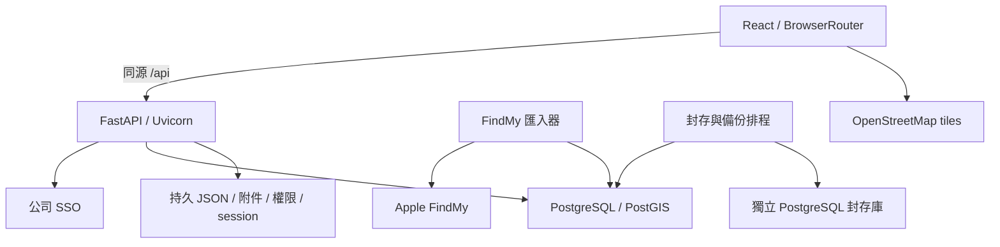
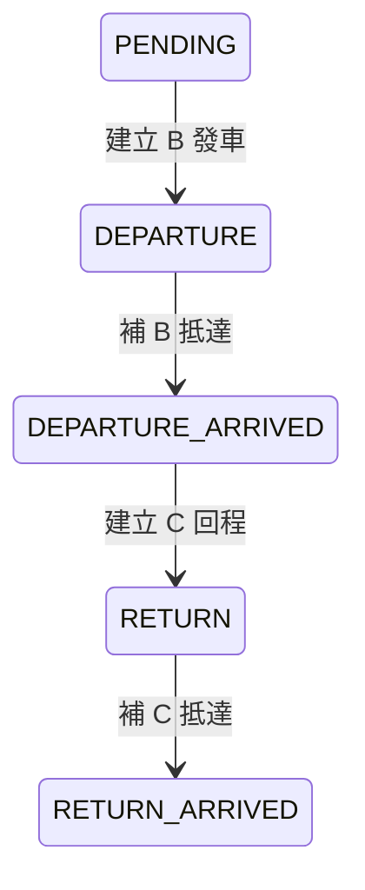

# polimax_refactor 完整專案規格盤點

> 專案名稱與路徑更新：2026-10-07。專案名稱為 `polimax_refactor`，本機目錄為 `/home/c113118138/polimax_refactor`。

盤點日期：2026-10-05；登入與權限更新：2026-10-06。範圍：本目錄現有程式、設定範本、部署與測試文件，包含工作區尚未提交的修改。本文是「目前實作規格」與「既有需求文件索引」，不代表所有原始需求已完成。2026-10-06 的登入與權限修改已更新正式服務並檢查 health，驗證範圍見第14節；本次文件編修未再修改程式、資料庫或部署，也未刊登密碼與 token。

## 1. 規格來源與判讀順序

原始功能需求為 [POLIMAX_原始_SPEC.md](../POLIMAX_原始_SPEC.md)，涵蓋登入權限、日曆、A/B/C/D/E 表單、資產、定位、附件、通知、服務契約與驗收，附錄包含完整欄位、資料型別與來源索引。文件保留業務需求與原欄位相容附錄，現行架構與API已對照 polimax_refactor；完整端點以本文及程式為準。

現行行為依 `backend/app.py` 的 PostgreSQL 正式模式及各安裝模組判讀；專案文件已同步為現行架構，有日期的驗證結果仍僅代表當時執行。本文下方列出專案全部 Markdown 文件及原始需求章節，避免遺漏規格來源。

## 2. 產品與架構

公司資產與預約管理系統，涵蓋公務車、儀器、固定作業區、借用紀錄、車輛出回程、日曆、Beacon、GPS／FindMy、掃描站、附件、權限及歷史封存。



- `AMS_DATABASE_MODE=postgresql`：`app.py → legacy_api.create_app → legacy_store`，使用既有 schema 與表單 JSON。`legacy_*` 表示資料相容層，正式執行不需要舊專案目錄。
- `AMS_DATABASE_MODE=demo`：明確啟用 `demo_app.py`、SQLite、fixtures 與測試資料介接。不因正式連線失敗自動切換 demo。
- 現行正式固定 PostgreSQL，MySQL 已不再使用。database.py 與 .env.example 仍保留 mysql 預設，相容分支與 PyMySQL 僅屬歷史工具；新部署必須明確指定 postgresql，本次文件更新未改程式或設定。
- FastAPI 同時提供 `dist/` 與 SPA fallback；Vite 開發時代理 `/api`。前端使用 React／Vite，沒有獨立 SSR／Next.js 架構。

## 3. 工具、套件與版本

以下 npm 版本是 package.json 的宣告範圍，Python 是 requirements 的固定版本；實際安裝依 lockfile／環境而定。

### 3.1 前端依賴

| 套件 | 宣告版本 |
| --- | --- |
| `@emotion/react` | `^11.13.0` (dependencies) |
| `@emotion/styled` | `^11.13.0` (dependencies) |
| `@fullcalendar/daygrid` | `^6.1.15` (dependencies) |
| `@fullcalendar/interaction` | `^6.1.15` (dependencies) |
| `@fullcalendar/list` | `^6.1.15` (dependencies) |
| `@fullcalendar/luxon3` | `^6.1.15` (dependencies) |
| `@fullcalendar/react` | `^6.1.15` (dependencies) |
| `@fullcalendar/timegrid` | `^6.1.15` (dependencies) |
| `@hookform/resolvers` | `^3.9.1` (dependencies) |
| `@mui/material` | `^5.17.1` (dependencies) |
| `@tanstack/react-query` | `^5.62.0` (dependencies) |
| `@vitejs/plugin-react` | `4.3.4` (dependencies) |
| `leaflet` | `^1.9.4` (dependencies) |
| `lucide-react` | `^0.503.0` (dependencies) |
| `luxon` | `^3.5.0` (dependencies) |
| `react` | `^18.3.1` (dependencies) |
| `react-dom` | `^18.3.1` (dependencies) |
| `react-hook-form` | `^7.54.0` (dependencies) |
| `react-leaflet` | `^4.2.1` (dependencies) |
| `react-router-dom` | `^6.28.0` (dependencies) |
| `typescript` | `^5.0.0` (dependencies) |
| `vite` | `^5.4.0` (dependencies) |
| `zod` | `^3.24.0` (dependencies) |
| `@types/leaflet` | `^1.9.0` (devDependencies) |
| `@types/react` | `^18.3.0` (devDependencies) |
| `@types/react-dom` | `^18.3.0` (devDependencies) |
| `playwright` | `1.51.1` (devDependencies) |
| `prettier` | `^3.6.2` (devDependencies) |

React 18 建構頁面；React Router v6 使用 BrowserRouter；TanStack Query 處理快取；MUI／Emotion 與 CSS 提供介面；Lucide 提供圖示；React Hook Form／Zod 處理表單；FullCalendar／Luxon 提供日曆與時區；Leaflet／React Leaflet 提供地圖。

TypeScript：strict、ES2022、ESNext、Bundler module resolution、react-jsx、noEmit；檢查範圍 src。主題色 #277c67、圓角 12，字型 Inter／Noto Sans TC／系統字型。Prettier 已宣告依賴，但沒有 npm format 腳本。

### 3.2 後端及整合依賴

```text
fastapi==0.115.12
uvicorn==0.34.2
SQLAlchemy==2.0.40
PyMySQL[rsa]==1.1.1
psycopg[binary]==3.3.6
pydantic==2.11.4
python-dotenv==1.1.1
httpx==0.28.1
GeoAlchemy2[shapely]==0.18.0
Shapely==2.1.2
```

FastAPI／Pydantic 提供 HTTP 與輸入驗證；Uvicorn 為 ASGI server；SQLAlchemy 管理 SQL；psycopg 為現行 PostgreSQL 驅動，PyMySQL 為保留的歷史相容依賴；httpx 呼叫 SSO；python-dotenv 載入設定；GeoAlchemy2／Shapely 用於 PostGIS 反射與封存地理型別。FindMy 環境另安裝 `FindMy==0.10.2` 並引用完整後端 requirements。

維運工具包含 Python venv、Node.js/npm、Nginx、systemd user service/timer、PostgreSQL CLI（psql／pg_dump／pg_restore）、tar、SHA-256、Playwright Chromium。交接文件以 Python 3.12／Node 20+ 為部署基準；空白主機仍需建立相容 schema、外部登入與持久資料。

## 4. 啟動、建置與連接埠

| npm 腳本 | 實際命令 |
| --- | --- |
| `dev` | `vite` |
| `build` | `tsc --noEmit && vite build` |
| `test:browser` | `node tests/browser.mjs` |
| `start` | `.venv/bin/python -m uvicorn app:app --app-dir backend --host 0.0.0.0 --port 5173` |
| `test:api` | `.venv/bin/python tests/test_integration.py` |
| `check` | `tsc --noEmit` |

```bash
python3 -m venv .venv
.venv/bin/python -m pip install -r backend/requirements.txt
npm ci
npm run build
npm start
```

- `npm start`：單一 FastAPI 服務，0.0.0.0:5173。
- `npm run dev`：Vite，0.0.0.0:5174，strictPort；允許 uclams.54ucl.com、localhost、127.0.0.1。
- 開發後端：`.venv/bin/python -m uvicorn app:app --app-dir backend --host 127.0.0.1 --port 8001 --reload`。
- Vite `/api` 預設代理 http://127.0.0.1:8001，`AMS_API_TARGET` 可覆寫。
- Nginx 範本監聽 80，server_name 163.18.26.228，代理 127.0.0.1:5174，request body 上限 1g，讀寫 timeout 120s，轉送 Host／來源 IP／proto。
- systemd 範本與實際選用服務可能使用 5173 或 5174；Vite 與 API 不可佔用同一個埠。正式前端變更須重建 dist。

## 5. 前端路由（URL）

未登入時 App 載入 `/api/auth/me`，無使用者資料則顯示登入介面；沒有獨立 `/login` Route。以下權限表示 App 的 Guard；借用與階段頁還需頁面及後端依表單做檢查。

| 路由 | 元件／用途 | App Guard |
| --- | --- | --- |
| `/` | CalendarPage 預約日曆 | 登入 |
| `/bookings` | BookingList 借用紀錄 | 登入、頁內權限 |
| `/bookings?history=1` | 車輛使用歷史（同一列表） | 同上 |
| `/bookings/new/:kind` | BookingForm 新建 A/D/E | 依表單 |
| `/bookings/:id/edit` | BookingForm 修改 | 依表單 |
| `/bookings/:id` | BookingDetail 詳情 | 依表單 |
| `/vehicles`、`/vehicles/:id` | Assets / AssetDetail | VehicleManagement |
| `/equipment`、`/equipment/:id` | Assets / AssetDetail | EquipmentManagement |
| `/positions` | Positions 最新位置／軌跡 | CarUpdate |
| `/findmy` | FindMy Beacon 設備位置 | FindMy |
| `/beacons` | Beacons 清單 | BeaconList |
| `/integrations` | Integrations 資料來源與通知 | Administration |
| `/stages` | StageList 出回程紀錄 | Departure_query |
| `/stages/:id` | StagePage 詳情／編輯 | 依表單 |
| `/scans` | Scans 場內掃描 | Latest_Device |
| `/archive` | Archive 歷史封存 | Administration |
| `*` | Navigate replace 到 `/` | — |

歷史封存側欄入口還要求 `/api/archive/status.enabled`；Guard 是介面控制，實際存取權限由後端決定。

SSO 登入後若全部功能操作權限皆為0，仍可顯示首頁外觀與空白日曆；首頁不查詢 bookings、resources、holidays，也不呼叫 notifications/check。點日曆日期顯示「沒有權限」，切換到首頁以外的功能路徑一律顯示「沒有權限」，不載入該功能頁。

## 6. API 共通契約

- 基底 `/api`，JSON API；前端 fetch 使用同源 cookie（credentials: same-origin）。
- 正式相容 API 的所有非 GET/HEAD/OPTIONS 請求須有 `X-AMS-Client: preview`，否則 403。此字串是目前操作來源標記，不能視為認證憑證。
- JSON request 使用 `Content-Type: application/json`；附件上傳例外使用原始 body stream。
- 回應型態有物件、陣列、`{ok:true}`、檔案與登入 redirect，不是統一的 data envelope。
- 前端 Query retry=false、staleTime=15000ms、refetchOnWindowFocus=false；非 auth/me 的 401 會讓 me 快取失效。
- 一般驗證 422；認證 401；權限 403；不存在 404；衝突／revision／不支援操作 409；檔案超限 413；SQL 或檔案 I/O 失敗 503。HTTPException 訊息使用 `detail`，Pydantic 驗證可能為 detail 陣列。
- 正式 middleware 加 `Cache-Control: no-store`、`X-Content-Type-Options: nosniff`。
- FastAPI 預設另提供 `/docs`、`/redoc`、`/openapi.json`（程式未關閉）；下表是業務端點清單，不啟動 app 或連資料庫即可從 AST 擷取。

### 6.1 正式模式完整端點與函式參數

`Depends(current)` 表示 session 使用者依賴，不是 HTTP query 欄位；Request／Response 為框架物件；URL `{...}` 為 path；其餘 scalar 依 FastAPI 規則作 query，BaseModel／dict 作 body。各檔案的 install/create_app 內定義也包含在表內。SSO 端點只有非 test auth 才安裝。

| 方法 | 路徑 | handler 與參數（含預設） | 程式來源 |
| --- | --- | --- | --- |
| GET | `/api/auth/config` | `auth_settings()` | [backend/legacy_api.py:78](backend/legacy_api.py#L78) |
| GET | `/api/health` | `health()` | [backend/legacy_api.py:111](backend/legacy_api.py#L111) |
| POST | `/api/auth/login` | `login(body: LoginInput, response: Response)` | [backend/legacy_api.py:115](backend/legacy_api.py#L115) |
| GET | `/api/auth/me` | `me(user=Depends(current))` | [backend/legacy_api.py:123](backend/legacy_api.py#L123) |
| POST | `/api/auth/logout` | `logout(request: Request, response: Response)` | [backend/legacy_api.py:125](backend/legacy_api.py#L125) |
| GET | `/api/permissions` | `get_permissions(user=Depends(current))` | [backend/legacy_api.py:129](backend/legacy_api.py#L129) |
| GET | `/api/permissions/health` | `policy_health(user=Depends(current))` | [backend/legacy_api.py:131](backend/legacy_api.py#L131) |
| POST | `/api/permissions/sync` | `sync(user=Depends(current))` | [backend/legacy_api.py:135](backend/legacy_api.py#L135) |
| GET | `/api/options` | `options(user=Depends(current))` | [backend/legacy_api.py:140](backend/legacy_api.py#L140) |
| GET | `/api/resources` | `resources(user=Depends(current))` | [backend/legacy_api.py:145](backend/legacy_api.py#L145) |
| POST | `/api/resources` | `add_resource(body: ResourceInput, user=Depends(current))` | [backend/legacy_api.py:153](backend/legacy_api.py#L153) |
| PUT | `/api/resources/{rid}` | `edit_resource(rid: int, body: ResourceInput, user=Depends(current))` | [backend/legacy_api.py:158](backend/legacy_api.py#L158) |
| DELETE | `/api/resources/{rid}` | `delete_resource(rid: int, user=Depends(current))` | [backend/legacy_api.py:164](backend/legacy_api.py#L164) |
| GET | `/api/resources/{rid}/records` | `records(rid: int, user=Depends(current))` | [backend/legacy_api.py:169](backend/legacy_api.py#L169) |
| POST | `/api/resources/{rid}/records` | `add_record(rid: int, body: RecordInput, user=Depends(current))` | [backend/legacy_api.py:174](backend/legacy_api.py#L174) |
| PUT | `/api/records/{ident}` | `edit_record(ident: int, body: RecordInput, user=Depends(current))` | [backend/legacy_api.py:179](backend/legacy_api.py#L179) |
| DELETE | `/api/records/{ident}` | `delete_record(ident: int, user=Depends(current))` | [backend/legacy_api.py:185](backend/legacy_api.py#L185) |
| GET | `/api/bookings` | `bookings(user=Depends(current))` | [backend/legacy_api.py:190](backend/legacy_api.py#L190) |
| POST | `/api/bookings/check` | `check_booking(body: BookingInput, user=Depends(current))` | [backend/legacy_api.py:194](backend/legacy_api.py#L194) |
| POST | `/api/bookings` | `add_booking(body: BookingInput, user=Depends(current))` | [backend/legacy_api.py:199](backend/legacy_api.py#L199) |
| GET | `/api/bookings/{fid}` | `booking(fid: str, user=Depends(current))` | [backend/legacy_api.py:204](backend/legacy_api.py#L204) |
| PUT | `/api/bookings/{fid}` | `edit_booking(fid: str, body: BookingInput, user=Depends(current))` | [backend/legacy_api.py:210](backend/legacy_api.py#L210) |
| DELETE | `/api/bookings/{fid}` | `delete_booking(fid: str, user=Depends(current))` | [backend/legacy_api.py:216](backend/legacy_api.py#L216) |
| POST | `/api/bookings/{fid}/advance` | `advance(fid: str, body: StageInput, user=Depends(current))` | [backend/legacy_api.py:221](backend/legacy_api.py#L221) |
| GET | `/api/stages` | `stages(kind: str='B', user=Depends(current))` | [backend/legacy_api.py:230](backend/legacy_api.py#L230) |
| GET | `/api/stages/{fid}` | `stage(fid: str, user=Depends(current))` | [backend/legacy_api.py:238](backend/legacy_api.py#L238) |
| PUT | `/api/stages/{fid}` | `edit_stage(fid: str, body: EditStage, user=Depends(current))` | [backend/legacy_api.py:244](backend/legacy_api.py#L244) |
| DELETE | `/api/stages/{fid}` | `delete_stage(fid: str, user=Depends(current))` | [backend/legacy_api.py:252](backend/legacy_api.py#L252) |
| POST | `/api/files` | `upload(request: Request, user=Depends(current))` | [backend/legacy_api.py:260](backend/legacy_api.py#L260) |
| GET | `/api/files/{ident}` | `file(ident: str, preview: bool=False, user=Depends(current))` | [backend/legacy_api.py:285](backend/legacy_api.py#L285) |
| GET | `/{path:path}` | `frontend(path: str)` | [backend/legacy_api.py:298](backend/legacy_api.py#L298) |
| GET | `/api/auth/sso` | `start(request: Request, return_to: str='/', retry: bool=False)` | [backend/sso.py:267](backend/sso.py#L267) |
| GET | `/api/SSO` | `start(request: Request, return_to: str='/', retry: bool=False)` | [backend/sso.py:267](backend/sso.py#L267) |
| GET | `/api/Login` | `start(request: Request, return_to: str='/', retry: bool=False)` | [backend/sso.py:267](backend/sso.py#L267) |
| GET | `/api/callback` | `callback(request: Request, code: str \| None=None, state: str \| None=None, error: str \| None=None)` | [backend/sso.py:281](backend/sso.py#L281) |
| GET | `/api/auth/sso/callback` | `callback(request: Request, code: str \| None=None, state: str \| None=None, error: str \| None=None)` | [backend/sso.py:281](backend/sso.py#L281) |
| GET | `/api/beacons` | `list_beacons(user=Depends(current))` | [backend/legacy_integrations.py:32](backend/legacy_integrations.py#L32) |
| POST | `/api/beacons` | `create_beacon(body: dict, user=Depends(current))` | [backend/legacy_integrations.py:36](backend/legacy_integrations.py#L36) |
| PUT | `/api/beacons/{ident}` | `edit_beacon(ident: str, body: dict, user=Depends(current))` | [backend/legacy_integrations.py:47](backend/legacy_integrations.py#L47) |
| DELETE | `/api/beacons/{ident}` | `delete_beacon(ident: str, user=Depends(current))` | [backend/legacy_integrations.py:57](backend/legacy_integrations.py#L57) |
| GET | `/api/positions` | `positions(user=Depends(current))` | [backend/legacy_integrations.py:63](backend/legacy_integrations.py#L63) |
| GET | `/api/trajectory/{rid}` | `trajectory(rid: int, start: str, end: str, limit: int=1000, user=Depends(current))` | [backend/legacy_integrations.py:77](backend/legacy_integrations.py#L77) |
| GET | `/api/findmy/{ident}` | `findmy(ident: str, user=Depends(current))` | [backend/legacy_integrations.py:90](backend/legacy_integrations.py#L90) |
| GET | `/api/stations` | `stations(user=Depends(current))` | [backend/legacy_integrations.py:100](backend/legacy_integrations.py#L100) |
| GET | `/api/scans` | `scans(station: str='', user=Depends(current))` | [backend/legacy_integrations.py:106](backend/legacy_integrations.py#L106) |
| GET | `/api/holidays` | `holidays(user=Depends(current))` | [backend/legacy_integrations.py:119](backend/legacy_integrations.py#L119) |
| GET | `/api/notifications` | `notifications(user=Depends(current))` | [backend/legacy_integrations.py:123](backend/legacy_integrations.py#L123) |
| POST | `/api/notifications/check` | `notification_check(user=Depends(current))` | [backend/legacy_integrations.py:130](backend/legacy_integrations.py#L130) |
| POST | `/api/reports/sync` | `reports(user=Depends(current))` | [backend/legacy_integrations.py:134](backend/legacy_integrations.py#L134) |
| POST | `/api/reports/import` | `reports(user=Depends(current))` | [backend/legacy_integrations.py:134](backend/legacy_integrations.py#L134) |
| GET | `/api/archive/status` | `status(user=Depends(current))` | [backend/archive_api.py:34](backend/archive_api.py#L34) |
| GET | `/api/archive/catalog` | `catalog(user=Depends(current))` | [backend/archive_api.py:59](backend/archive_api.py#L59) |
| GET | `/api/archive/live/{name}` | `live(name: str, page: int=Query(0, ge=0), search: str=Query('', max_length=100), user=Depends(current))` | [backend/archive_api.py:65](backend/archive_api.py#L65) |
| PUT | `/api/archive/live/{name}/{key}/completion` | `complete(name: str, key: str, body: Completion, user=Depends(current))` | [backend/archive_api.py:87](backend/archive_api.py#L87) |
| DELETE | `/api/archive/live/{name}/{key}/completion` | `reopen(name: str, key: str, user=Depends(current))` | [backend/archive_api.py:98](backend/archive_api.py#L98) |
| GET | `/api/archive/history` | `history(name: str, key: str=Query('', max_length=100), page: int=Query(0, ge=0), user=Depends(current))` | [backend/archive_api.py:105](backend/archive_api.py#L105) |
| GET | `/api/archive/history/{ident}` | `detail(ident: str, user=Depends(current))` | [backend/archive_api.py:129](backend/archive_api.py#L129) |
| GET | `/api/archive/history/{ident}/file` | `file(ident: str, path: str, user=Depends(current))` | [backend/archive_api.py:141](backend/archive_api.py#L141) |

### 6.2 各 API 群行為與權限

| 群組 | 行為與主要回傳 | 權限／限制 |
| --- | --- | --- |
| health、auth/config | 資料庫 SELECT 1；登入模式／是否配置／登入 URL | 公開；health 不保證 SSO 與附件可用 |
| auth/login、me、logout | 測試角色登入／目前 User／清 session 與 SSO logout URL | 正式 login 403；測試須 AMS_AUTH_MODE=test 且 PREVIEW_LOGIN_ENABLED=1 |
| permissions | 當前 effective permissions；health 來源／版本；sync 重讀政策 | health read Administration，sync write Administration；不是從公司即時拉取快照 |
| options | cities、employees、reasons、equipment_reasons | 登入；正式 employees 僅目前使用者姓名，不能當作完整 HR 清單 |
| resources | 資源列表、新增／修改／軟刪除 | VehicleManagement 或 EquipmentManagement；列表只包含有 read 的類型 |
| resources records、records | insurance/cost/maintenance/garage/manager 類別與附件 | 保險使用 Insurance，其餘 Cost；讀取入口先檢查 VehicleManagement |
| bookings/check | 驗證內容與預約衝突，回傳 ok | create；最終保存仍重新檢查 |
| bookings | 列表／詳情／建立／修改／刪除 | A=Lending_form、D=Room_form、E=Equipment_form；建立 create+submit；修改 write；刪除 delete；部分操作檢查 owner |
| bookings advance | 推進車輛流程並回傳主表 | 依當前狀態使用 departure_form／departure_arrive／back_form／back_arrive |
| stages | B/C 列表、詳情、修改、刪除 | 對應表單 read/write/delete；修改 revision；刪除標記 JSON is_deleted，不應假設同步回退主表流程 |
| files | 保存原始內容及 metadata／下載／預覽 | 上傳需任一表單 create；下載目前僅要求登入，沒有逐附件 owner 檢查 |
| beacons | CRUD、四位十六進位 ID、owner、programmed、ble_mac | BeaconList 對應動作；重複 409；ID 不可改；修改 programmed 僅 y/n |
| positions | 每車最新 gps，缺資料仍保留資源項目 | CarUpdate read；CarList.client_id 對 gps_readings.client_id；只處理 vehicle |
| trajectory | points/count/total，依 created_at 篩選與抽樣 | carMap read；跨度最多 90 天；limit 預設1000、clamp 2..10000 |
| findmy | Beacon 與最新點，提供 point/position/latest/points 等相容欄位 | FindMy read；依 Beacon ID 查 new_reports.sheet_id；無 Beacon 404 |
| stations/scans | 站台列表／每個 major 最新掃描 | Latest_Device read；每站最多取1000列後去重；online=age_seconds<300 |
| holidays | 外部 JSON 假日清單，未設定則 [] | 登入；AMS_HOLIDAYS_FILE |
| notifications | 最新500筆 notification、payload Title/Content/UserID | Administration read；success 固定 true，不能據此保證通知平台成功 |
| notifications/check | 正式固定409、不另送通知 | 舊上游負責；前端日曆呼叫並吞掉錯誤 |
| reports/import、reports/sync | 正式固定409，無網頁寫入報告流程 | Administration write；背景匯入與 API 分開 |
| archive/status、catalog | 啟用狀態／可用類別與 manual | Administration read |
| archive/live | 人工完成類別的現有資料、completion、has_more | Administration 加對應業務完整權限；page 0起，每頁50、讀51判斷下一頁；search<=100 |
| archive completion | PUT登記 completed_at/note，DELETE取消 | Administration 及業務 read/write；note 1..2000；記錄指紋、操作者 |
| archive/history | 已驗證批次列表、詳情、串流原檔 | 附件 path 必須屬於該批次；只查 verified_at 非空 |

封存的原始欄位不能繞過欄位／owner／allow_list 限制；有這些限制的帳號會被拒絕原始封存資料存取。archive/status 用旗標控制介面入口，其他 archive handler 並未一律先檢查旗標；仍依權限與資料庫條件處理。

### 6.3 正式 request body 模型（從程式擷取）

**backend/legacy_api.py / LoginInput**

```python
class LoginInput(BaseModel):
    role: str
```

**backend/legacy_api.py / ResourceInput**

```python
class ResourceInput(BaseModel):
    kind: str
    label: str = Field(default='', max_length=200)
    data: dict
```

**backend/legacy_api.py / BookingInput**

```python
class BookingInput(BaseModel):
    kind: str
    content: dict
    revision: int | None = None
```

**backend/legacy_api.py / RecordInput**

```python
class RecordInput(BaseModel):
    category: str
    data: dict
```

**backend/legacy_api.py / StageInput**

```python
class StageInput(BaseModel):
    expected_status: str
    content: dict
    revision: int
```

**backend/legacy_api.py / EditStage**

```python
class EditStage(BaseModel):
    content: dict
    revision: int
```

**backend/archive_api.py / Completion**

```python
class Completion(BaseModel):
    completed_at: str
    note: str = Field(min_length=1, max_length=2000)
```


Booking content：`title, applicant, application_date, total_people, reason, details[], employees[], slots[], purposes[], other_purpose, other_processing, notes, reason_drafts`。detail 包含 name/city/district/leader/sales/notes/notes2；slot 包含 resource_id/start/end/detail_index。後端附加 resource_snapshots，更新 applicant 與 application_date 的可信值。

Stage content：開始／抵達以 `start`、`arrival` 保存；advance 每次傳該階段資料。欄位含 driver/codriver/employees/place/mileage/confirmed/checks/anomalies/anomaly_details/attachments/notes/tires/interior/exterior/equipment，以及 interior_files/exterior_files/equipment_files/parking_files。異狀須填相應 `_note`。

### 6.4 常用回應型別

- User：id/name/email/role/role_label/permissions/auth_source；SSO 可另有 username。無授權身分 role=''、role_label='無權限'、permissions.roles=[]，各功能操作皆為0。
- Resource：id/kind/label，加資產欄位；車輛、設備與固定作業區共用列表。
- Booking：id/kind/status/revision/created_at/updated_at/content/slots，可有 previous_id、stages、history、versions。工程人員查看他人紀錄時改回摘要：id/kind/status/created_at/updated_at/detail_allowed=false，content 僅 applicant 與固定 title='借用紀錄'，slots 僅 resource_id/start/end；不回傳 owner、revision、contact_person、緣由、明細、備註、附件或版本。
- Stage：除階段內容與 owner（最後提交者）外，applicant_owner 表示原父申請的 owner；無父申請的歷史紀錄使用原 applicantID。權限判斷不得把最後提交者視為原申請人。
- Position：resource_id/label/source/position_source/test_data/lat/lng/time/record_time/created_at/latest_report_time/missing；無定位 lat/lng=null。
- Trajectory：points/count/total，count 是抽樣數，total 是符合條件的原始點數。
- File：id/uuid/name/mime/size/owner。

## 7. 核心業務規則

### 7.1 表單與預約

| 代碼 | 用途 | JSON 子目錄 | 權限文件 |
| --- | --- | --- | --- |
| A | 車輛借用 | 主表 | Lending_form |
| B | 發車及去程抵達 | 發車紀錄表 | departure_form / departure_arrive |
| C | 回程及還車抵達 | 回程紀錄表 | back_form / back_arrive |
| D | 工作間／作業區預約 | 工作間預約表 | Room_form |
| E | 儀器借用 | 儀器借用表 | Equipment_form |

- 至少一個合法 slot；資源須存在、類型吻合且非停用。
- 時段包含相接邊界：同資源 start<=既有end 且 end>=既有start 就衝突（409）。車輛 A 後端允許起訖相同；D/E 必須 end>start。
- A/E 必須需求、人員與明細；A 每筆需 city，total_people>=1，明細數須為1或與slots等長。材料送貨例外允許明細 name 空白。
- A 七種需求：工案、材料送貨、新開發案、客戶拜訪、成交案回訪、參展、其他。
- E 七種需求：開案、成案（施工前量測）、成案（完工量測）、成案（服務回訪）、儀器設備保養／校正、儀器設備維修、其它。
- D 後端補 reason=工作間租用；空 title 補工作間租用。固定作業區非獨立 DB 資產，不能透過資產 CRUD 刪除。
- 表單識別格式 `五位數 + A/B/C/D/E + 至少四位流水號`。修改 A 產生新 ID、previous_id 連舊表並軟刪舊 SQL 索引；D/E 修改保留 ID。A 已發車不得重新排預約。
- 修改 body revision 必須吻合；advance 另檢查 expected_status，避免過期畫面重複操作。
- 工程人員可在列表／日曆查看他人的借用人、時間與資源摘要，不能讀取詳細申請、修改／刪除或推進他人流程；他人的 B/C 階段不出現在階段列表，直接存取階段明細也回403。自己與最高 Admin 的完整資料操作仍依原有功能權限。
- 他人紀錄的標題不提供詳細連結，「>」按鈕不可跳轉，滑鼠懸停顯示「無法修改他人借用紀錄」；日曆摘要的「查看完整申請」也停用。後端以相同訊息阻擋工程人員存取他人明細。

固定作業區共12個：1F 批覆區1-1/1-2、拆組裝區、裝載區、汞浦試壓區、噴砂室、研磨與氣動除鏽區6-1/6-2/6-3、產品說明室；2F會議室、會客室。

### 7.2 車輛出回程



有效非負里程與 confirmed=true；開始階段須駕駛、地點、人員。人員集合至少兩人須副駕；駕駛與副駕不可同人；姓名須非空且最多100字。必須完成對應檢查項目；內外部、設備與輪胎的正常／異狀值需合法，異狀須說明。所選車輛須在主表內；抵達里程不可低於出發。C 前必須已有 B。編輯不能直接新增未經流程建立的 arrival，也有不可改欄位檢查。

B 檢查：擋風玻璃清潔、照後鏡清潔、油量、輪胎、車輛內部清潔、車體外部、隨車設備。C 檢查：內部清潔、內部物品歸位、鑰匙歸位、油量、車體外部、隨車設備。抵達 anomalies 限維修／違規／事故。

發車與發車抵達紀錄的新增、修改及刪除，以原父申請 owner 判斷本人；沒有 owner 時才回退 applicant。身分可對應 SSO id/email/username/name，email 比對不分大小寫；不能用提交內容冒充原申請人，也不能以最後修改者取得原申請人權限。只有最高 Admin（隔離測試為 admin）可以代填他人的發車紀錄，仍須具備對應功能操作權限。

### 7.3 日曆與時間

FullCalendar 月／週／日／列表與資源預約互動；支援種類、資源及假日控制。主表與時段由 bookings/resources API 供應。`datetime-local` 一律按 Asia/Taipei 業務時間解讀，不依瀏覽器時區；前端無 offset 補 +08:00，後端轉換成台北 naive datetime，回應一般輸出 +08:00。

FindMy 匯入與保留另使用 UTC naive；不能把所有 DB 日期欄位都當作台北時間。

## 8. 登入與權限

- SSO 授權碼流程：GET `{SSO_SERVER}/authorize`，response_type=code、scope=openid、client_id、redirect_uri、state；POST `/token` 換 token／refresh；GET `/userinfo` Bearer 驗證身份。
- 本站 SSO 入口與 callback 別名見 API 表；callback 成功303導向 PUBLIC_WEB_URL 加安全 return_to，失敗到 `/?sso_error=...`。
- 錯誤頁再次按 SSO 登入會帶 retry=1；本站撤銷本地 session/cookie，再303導向上游 `/logout`，redirect_uri 指向本站 SSO 入口，完成登出後重新授權。跨主機導向保留 retry，return_to 仍限制站內路徑。這是清除 SSO 網域登入狀態，不依賴清瀏覽器快取。
- SSO userinfo 身分與 AMS 快照中的 email／含 @ 的別名採不分大小寫比對；非 email 的 opaque subject ID 仍區分大小寫。角色與個別限制查詢保留快照中的原始帳號鍵。
- SSO 身分驗證成功即可登入；快照找不到啟用使用者、帳號對應歧義，或個別資料限制尚未完成對應時，都使用零權限身分顯示首頁，不自動授權。已有使用者但沒有有效角色也無功能權限。token、state、身分或政策來源讀取失敗仍照原錯誤處理，不能當成驗證成功。
- state 10分鐘、一次性檔案消耗與 cookie 比對；session 12小時，cookie `polimax_session`，state cookie `polimax_sso_state`。超過60秒重新檢查身份，401 可用 refresh token；身份改變或 refresh 失敗清 session。
- session/token 保存持久目錄，不送給前端；登出刪本機 session/cookie、POST 上游 `/logout`，回傳上游瀏覽器 logout URL。
- 多角色權限採 OR，表單操作、permlevel、欄位 read/write、owner_only、allow_list、UI 狀態各有處理。實際操作是否使用全部維度需依各 handler，不能只看政策宣告。
- 操作字典：read/write/create/delete/submit/cancel/export/import/print；宣告某操作不代表有對應 API。
- 正式依 AMS_SSO_POLICY_MANIFEST 選擇 manifest／快照，未設定時預設 `.data/permissions/latest-AMS.json`；AMS_POLICY_FILE 明確政策優先。目前部署使用 `.data/permissions/latest-AMS-local.json`，指向 `snapshot-AMS-local-v000014.json`（version=14）。sync 重讀本地來源，沒有自動 HR／權限中心同步服務；新快照原子切換 manifest 並保留舊版本，不必重啟即可重讀權限。
- 正式 API 共用 require_workspace_access：所有功能操作皆為0者，其餘 `/api/` 資料端點一律403「沒有權限」，包含借用、資產、階段、假日、通知、權限資訊與附件。例外僅 health、auth/config、auth/me、auth/login、auth/logout、SSO 入口與 callback；例外仍維持各端點原有認證與登入規則。無權限使用者可以讀自己的登入身分及正常登出。
- demo/test 角色：admin、borrower、viewer、draft；viewer 隱藏 notes 等限制、draft 無 submit，不代表公司正式角色清單。

### 8.1 目前帳號角色與一般工程人員

以下為2026-10-06本地權限快照設定；SSO 身分仍由上游驗證，不在本站新增帳密。

| 帳號 | AMS 角色 | 範圍 |
| --- | --- | --- |
| F114118117@nkust.edu.tw | Admin | 最高管理權限 |
| f114118116@nkust.edu.tw | Admin | 最高管理權限 |
| F114118119@nkust.edu.tw | Admin | 最高管理權限 |
| C111118243@nkust.edu.tw | Admin | 最高管理權限 |
| test@test | 工程人員 | 一般申請與資料查閱，無系統管理／資產維護權限 |
| 其他 SSO 使用者 | 依既有 AMS 有效授權；無授權則無角色 | 可登入，沒有授權時僅顯示首頁外觀 |

四個指定管理員權限相同，帳號 email 大小寫不同仍對應同一授權。工程人員可建立／修改／送出借用、出車、還車表單，不可刪除表單；資產與定位等既有資料僅查閱，Administration 全部操作為0。另依7.1／7.2限制他人借用明細與代填；申請人與申請日期仍由系統維持可信值。

## 9. 儲存、資料字典與一致性

正式資產與附屬紀錄映射如下；API 欄位名與 SQL 名不同。資源 ID 車輛=`原ID*10+1`、設備=`原ID*10+2`，room 為 label hash 推導，不能直接用 API id 當 CarList.ID。

```python
ASSETS = {'vehicle': ('CarList', 'ID', 'license_plate', 'isdelete', {'model': 'car_type', 'client_id': 'client_id', 'holder': 'holder', 'owner': 'owner', 'purchase_date': 'purchase_date', 'amount': 'amount', 'passengers': 'passengers', 'notes': 'notes', 'manager': 'manager', 'contact_person': 'contact_person', 'phone_number': 'phone_number', 'equipment': 'equipment', 'type_code': 'type_code'}), 'equipment': ('EquipmentList', 'id', 'equipment_id', 'is_deleted', {'name': 'equipment_name', 'location': 'equipment_loc', 'brand': 'brand_manufacturer', 'holder': 'holder', 'quantity': 'quantity', 'notes': 'notes', 'state': 'hold_adv', 'estimated_amount': 'estimated_amount', 'accessories': 'equipment_plus', 'purpose': 'purpose', 'purchase_manufacturer': 'purchase_manufacturer', 'fix_manufacturer': 'fix_manufacturer', 'fix_date': 'fix_date', 'valid_period': 'valid_period'})}
```

```python
RECORDS = {'insurance': ('insurance_records', {'company': 'company', 'expiry': 'validity_period', 'phone': 'company_phone', 'employee': 'employee', 'employee_phone': 'employee_phone', 'roadside_assistance': 'roadside_assistance'}), 'cost': ('cost', {'type': 'type', 'reason': 'reason', 'amount': 'amount', 'notes': 'notes'}), 'maintenance': ('vehicle_records', {'type': 'record_type', 'date': 'record_date', 'notes': 'notes'}), 'garage': ('garage_files', {'notes': 'notes'}), 'manager': ('vehicle_managers', {'name': 'manager_name', 'notes': 'notes'})}
```


legacy_store 額外加入 vehicle 的 phone→phone_number、license_files→license_file_uuid、vehicle_files→vehicle_data_file_uuid、contract_files→contract_file_uuid；insurance 的 roadside→roadside_assistance、policy_files→policy_file_uuid、claim_files→claim_file_uuid；cost/maintenance/garage 的 attachments 對應各自附件欄位。

核心 SQL 表：CarList、EquipmentList、insurance_records、cost、vehicle_records、garage_files、vehicle_managers、formio_responses、form_flows。定位相關：gps_readings、BeaconList、new_reports、FindMy、Outdoor_Beacon_readings；通知 notification；封存另處理 sensor_readings、alert_logs、device_alert、vehicle_alerts2、vehicle_status。

```text
.data/
  responses/{主表,發車紀錄表,回程紀錄表,工作間預約表,儀器借用表}/
  files/<uuid>         # 二進位原檔
  files/<uuid>.json    # 附件索引
  permissions/        # manifest、快照或政策
  sso/                # token/session/state
  findmy/account.json # Apple session
  findmy/ani_libs.bin  # Anisette cache
  session.key         # 測試 cookie 簽章金鑰
```

完整表單保存在 JSON，新版欄位置於 `_polimax_next.content`；SQL 儲存預約索引與流程。`legacy_form_fields.json` 為 A/E 舊表單映射來源；出回程正式映射在 legacy_store 的 STAGE_FIELDS/STAGE_CHECKS 及抵達編解碼，不能只改 legacy_stage_fields.json。

寫入使用資料庫交易加專案級鎖：現行 PostgreSQL pg_try_advisory_lock 輪詢最多15秒；MySQL GET_LOCK 分支僅作歷史相容。JSON 暫存、備份、替換與失敗還原配合交易；這不等於 SQL＋檔案具有原生原子交易，備份須同時保存 DB 與持久檔案。

### 9.1 附件

POST /api/files 上傳原始 body，標頭 X-File-Name（URL encode）、Content-Type、X-AMS-Client；X-File-Purpose=stage-photo 上限1GiB，其他10MiB。檔名只保留 basename 並截255字，UUID與metadata分檔；建立檔案mode600、fsync、失敗清理。

GET /api/files/{ident}?preview=true 僅 JPEG/PNG/WebP/GIF 允許 inline；其他回應 application/octet-stream 並 attachment。識別碼限英數／底線／減號1..100字，缺原檔或metadata為404。不會轉向舊附件服務。

### 9.2 PostGIS 與定位

gps_readings/new_reports/FindMy 保留 latitude/longitude 數值欄位作來源；location 為 geography(Point,4326)，BEFORE INSERT/UPDATE trigger 依經度、緯度更新，非法／空座標為 NULL，GiST index 支援空間查詢。

目前 positions/trajectory/findmy API 直接讀取數值欄位，沒有座標來源切換或耗時標籤。軌跡使用 created_at 篩時間並排序、過濾超出範圍與 abs(lat/lng)<=0.001，再資料庫抽樣保留起終點；最新位置 handler 不套用相同軌跡有效座標篩選。

`scripts/add_location.sql` 是一次性遷移，已存在函式／欄位時會失敗，不能把它當可重跑初始化。正式與封存 schema 須一致。

## 10. 外部服務與背景工作

| 服務／工具 | 用途與契約 |
| --- | --- |
| 公司 SSO | authorize/token/userinfo/logout，後端私密設定，公開 callback 須匹配註冊 |
| PostgreSQL／PostGIS | 正式資料庫，app啟動反射既有表；不自動建置全新業務schema |
| Apple FindMy／Anisette | integrations/findmy 以 Apple session與2FA取回定位報告 |
| OpenStreetMap | 瀏覽器載入 https://{s}.tile.openstreetmap.org/{z}/{x}/{y}.png，保留 attribution |
| GPS／RFID／掃描上游 | 正式 API 讀現有表；GPS 接收器與硬體採集不在本站 HTTP API 內 |
| 通知上游 | 正式 polimax_refactor 只查通知表，不實作新的通知排程或寄送 |
| 選项／假日 JSON | AMS_OPTIONS_FILE、AMS_HOLIDAYS_FILE，未設定依各模式採內建值或空清單 |

FindMy 專案內工具 create_findmy_session.py 互動建立 Apple session；fetch_reports_async.py 抓報告；findmyupdate.py 單次匯入，--loop 可每小時重跑。只允許 postgresql+psycopg 且資料庫名 polimax_PostgreSQL，將同批資料交易寫入 FindMy 與 new_reports，以 advisory lock與自然鍵去重，時間存 UTC naive。

| systemd 項目 | 排程／職責 |
| --- | --- |
| polimax-next@.service | 可依 instance 指定埠的網站服務 |
| polimax-next.service.example | 單一服務部署範本 |
| polimax-findmy-import.timer/service | hourly、隨機延遲5分鐘、Persistent；需已有 Apple session |
| polimax-gps-cleanup.timer/service | 每日03:30 Asia/Taipei、Persistent；現為封存清理 |
| polimax-pg-backup.timer/service | 每日04:00、Persistent；timer未明寫時區，依主機設定 |

範本存在不等於已安裝啟用；路徑、帳號、ReadWritePaths、資料目錄、linger 與主機時區須依部署核對。

## 11. 歷史封存與備份規格

- PostgreSQL 封存庫預設 polimax_PostgreSQL_Expired，與正式庫同伺服器、不同名稱；僅 PostgreSQL 支援此流程。
- GPS／FindMy／Outdoor／sensor歷史保存90天，保留每個識別群組最新紀錄；Outdoor/FindMy/sensor 的最新接收與最新記錄可能為兩筆。
- alert_logs/notification 超過90天；vehicle_status 保留每 client_id/license_plate 最新；device_alert/vehicle_alerts2 要處理完成，後者另需 notification_sent。
- cost/insurance_records/vehicle_records/garage_files 必須人工完成登記及相應日期超過90天。A 必須已歸還，全部使用時段結束及 JSON 最近修改超過90天；D/E另需人工確認完成／歸還。
- 主檔不清理：CarList、EquipmentList、BeaconList、basic_information、findmy_id、rfid_tags、vehicle_managers。缺日期、缺識別、未完成、缺 JSON/附件與指紋變動保留。
- 正式庫新增 polimax_retention_decisions、polimax_retention_cursor；封存庫有來源同名表、polimax_archive_batches、polimax_archive_files。manifest含原始列、完成登記、檔案索引、截止時間與驗證時間。
- 取得共享鎖與來源列鎖 → 封存交易 → 新交易完整讀回驗證 → 再核對來源 → 刪除來源。跨庫不是單一交易，重跑只接受內容相同的既有資料。
- JSON／附件分4MiB區塊按SHA-256去重；本機原檔保留，不自動回收 files/responses。
- 定位／事件每批500、每表最多100批；業務每次最多100候選，續跑游標避免缺檔堵住後續。
- archive_maintenance.py 預設有限批次唯讀預覽；--initialize建立相關表，--apply實際搬移／刪除，--complete登記完成；需啟用AMS_ARCHIVE_ENABLED。
- backup_postgresql.py 在完整備份模式輸出正式 postgresql.dump、啟用封存時 expired.dump、persistent.tar 與 SHA-256 manifest。只備份 DB 無法完整還原。
- 還原用 pg_restore、tar與manifest核對；回搬正式庫另需處理主鍵、流水號、JSON及附件，不能直接用封存覆蓋正式庫。

## 12. 設定規格

設定合併順序：程序環境 > .env > env；相對檔案路徑依專案根解析。但部分 options/holidays/demo helper 直接讀 os.getenv，不能假設每個設定都已自動注入環境。

| 設定 | 用途／預設 |
| --- | --- |
| AMS_DATABASE_MODE | 正式 postgresql；demo僅隔離示範；程式mysql預設須明確覆寫 |
| MYSQL_HOST/PORT/DATABASE/USER/PASSWORD/CHARSET | 僅歷史相容分支使用，現行正式不需要 |
| POSTGRES_HOST/PORT/DATABASE/USER/PASSWORD | PostgreSQL必填，port5432 |
| AMS_AUTH_MODE / PREVIEW_LOGIN_ENABLED | 正式sso；原生模式test登入另需旗標1 |
| SSO_SERVER/SSO_CLIENT_ID/SSO_CLIENT_SECRET | SSO服務及後端憑證 |
| PUBLIC_WEB_URL / SSO_REDIRECT_URI | 對外入口；callback預設公開網址+/api/callback |
| AMS_DATA_DIR / PREVIEW_DATA_DIR | 持久資料根，優先AMS，預設.data |
| AMS_RESPONSES_DIR / AMS_LEGACY_RESPONSES_DIR | 表單目錄，優先AMS，預設data/responses |
| AMS_SSO_POLICY_MANIFEST / AMS_POLICY_FILE | 權限manifest或明確政策來源 |
| AMS_API_TARGET | Vite開發代理，預設127.0.0.1:8001 |
| AMS_ARCHIVE_DATABASE / AMS_ARCHIVE_ENABLED | 封存庫／預設0，初始化完成才啟用 |
| AMS_BACKUP_DIR | 預設專案.backups/scheduled |
| AMS_OPTIONS_FILE / AMS_HOLIDAYS_FILE | JSON選項與假日 |
| PREVIEW_DATABASE_URL | demo DB URL，預設data/preview.sqlite3 |
| AMS_REPORTS_FILE | demo報告同步檔案 |
| AMS_TRACKING_PREFIX | demo定位設備前綴，預設PLM |
| AMS_COMPANY / AMS_SERVICE / AMS_NOTIFY_FAIL | demo通知payload與失敗測試，預設polime／AMS／0 |

.env.example 仍有未切換前註解與mysql預設，不能據此判斷正式部署仍用mysql。本文只列變數名與範本預設，不列目前秘密值。

## 13. Demo API 與正式差異

demo 以 demo_app.py 加 stages.py／integrations.py／permissions.install 安裝介面；使用SQLite ORM、fixtures、假定位與通知outbox。正式報告import/sync及通知check為409，demo則可用檔案或body匯入及模擬通知；demo Beacon可關聯equipment_resource_id，正式Beacon沒有同等設備關聯寫入。正式archive模組不裝在demo。

下列為 demo 相關檔案內的 decorator 完整清單；permissions.py 同時提供共用權限邏輯。

| 方法 | 路徑 | handler 與參數 | 程式來源 |
| --- | --- | --- | --- |
| GET | `/api/auth/config` | `auth_settings()` | [backend/demo_app.py:242](backend/demo_app.py#L242) |
| GET | `/api/health` | `health()` | [backend/demo_app.py:245](backend/demo_app.py#L245) |
| POST | `/api/auth/login` | `login(body: LoginInput, response: Response, db=Depends(getdb))` | [backend/demo_app.py:251](backend/demo_app.py#L251) |
| GET | `/api/auth/me` | `me(u=Depends(user))` | [backend/demo_app.py:259](backend/demo_app.py#L259) |
| POST | `/api/auth/logout` | `logout(request: Request, response: Response, db=Depends(getdb))` | [backend/demo_app.py:261](backend/demo_app.py#L261) |
| GET | `/api/options` | `options(u=Depends(user), db=Depends(getdb))` | [backend/demo_app.py:277](backend/demo_app.py#L277) |
| GET | `/api/resources` | `resources(u=Depends(user), db=Depends(getdb))` | [backend/demo_app.py:281](backend/demo_app.py#L281) |
| POST | `/api/resources` | `addresource(body: ResourceInput, u=Depends(admin), db=Depends(getdb))` | [backend/demo_app.py:302](backend/demo_app.py#L302) |
| PUT | `/api/resources/{id}` | `editresource(id: int, body: ResourceInput, u=Depends(admin), db=Depends(getdb))` | [backend/demo_app.py:309](backend/demo_app.py#L309) |
| DELETE | `/api/resources/{id}` | `deleteresource(id: int, u=Depends(admin), db=Depends(getdb))` | [backend/demo_app.py:318](backend/demo_app.py#L318) |
| GET | `/api/bookings` | `bookings(u=Depends(user), db=Depends(getdb))` | [backend/demo_app.py:377](backend/demo_app.py#L377) |
| POST | `/api/bookings/check` | `check(body: BookingInput, u=Depends(writer), db=Depends(getdb))` | [backend/demo_app.py:380](backend/demo_app.py#L380) |
| POST | `/api/bookings` | `createbooking(body: BookingInput, u=Depends(writer), db=Depends(getdb))` | [backend/demo_app.py:383](backend/demo_app.py#L383) |
| GET | `/api/bookings/{id}` | `booking(id: str, u=Depends(user), db=Depends(getdb))` | [backend/demo_app.py:390](backend/demo_app.py#L390) |
| PUT | `/api/bookings/{id}` | `editbooking(id: str, body: BookingInput, u=Depends(writer), db=Depends(getdb))` | [backend/demo_app.py:401](backend/demo_app.py#L401) |
| DELETE | `/api/bookings/{id}` | `deletebooking(id: str, u=Depends(admin), db=Depends(getdb))` | [backend/demo_app.py:420](backend/demo_app.py#L420) |
| POST | `/api/bookings/{id}/advance` | `advance(id: str, body: StageInput, u=Depends(writer), db=Depends(getdb))` | [backend/demo_app.py:431](backend/demo_app.py#L431) |
| GET | `/api/resources/{id}/records` | `records(id: int, u=Depends(user), db=Depends(getdb))` | [backend/demo_app.py:453](backend/demo_app.py#L453) |
| POST | `/api/resources/{id}/records` | `addrecord(id: int, body: RecordInput, u=Depends(admin), db=Depends(getdb))` | [backend/demo_app.py:471](backend/demo_app.py#L471) |
| PUT | `/api/records/{id}` | `editrecord(id: int, body: RecordInput, u=Depends(admin), db=Depends(getdb))` | [backend/demo_app.py:476](backend/demo_app.py#L476) |
| DELETE | `/api/records/{id}` | `deleterecord(id: int, u=Depends(admin), db=Depends(getdb))` | [backend/demo_app.py:483](backend/demo_app.py#L483) |
| POST | `/api/files` | `upload(request: Request, u=Depends(writer), db=Depends(getdb))` | [backend/demo_app.py:489](backend/demo_app.py#L489) |
| GET | `/api/files/{id}` | `download(id: str, preview: bool=False, u=Depends(user), db=Depends(getdb))` | [backend/demo_app.py:506](backend/demo_app.py#L506) |
| GET | `/{path:path}` | `frontend(path: str)` | [backend/demo_app.py:522](backend/demo_app.py#L522) |
| GET | `/api/stages` | `stages(kind: str='B', u=Depends(user), db=Depends(getdb))` | [backend/stages.py:55](backend/stages.py#L55) |
| GET | `/api/stages/{id}` | `detail(id: str, u=Depends(user), db=Depends(getdb))` | [backend/stages.py:59](backend/stages.py#L59) |
| PUT | `/api/stages/{id}` | `edit(id: str, body: EditStage, u=Depends(writer), db=Depends(getdb))` | [backend/stages.py:66](backend/stages.py#L66) |
| DELETE | `/api/stages/{id}` | `delete(id: str, u=Depends(user), db=Depends(getdb))` | [backend/stages.py:88](backend/stages.py#L88) |
| GET | `/api/beacons` | `beacons(u=Depends(user), db=Depends(getdb))` | [backend/integrations.py:152](backend/integrations.py#L152) |
| POST | `/api/beacons` | `create_beacon(body: BeaconInput, u=Depends(admin), db=Depends(getdb))` | [backend/integrations.py:154](backend/integrations.py#L154) |
| PUT | `/api/beacons/{id}` | `edit_beacon(id: str, body: BeaconInput, u=Depends(admin), db=Depends(getdb))` | [backend/integrations.py:162](backend/integrations.py#L162) |
| DELETE | `/api/beacons/{id}` | `delete_beacon(id: str, u=Depends(admin), db=Depends(getdb))` | [backend/integrations.py:172](backend/integrations.py#L172) |
| POST | `/api/reports/import` | `import_reports(body: ReportBatch, u=Depends(admin), db=Depends(getdb))` | [backend/integrations.py:177](backend/integrations.py#L177) |
| POST | `/api/reports/sync` | `sync_reports(u=Depends(admin), db=Depends(getdb))` | [backend/integrations.py:189](backend/integrations.py#L189) |
| GET | `/api/positions` | `positions(u=Depends(user), db=Depends(getdb))` | [backend/integrations.py:202](backend/integrations.py#L202) |
| GET | `/api/trajectory/{id}` | `trajectory(id: int, start: str, end: str, u=Depends(user), db=Depends(getdb))` | [backend/integrations.py:219](backend/integrations.py#L219) |
| GET | `/api/findmy/{id}` | `findmy(id: str, u=Depends(user), db=Depends(getdb))` | [backend/integrations.py:232](backend/integrations.py#L232) |
| GET | `/api/stations` | `stations(u=Depends(user), db=Depends(getdb))` | [backend/integrations.py:240](backend/integrations.py#L240) |
| GET | `/api/scans` | `scans(station: str, u=Depends(user), db=Depends(getdb))` | [backend/integrations.py:242](backend/integrations.py#L242) |
| GET | `/api/holidays` | `holidays(u=Depends(user), db=Depends(getdb))` | [backend/integrations.py:251](backend/integrations.py#L251) |
| POST | `/api/notifications/check` | `check_notifications(u=Depends(user), db=Depends(getdb))` | [backend/integrations.py:256](backend/integrations.py#L256) |
| GET | `/api/notifications` | `notifications(u=Depends(admin), db=Depends(getdb))` | [backend/integrations.py:260](backend/integrations.py#L260) |
| GET | `/api/permissions` | `get_permissions(u=Depends(user))` | [backend/permissions.py:199](backend/permissions.py#L199) |
| POST | `/api/permissions/check` | `check(request: Request, u=Depends(user), db=Depends(getdb))` | [backend/permissions.py:201](backend/permissions.py#L201) |
| GET | `/api/permissions/health` | `health(u=Depends(user))` | [backend/permissions.py:219](backend/permissions.py#L219) |
| POST | `/api/permissions/sync` | `sync(u=Depends(admin), db=Depends(getdb))` | [backend/permissions.py:221](backend/permissions.py#L221) |

## 14. 測試與驗收

2026-10-05原始文件盤點未執行功能測試。2026-10-06登入與權限修改已完成以下驗證：tests/test_sso.py 11項、tests/test_departure_access.py 9項通過，npm run build（含 TypeScript 檢查）通過；更新5173／5174服務後 health 皆回 PostgreSQL 正常。唯讀呼叫現行權限函式確認未知 SSO 身分所有操作為0，既有管理員仍為 Admin。

上述 SSO 測試使用 mock IdP，API 權限測試使用隔離 mock repository，未寫正式表單。不能替代實際公司 SSO 帳密與瀏覽器全流程驗收。借用列表提示／禁止跳轉的 Playwright 測試因主機缺少 libatk-1.0.so.0 無法啟動 Chromium；原生 title 懸停提示與無權限首頁仍需實際瀏覽器確認。本次文件更新未重跑上述測試。

| 檔案 | 範圍／注意 |
| --- | --- |
| tests/test_integration.py | SQLite demo整合，不能替代正式schema驗證 |
| tests/test_mysql.py | 127.0.0.1:13316隔離MySQL、隨機測試庫；勿指向正式 |
| tests/test_sso.py | SSO模擬／安全行為，不能取代實際公司帳號 |
| tests/test_departure_access.py | 隔離API測試：本人與管理員代填、工程人員摘要及明細阻擋、無權限者API全面拒絕 |
| tests/test_standalone.py | 設定、獨立部署、搬移與相容行為 |
| tests/test_manual_people.py | 手動人員與姓名驗證 |
| tests/test_retention.py | 隔離PostgreSQL叢集、封存／備份還原／PostGIS；需PG16與PostGIS |
| tests/browser.mjs | Playwright demo，需dist與Chromium；隔離服務18021 |
| tests/browser_location.mjs | 地圖互動、空資料、移除來源選擇與耗時；使用mock，不代表真定位 |
| scripts/verify_postgresql_api.py | 指定隔離PG的API驗證，依CLI設定 |
| scripts/benchmark_location.py | 定位查詢效能，輸出JSON；不是功能驗收 |
| tests/legacy-schema.sql | 隔離舊schema測試fixture |

## 15. 所有相關文件與工具索引

### 15.1 專案現有 Markdown 規格／紀錄

- [PROJECT_SPEC_view.md](PROJECT_SPEC_view.md)：規格與畫面、API、程式、資料位置的對照導讀。
- [ACCEPTANCE.md](ACCEPTANCE.md)：polimax_refactor 現行驗收與測試範圍。
- [POSTGRESQL_CUTOVER_RUNBOOK.md](POSTGRESQL_CUTOVER_RUNBOOK.md)：PostgreSQL 搬移、發版與回復手冊。
- [POSTGRESQL_MIGRATION_BASELINE.md](POSTGRESQL_MIGRATION_BASELINE.md)：PostgreSQL 現行資料架構與遷移紀錄。
- [README.md](README.md)：polimax_refactor / AMS 交接手冊。
- [SEQUENCE_DIAGRAMS.md](SEQUENCE_DIAGRAMS.md)：polimax_refactor 時序圖。
- [USER_JOURNEY_SEQUENCE.md](USER_JOURNEY_SEQUENCE.md)：polimax_refactor：從登入開始的逐步時序圖。
- [deploy/ARCHIVE_RETENTION.md](deploy/ARCHIVE_RETENTION.md)：PostgreSQL 歷史封存與清理。
- [deploy/FINDMY_POSTGRESQL.md](deploy/FINDMY_POSTGRESQL.md)：FindMy 獨立部署。
- [deploy/GPS_RETENTION.md](deploy/GPS_RETENTION.md)：PostgreSQL 定位保存與查詢。
- [deploy/POSTGIS.md](deploy/POSTGIS.md)：PostGIS location support。
- [deploy/README.md](deploy/README.md)：PostgreSQL 正式部署與維運。
- [deploy/STANDALONE.md](deploy/STANDALONE.md)：PostgreSQL 獨立部署與搬機清單。
- [scripts/LOCATION_BENCHMARK.md](scripts/LOCATION_BENCHMARK.md)：Location read benchmark。

### 15.2 功能與欄位規格章節索引

- 1. 文件的使用方式與範圍
- 2. 系統導覽與共通介面
- 3. 登入、使用者與權限
- 4. 日曆與資源預約總覽
- 5. 車輛借用申請
- 6. 發車、抵達、回程與完成
- 7. 借用與歷史查詢
- 8. 作業區／工作間預約
- 9. 儀器借用入口與最小補足範圍
- 10. 車輛資產管理
- 11. 儀器設備資產管理與後台清單
- 12. 現行車輛定位與軌跡
- 13. 現行FindMy與場內掃描
- 14. 現行附件與通知
- 15. 資料與服務契約
- 16. 原始差異與業務裁決（要求，不代表目前全部完成）
- 17. 業務驗收案例（執行結果另見現行ACCEPTANCE）
- 18. 後續維護指示
- 附錄 A. 七份表單完整欄位規格
- 附錄 B. 原始相容資料欄位型別對照（現行型別以PostgreSQL schema為準）
- 附錄 C. 2026-09-10原始功能來源索引（非現行執行依賴）
- 附錄 D. 最小示範資料與重建預設

完整需求與欄位見[功能規格](../POLIMAX_原始_SPEC.md)，現行正式API以本文第6節及程式為準。

### 15.3 原始欄位映射

**[backend/legacy_form_fields.json](backend/legacy_form_fields.json)**

```json
{
  "table": {
    "工案": {
      "grid_key": "Reason_Case_Grid",
      "city_field": "Reason_Case_city",
      "district_field": "reasonCaseGridSelect",
      "time_key": "Case_TimeRegistration",
      "plate_field": "Case_car_plate",
      "start_field": "Case_start",
      "end_field": "Case_end"
    },
    "材料送貨": {
      "grid_key": "Reason_Material_Delivering_Grid",
      "city_field": "Reason_Material_Delivering_city",
      "district_field": "reasonMaterialDeliveringGridSelect",
      "time_key": "Material_Delivering_TimeRegistration",
      "plate_field": "Material_Delivering_car_plate",
      "start_field": "Material_Delivering_start",
      "end_field": "Material_Delivering_end"
    },
    "新開發案": {
      "grid_key": "Reason_New_Project_Grid",
      "city_field": "Reason_New_Develop_Project_city",
      "district_field": "reasonNewProjectGridSelect",
      "time_key": "New_Project_TimeRegistration",
      "plate_field": "New_Project_car_plate",
      "start_field": "New_Project_start",
      "end_field": "New_Project_end"
    },
    "客戶拜訪": {
      "grid_key": "Reason_Client_Visiting_Grid",
      "city_field": "Reason_Client_Visiting_city",
      "district_field": "reasonClientVisitingGridSelect",
      "time_key": "Client_Visiting_TimeRegistration",
      "plate_field": "Client_Visiting_car_plate",
      "start_field": "Client_Visiting_start",
      "end_field": "Client_Visiting_end"
    },
    "成交案回訪": {
      "grid_key": "Reason_Recall_Grid",
      "city_field": "Reason_Recall_city",
      "district_field": "reasonRecallGridSelect",
      "time_key": "Recall_TimeRegistration",
      "plate_field": "Recall_car_plate",
      "start_field": "Recall_start",
      "end_field": "Recall_end"
    },
    "參展": {
      "grid_key": "Attending_Exhibition_Grid",
      "city_field": "Reason_Attending_Exhibition_city",
      "district_field": "attendingExhibitionGridSelect",
      "time_key": "Attending_Exhibition_TimeRegistration",
      "plate_field": "Attending_Exhibition_car_plate",
      "start_field": "Attending_Exhibition_start",
      "end_field": "Attending_Exhibition_end"
    },
    "其他": {
      "grid_key": "Reason_Others_Grid",
      "city_field": "Reason_Others_city",
      "district_field": "reasonOthersGridSelect",
      "time_key": "Others_TimeRegistration",
      "plate_field": "Others_car_plate",
      "start_field": "Others_start",
      "end_field": "Others_end"
    }
  },
  "reason_detail_field_map": {
    "工案": "Case_ID_and_name",
    "材料送貨": "Material_Delivering_client",
    "新開發案": "New_develop_project_ID_and_Name",
    "參展": "exhibit_name",
    "其他": "Others_comment"
  },
  "employee_field_map": {
    "工案": "Case_employee",
    "材料送貨": "Material_delivering_employees",
    "新開發案": "New_develop_project_employees"
  }
}
```

**[backend/legacy_stage_fields.json](backend/legacy_stage_fields.json)**

```json
{
  "departure_form": {
    "Form_Type": "發車紀錄表",
    "panel2": "開始借用時間",
    "panel6": "車輛",
    "panelTable11Text2": "去程駕駛人員",
    "panelTable111": "副駕人員（兩人以上需填寫）",
    "panel3": "去程發車地點",
    "panel4": "使用人員",
    "panelTable2": "擋風玻璃清潔",
    "panelTable3": "照後鏡清潔",
    "panelTable5": "油量檢查",
    "panelTable4": "輪胎檢查",
    "panelTableRadio4": "Radio",
    "panelTable13": "異狀備註",
    "panelTable6": "車輛內部清潔確認",
    "panelTableRadio": "Radio",
    "panelTable12": "異狀備註",
    "panelTable7": "車體外部檢查",
    "panelTableRadio2": "Radio",
    "panelTable10": "異狀備註",
    "panelTable8": "設備(異狀)報備",
    "panelTableRadio3": "Radio",
    "panelTableTextArea2": "異狀備註",
    "panelTable9": "去程開始里程數:",
    "panelTableText": "Text",
    "panelPanelPanelTextArea": "panelPanelPanelTextArea",
    "submit": "Submit"
  },
  "back_form": {
    "Form_Type": "回程紀錄表",
    "page4": "開始使用時間",
    "page7": "車輛",
    "page1Table4": "回程駕駛人員",
    "page1Table1": "副駕人員",
    "page8": "發車使用人員",
    "page5": "回程發車地點",
    "page2Table2": "車輛內部清潔確認",
    "page2TableFile": "上傳內部照片",
    "page2TableContent": "Content",
    "page2Table3": "車輛內部物品歸位",
    "page2Table4": "車輛鑰匙歸位",
    "page2Table5": "油量檢查",
    "page2Table6": "車體外部檢查",
    "page2TableRadio": "Radio",
    "page2Table8": "上傳照片",
    "page2Table7": "設備（異狀）報備",
    "page2TableRadio2": "Radio",
    "page2Table10": "上傳照片",
    "page2Table9": "回程開始里程數",
    "page2Table8Text": "Text",
    "page2PanelFile": "車輛停放地拍照上傳",
    "page2PanelTextArea": "Text Area",
    "submit": "Submit"
  },
  "departure_arrive": {
    "page2": "去程結束里程數",
    "page1Text": "Text",
    "page1SelectBoxes": "Select Boxes",
    "page1PanelTableText": "車輛問題部位",
    "page1PanelTableText2": "車輛故障地點",
    "page1PanelTableText3": "維修",
    "page1PanelTable2": "備註",
    "page1Panel2TableText": "違規地點",
    "page1Panel2TableText2": "違規事由",
    "page1Panel2Table2": "備註",
    "page1Panel3TableText": "事故地點",
    "page1Panel3TableText2": "事故原因",
    "page1Panel3TableText3": "公司內部人員受傷狀況",
    "page1Panel3TableText4": "對方人員受傷狀況",
    "page1Panel3Table2": "備註",
    "submit": "Submit"
  },
  "back_arrive": {
    "page2": "回程結束里程數",
    "page1Text": "Text",
    "page1SelectBoxes": "Select Boxes",
    "page1PanelTableText": "車輛問題部位",
    "page1PanelTableText2": "車輛故障地點",
    "page1PanelTableText3": "維修地點/維修廠",
    "page1PanelTableTextArea": "備註",
    "page1Panel2TableText": "違規地點",
    "page1Panel2TableText2": "違規事由",
    "page1Panel2TableTextArea": "備註",
    "page1Panel3TableText": "事故地點",
    "page1Panel3TableText2": "事故原因",
    "page1Panel3TableText3": "公司內部人員受傷狀況",
    "page1Panel3TableText4": "對方人員受傷狀況",
    "page1Panel3TableTextArea": "備註",
    "submit": "Submit"
  }
}
```

### 15.4 腳本／部署／原始碼檔案索引

**src**

- [src/Access.tsx](src/Access.tsx)
- [src/Admin.tsx](src/Admin.tsx)
- [src/App.tsx](src/App.tsx)
- [src/Archive.tsx](src/Archive.tsx)
- [src/Assets.tsx](src/Assets.tsx)
- [src/Bookings.tsx](src/Bookings.tsx)
- [src/Calendar.tsx](src/Calendar.tsx)
- [src/Maps.tsx](src/Maps.tsx)
- [src/Stages.tsx](src/Stages.tsx)
- [src/api.ts](src/api.ts)
- [src/main.tsx](src/main.tsx)
- [src/style.css](src/style.css)
- [src/ui.tsx](src/ui.tsx)

**backend**

- [backend/app.py](backend/app.py)
- [backend/archive_api.py](backend/archive_api.py)
- [backend/database.py](backend/database.py)
- [backend/demo_app.py](backend/demo_app.py)
- [backend/fixtures.py](backend/fixtures.py)
- [backend/gps_history.py](backend/gps_history.py)
- [backend/integrations.py](backend/integrations.py)
- [backend/legacy_api.py](backend/legacy_api.py)
- [backend/legacy_form_fields.json](backend/legacy_form_fields.json)
- [backend/legacy_integrations.py](backend/legacy_integrations.py)
- [backend/legacy_schema.py](backend/legacy_schema.py)
- [backend/legacy_stage_fields.json](backend/legacy_stage_fields.json)
- [backend/legacy_store.py](backend/legacy_store.py)
- [backend/permissions.py](backend/permissions.py)
- [backend/requirements-dev.txt](backend/requirements-dev.txt)
- [backend/requirements.txt](backend/requirements.txt)
- [backend/retention.py](backend/retention.py)
- [backend/settings.py](backend/settings.py)
- [backend/sso.py](backend/sso.py)
- [backend/stages.py](backend/stages.py)
- [backend/taiwan_cities.json](backend/taiwan_cities.json)

**scripts**

- [scripts/add_location.sql](scripts/add_location.sql)
- [scripts/archive_maintenance.py](scripts/archive_maintenance.py)
- [scripts/backup_cutover.sh](scripts/backup_cutover.sh)
- [scripts/backup_postgresql.py](scripts/backup_postgresql.py)
- [scripts/benchmark_location.py](scripts/benchmark_location.py)
- [scripts/export_postgresql.py](scripts/export_postgresql.py)
- [scripts/gps_maintenance.py](scripts/gps_maintenance.py)
- [scripts/location_benchmark_PLM5.json](scripts/location_benchmark_PLM5.json)
- [scripts/location_benchmark_PLM7.json](scripts/location_benchmark_PLM7.json)
- [scripts/migrate_storage.py](scripts/migrate_storage.py)
- [scripts/postgresql_views.sql](scripts/postgresql_views.sql)
- [scripts/prepare_cutover_pgpass.py](scripts/prepare_cutover_pgpass.py)
- [scripts/verify_postgresql.sql](scripts/verify_postgresql.sql)
- [scripts/verify_postgresql_api.py](scripts/verify_postgresql_api.py)

**deploy**

- [deploy/create_archive_database.sql](deploy/create_archive_database.sql)
- [deploy/install-nginx.sh](deploy/install-nginx.sh)
- [deploy/polimax-findmy-import.service](deploy/polimax-findmy-import.service)
- [deploy/polimax-findmy-import.timer](deploy/polimax-findmy-import.timer)
- [deploy/polimax-gps-cleanup.service](deploy/polimax-gps-cleanup.service)
- [deploy/polimax-gps-cleanup.timer](deploy/polimax-gps-cleanup.timer)
- [deploy/polimax-refactor.conf](deploy/polimax-refactor.conf)
- [deploy/polimax-next.service.example](deploy/polimax-next.service.example)
- [deploy/polimax-next@.service](deploy/polimax-next@.service)
- [deploy/polimax-pg-backup.service](deploy/polimax-pg-backup.service)
- [deploy/polimax-pg-backup.timer](deploy/polimax-pg-backup.timer)

**integrations/findmy**

- [integrations/findmy/_login.py](integrations/findmy/_login.py)
- [integrations/findmy/create_findmy_session.py](integrations/findmy/create_findmy_session.py)
- [integrations/findmy/fetch_reports_async.py](integrations/findmy/fetch_reports_async.py)
- [integrations/findmy/findmyupdate.py](integrations/findmy/findmyupdate.py)
- [integrations/findmy/requirements.txt](integrations/findmy/requirements.txt)

**tests**

- [tests/browser.mjs](tests/browser.mjs)
- [tests/browser_location.mjs](tests/browser_location.mjs)
- [tests/legacy-schema.sql](tests/legacy-schema.sql)
- [tests/test_integration.py](tests/test_integration.py)
- [tests/test_manual_people.py](tests/test_manual_people.py)
- [tests/test_mysql.py](tests/test_mysql.py)
- [tests/test_retention.py](tests/test_retention.py)
- [tests/test_sso.py](tests/test_sso.py)
- [tests/test_standalone.py](tests/test_standalone.py)

## 16. 現行限制與後續核對

1. 現行正式使用PostgreSQL；程式及.env.example尚保留mysql預設。文件已統一正式部署模式，建立新環境仍須明確設定AMS_DATABASE_MODE=postgresql。MySQL相容測試與遷移工具不是正式服務依賴。
2. 最新位置API只支援車輛；設備走Beacon/FindMy。定位UI仍有demo文案，latest_report_time與updated_at顯示欄位尚未對齊。
3. FindMy由專案內匯入器提供，GPS／掃描由外部PMXAgent。正式通知只讀資料、check409，權限sync只重讀本地來源；這些不是完整上游成功的保證。
4. 所有文件連結指向現存時序與POLIMAX_原始_SPEC.md；GPS清理統一archive_maintenance.py，不使用不存在的舊測試或索引旗標。
5. backup_postgresql.py目前打包專案固定.data子目錄及env/.env，自訂持久路徑須另行一致備份；共享應用鎖不涵蓋所有上游接收器，搬機需停所有寫入者。
6. B/C刪除不回退父流程。零權限使用者不能下載附件；其餘已授權使用者的附件下載尚無逐檔案或所屬表單權限檢查。工程人員的他人借用摘要不包含附件識別碼，但這不能取代逐檔案授權。
7. 有日期的遷移／測試／benchmark紀錄保留其驗證範圍；2026-10-06登入權限的部署與驗證見第14節，本次文件編修未重新部署或重跑功能測試。

新增欄位須同步前端輸入／回填／詳情、後端驗證與編解碼、權限及相容預設；需SQL查詢時評估schema遷移。變更API或Route時同步本文與驗收條件。
