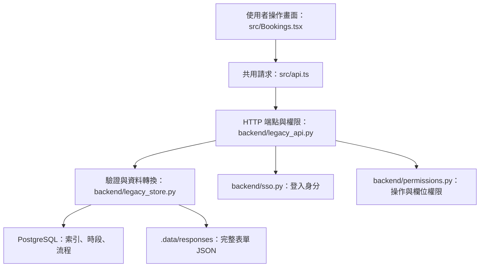
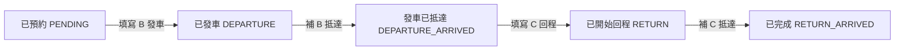

# polimax_refactor：PROJECT_SPEC 規格與專案實作導讀

更新：2026-10-07。專案目錄：`/home/c113118138/polimax_refactor`。

這份文件搭配 [PROJECT_SPEC.md](PROJECT_SPEC.md) 閱讀，回答「規格描述的功能，在網站哪裡？由哪個檔案處理？資料放在哪裡？」。下列對應已依目前工作區程式核對；這次只新增導讀及文件索引，沒有重新執行功能驗收。

## 先認識一次操作經過哪些地方

例如使用者在借用表單按下儲存，前端先整理輸入，送出 API；後端確認身分、權限與業務規則，再保存資料。前端、API 與儲存是不同責任，同一功能通常會跨數個檔案。



| 名詞 | 在這個專案的意思 | 例子 |
| --- | --- | --- |
| 畫面／元件 | 使用者看到、輸入或點擊的 React 介面 | `BookingForm` 借用表單 |
| Route | 瀏覽器網址對應哪個畫面 | `/bookings/new/A` |
| API | 前端向後端讀取或修改資料的 HTTP 入口 | `POST /api/bookings` |
| handler | 處理某個 API 的 Python 函式 | `add_booking()` |
| Repository | 將業務資料轉換、查詢並寫入資料庫或 JSON | `Repository.save_booking()` |
| manifest | 指出應讀哪份資料檔案的索引 | `latest-AMS-local.json` 指向 v14 快照 |
| revision | 用來確認資料是否已被其他操作修改的版本值 | 過期畫面送出時回 409 |

## 1. PROJECT_SPEC 各章節的實作位置

下表沿用原規格的章節編號。要理解某章，先看「使用者／維運者接觸的位置」，再沿檔案連結往下追。

| 規格章節 | 使用者／維運者接觸的位置 | 專案對應與閱讀重點 |
| --- | --- | --- |
| 1 規格來源與判讀順序 | 文件閱讀入口 | [原始需求](../POLIMAX_原始_SPEC.md) 說明業務要求；[PROJECT_SPEC](PROJECT_SPEC.md) 盤點目前實作；[backend/app.py](backend/app.py) 決定真正啟用哪個後端模式。需求存在不等於功能已完成。 |
| 2 產品與架構 | 整個網站與背景工作 | [src/main.tsx](src/main.tsx) 啟動 React；[src/App.tsx](src/App.tsx) 組合網站；[backend/app.py](backend/app.py) 啟動後端；正式 API 由 [legacy_api.py](backend/legacy_api.py) 建立。 |
| 3.1 前端依賴 | 日曆、地圖、表單與視覺樣式 | [package.json](package.json) 列依賴、[package-lock.json](package-lock.json) 固定解析版本；[main.tsx](src/main.tsx) 設定主題；[Calendar.tsx](src/Calendar.tsx) 使用日曆；[Maps.tsx](src/Maps.tsx) 使用地圖。 |
| 3.2 後端與整合依賴 | API、SQL、SSO、FindMy | [backend/requirements.txt](backend/requirements.txt)、[integrations/findmy/requirements.txt](integrations/findmy/requirements.txt)；`.venv` 跑網站與維運，`.venv-findmy` 跑 FindMy。 |
| 4 啟動、建置與連接埠 | 開發指令、正式網站服務 | [package.json](package.json) 的 scripts、[vite.config.js](vite.config.js)、[deploy/polimax-next@.service](deploy/polimax-next@.service)、[deploy/polimax-refactor.conf](deploy/polimax-refactor.conf)。正式 FastAPI 提供建置後的 `dist/`。 |
| 5 前端路由 | 側欄與各功能網址 | [App.tsx](src/App.tsx) 的 `Routes` 決定畫面；[Access.tsx](src/Access.tsx) 的 `Guard` 控制介面權限。登入畫面由 App 的登入狀態決定，沒有獨立 `/login` Route。 |
| 6 API 共通契約 | 所有查詢、儲存及錯誤提示 | [src/api.ts](src/api.ts) 的 `api()` 統一送請求；[legacy_api.py](backend/legacy_api.py) 的 middleware 與共用檢查處理來源標頭、身分、權限與錯誤。 |
| 6.1 正式端點 | 瀏覽器發出的 `/api/...` 請求 | 一般業務在 [legacy_api.py](backend/legacy_api.py)，SSO 在 [sso.py](backend/sso.py)，定位等在 [legacy_integrations.py](backend/legacy_integrations.py)，封存在 [archive_api.py](backend/archive_api.py)。 |
| 6.2 API 群行為與權限 | 某功能能查、能改或不能執行 | 各 handler 呼叫 `check()`／共用 permissions 函式，再進入 Repository。不要只依畫面按鈕判斷後端授權。 |
| 6.3 請求模型 | 表單送出的資料形狀 | [legacy_api.py](backend/legacy_api.py) 的 `BookingInput`、`ResourceInput`、`RecordInput`、`StageInput`、`EditStage`；[archive_api.py](backend/archive_api.py) 的 `Completion`。`content: dict` 內的業務規則還會在 Store 驗證。 |
| 6.4 回應型別 | 畫面取得的使用者、資源、借用、位置資料 | [src/api.ts](src/api.ts) 定義 `User`、`Resource`、`Booking` 等型別；[legacy_store.py](backend/legacy_store.py) 組合借用及資源資料；[legacy_integrations.py](backend/legacy_integrations.py) 組合定位資料。 |
| 7.1 表單與預約 | 車輛 A、作業區 D、儀器 E 借用 | [Bookings.tsx](src/Bookings.tsx) 的 `BookingForm`／列表／詳情；[legacy_store.py](backend/legacy_store.py) 的 `validate_booking()`、`encode_booking()`、`save_booking()`。 |
| 7.2 車輛出回程 | 四次送出及 B/C 紀錄 | [Stages.tsx](src/Stages.tsx) 的 `StageForm`、`StagePage`、`StageList`；[legacy_store.py](backend/legacy_store.py) 的 `validate_stage()`、`advance()`、`edit_stage()`。 |
| 7.3 日曆與時間 | 首頁日曆、時間輸入及顯示 | [Calendar.tsx](src/Calendar.tsx)、[api.ts](src/api.ts) 的 `businessDate()`／`localInput()` 等；[legacy_store.py](backend/legacy_store.py) 的 `parse()`／`iso()` 處理後端業務時間。 |
| 8 登入與權限 | SSO 登入、無權限首頁、欄位限制 | [App.tsx](src/App.tsx)、[Access.tsx](src/Access.tsx)、[sso.py](backend/sso.py)、[permissions.py](backend/permissions.py)、[legacy_api.py](backend/legacy_api.py)。詳細分工見下文。 |
| 8.1 管理員與工程人員 | 同一網站因帳號不同而呈現不同操作 | `.data/permissions` 的政策快照提供角色；`permissions.can_fill_departure()`、`can_view_booking_detail()` 等落實本人與他人限制。帳號不是寫在前端讓使用者自行選擇。 |
| 9 儲存與一致性 | 資產、完整表單、流程與備份 | [legacy_schema.py](backend/legacy_schema.py) 定義資產欄位映射；[legacy_store.py](backend/legacy_store.py) 的 `Store`／`Repository` 處理 SQL、JSON、鎖與失敗回復。 |
| 9.1 附件 | 上傳、預覽與下載 | [ui.tsx](src/ui.tsx) 的 `FileUpload`；[legacy_api.py](backend/legacy_api.py) 的 `upload()`／`file()`；`.data/files` 保存原檔與 metadata。 |
| 9.2 PostGIS 與定位 | 最新位置、歷史軌跡及 Beacon 位置 | [Maps.tsx](src/Maps.tsx)、[legacy_integrations.py](backend/legacy_integrations.py)、[gps_history.py](backend/gps_history.py)；[add_location.sql](scripts/add_location.sql) 建立空間欄位及 trigger。 |
| 10 外部服務與背景工作 | SSO、Apple、MQTT 上游與各種排程 | [sso.py](backend/sso.py)、[integrations/findmy](integrations/findmy)、[deploy](deploy)。GPS／掃描接收器在專案外；網站讀取它們寫入的資料。 |
| 11 歷史封存與備份 | 歷史封存頁、每日清理與備份 | [Archive.tsx](src/Archive.tsx)、[archive_api.py](backend/archive_api.py)、[retention.py](backend/retention.py)、[archive_maintenance.py](scripts/archive_maintenance.py)、[backup_postgresql.py](scripts/backup_postgresql.py)。 |
| 12 設定規格 | 主機部署配置 | [settings.py](backend/settings.py) 合併程序環境、`.env`、`env`；[database.py](backend/database.py) 選擇資料庫模式；[.env.example](.env.example) 是設定範本。 |
| 13 Demo 與正式差異 | 隔離示範或測試環境 | [demo_app.py](backend/demo_app.py)、[fixtures.py](backend/fixtures.py)、[stages.py](backend/stages.py)、[integrations.py](backend/integrations.py)。正式流程要追 `legacy_*` 模組。 |
| 14 測試與驗收 | 開發驗證與正式驗收 | [tests](tests)、[ACCEPTANCE.md](ACCEPTANCE.md)；各測試有不同環境與範圍，mock／demo 通過不能直接代表真 SSO 或定位上游成功。 |
| 15.1 文件索引 | 查閱交接與維運文件 | 根目錄、[deploy](deploy) 與 [scripts/LOCATION_BENCHMARK.md](scripts/LOCATION_BENCHMARK.md)；本導讀將規格再連到實作。 |
| 15.2 功能與欄位需求索引 | 想了解業務為何需要某欄位 | [原始需求](../POLIMAX_原始_SPEC.md) 保存完整需求及附錄；目前程式是否實作仍需回到對應畫面與 handler 核對。 |
| 15.3 原始欄位映射 | 新畫面如何讀寫既有表單格式 | [legacy_form_fields.json](backend/legacy_form_fields.json) 對應 A/E 欄位；[legacy_stage_fields.json](backend/legacy_stage_fields.json) 可協助理解舊名稱；B/C 正式編解碼實作在 `legacy_store.py`。 |
| 15.4 檔案索引 | 找某個模組或維運工具 | `src` 是畫面、`backend` 是 API／資料邏輯、`scripts` 是命令列工具、`deploy` 是部署範本、`integrations/findmy` 是 Apple 匯入。 |
| 16 限制與後續核對 | 判斷目前功能邊界與改動影響 | 附件授權看 `legacy_api.py`，上游界線看 `legacy_integrations.py`，備份覆蓋看 `backup_postgresql.py`；限制不能只靠畫面文案判斷。 |

## 2. 從網站功能找到程式

這裡的網址是瀏覽器頁面；API 欄則是前端取得資料的後端入口。頁面名稱與 API 名稱不一定相同。

| 網站功能／頁面 | 瀏覽器網址 | 前端元件 | 主要 API | 正式後端與資料位置 |
| --- | --- | --- | --- | --- |
| 登入與使用者身分 | 未登入時由 App 顯示 | [App.tsx](src/App.tsx) | `/api/auth/config`、`/api/auth/me`、`/api/auth/sso`、callback、logout | [sso.py](backend/sso.py)；`.data/sso`、權限快照 |
| 預約日曆 | `/` | [Calendar.tsx](src/Calendar.tsx) | bookings、resources、holidays | `legacy_api.py`／`legacy_integrations.py`；借用索引與資源 |
| 借用紀錄／車輛歷史 | `/bookings`、`?history=1` | `Bookings.tsx → BookingList` | `GET /api/bookings` | `Repository.bookings()`；他人摘要由 permissions 處理 |
| A/D/E 新增與修改 | `/bookings/new/:kind`、`/bookings/:id/edit` | `Bookings.tsx → BookingForm` | options、resources、bookings/check、POST／PUT bookings | `validate_booking()`、`save_booking()`；SQL＋responses JSON |
| 借用詳情與流程入口 | `/bookings/:id` | `Bookings.tsx → BookingDetail` | bookings/{id}、advance、DELETE bookings/{id} | `Repository.detail()`、`advance()`、`delete_booking()` |
| 出回程紀錄 | `/stages`、`/stages/:id` | [Stages.tsx](src/Stages.tsx) | GET／PUT／DELETE stages | `Repository.stage()`／`stages()`／`edit_stage()`；B/C JSON |
| 車輛／儀器資產 | `/vehicles`、`/equipment` 及明細網址 | [Assets.tsx](src/Assets.tsx) 的 `Assets`／`AssetDetail` | resources、resources/{id}/records、records/{id} | `save_resource()`／`save_record()`；CarList、EquipmentList 及附屬表 |
| 車輛最新位置與軌跡 | `/positions` | [Maps.tsx](src/Maps.tsx) 的 `Positions` | positions、trajectory/{rid} | `legacy_integrations.py`＋`gps_history.py`；gps_readings |
| Beacon 設備位置 | `/findmy` | `Maps.tsx → FindMy` | beacons、findmy/{ident} | `legacy_integrations.py`；依來源讀既有定位表 |
| 場內掃描 | `/scans` | `Maps.tsx → Scans` | stations、scans | `legacy_integrations.py`；既有掃描／站點資料 |
| Beacon 管理 | `/beacons` | [Admin.tsx](src/Admin.tsx) 的 `Beacons` | GET／POST／PUT／DELETE beacons | `legacy_integrations.py`；BeaconList |
| 資料來源、通知與權限同步 | `/integrations` | `Admin.tsx → Integrations` | notifications、permissions/health、permissions/sync、reports | 正式同步功能有範圍限制，見第 6 節 |
| 歷史封存與完成登記 | `/archive` | [Archive.tsx](src/Archive.tsx) | archive/status、catalog、live、completion、history | `archive_api.py`＋`retention.py`；正式庫與封存庫 |
| 附件 | 表單或資產頁內 | [ui.tsx](src/ui.tsx) 的 `FileUpload` | POST files、GET files/{id} | `legacy_api.py`；`.data/files` |

## 3. 用兩個操作串起整個專案

### 3.1 新增一張車輛借用申請 A

1. [App.tsx](src/App.tsx) 將 `/bookings/new/A` 對應到 `BookingForm`。
2. [Bookings.tsx](src/Bookings.tsx) 載入使用者、選項與資源，透過表單 schema 和 `next()` 驗證各步輸入。
3. `submit()` 經 [api.ts](src/api.ts) 送出 `POST /api/bookings`，包含 `kind` 與 `content`。修改時則送 PUT 並附 revision。
4. [legacy_api.py](backend/legacy_api.py) 的 `add_booking()` 驗證使用者及表單操作權限，再交給 Repository；申請人等可信欄位由後端維持。
5. [legacy_store.py](backend/legacy_store.py) 的 `validate_booking()` 檢查時段、資源類型、人員、緣由與衝突，`save_booking()` 編號及保存。
6. PostgreSQL 保存預約索引及流程；`.data/responses/主表` 保存完整 JSON。SQL 和檔案需要一起備份。
7. 前端更新查詢快取，列表或日曆才能呈現新申請。

要改一個借用欄位，至少核對 `BookingForm` 的輸入、初始值、編輯回填、詳情顯示，API 的權限，以及 Repository 的驗證／編解碼。需要 SQL 搜尋時，再評估資料庫欄位及遷移。

### 3.2 車輛發車、抵達、回程與還車

[api.ts](src/api.ts) 提供狀態顯示文字，[legacy_store.py](backend/legacy_store.py) 的 `STATES` 與 `advance()` 控制正式流程。



| 操作環節 | 對應程式 | 你應該看什麼 |
| --- | --- | --- |
| 顯示下一步按鈕 | `Bookings.tsx → BookingDetail`、`api.ts → nextStates` | 目前狀態決定顯示哪一種表單 |
| 輸入檢查、里程、人員與照片 | `Stages.tsx → StageForm`、`ui.tsx → FileUpload` | 不同階段所需欄位和附件 |
| 送出下一階段 | `POST /api/bookings/{fid}/advance` | `expected_status` 與 revision 防止過期／重複送出 |
| 本人或管理員代填授權 | `permissions.py → require_departure_owner()` 等 | 依原申請人判斷，不依最後修改者 |
| 驗證與流程推進 | `legacy_store.py → validate_stage()`、`advance()` | 駕駛、副駕、檢查、異狀、里程及先後順序 |
| 保存 B/C 格式 | `save_stage_json()`、`STAGE_FIELDS`、`STAGE_CHECKS` | 新欄位如何轉成既有表單 JSON |
| 查詢或修改已有紀錄 | `Stages.tsx → StageList／StagePage`，GET／PUT stages | 修改既有資料與推進主流程是不同操作 |

A 是借用主申請；B 是去程紀錄，C 是回程紀錄。四次操作不代表四張獨立主申請。刪除 B/C 紀錄也不會自動將父申請流程倒退。

## 4. 登入、角色、畫面權限各在哪裡

| 責任 | 實作位置 | 作用 |
| --- | --- | --- |
| 驗證你是誰 | [sso.py](backend/sso.py)：`start()`、`request_tokens()`、`userinfo()`、`callback_response()` | 與公司 SSO 交換 code/token、取得身分及建立 session |
| 讀取你有哪些角色 | `SSO.with_permissions()` | 讀 manifest 指向的快照，找啟用帳號與角色；明確政策檔可優先使用 |
| 合併角色與欄位操作 | [permissions.py](backend/permissions.py)：`effective_policy()` | 算出表單 read/create/write/submit 等有效權限 |
| 決定介面能否顯示或操作 | [Access.tsx](src/Access.tsx)、[App.tsx](src/App.tsx) | `Guard`、`can()`、`useFieldAccess()` 及無權限首頁 |
| 阻擋無權限 API | [legacy_api.py](backend/legacy_api.py)：`require_workspace_access()`、`check()` | 即使直接呼叫 API，也必須符合權限 |
| 控制他人借用明細／代填 | `permissions.py` 的 booking／departure helper | 摘要可見與完整明細可見是不同授權 |
| 管理頁重讀權限 | `Admin.tsx → Integrations`、`POST /api/permissions/sync` | 重讀本地政策，並非自動從權限中心取得新快照 |

目前設定的對應關係是 `.env` 中 `AMS_SSO_POLICY_MANIFEST` → `.data/permissions/latest-AMS-local.json` → `snapshot-AMS-local-v000014.json`。manifest 決定讀取哪份快照；單純放入更高版本檔案不會自動切換。

身分驗證成功但沒有有效授權時，使用者可以進入零權限首頁。登入成功和具有業務操作權限是兩件分開處理的事情。

## 5. 資料究竟保存在哪裡

| 資料 | 主要位置 | 負責程式／理解重點 |
| --- | --- | --- |
| 車輛、儀器 | PostgreSQL：CarList、EquipmentList | `legacy_schema.py → ASSETS`、Repository 資源函式；畫面欄位與 SQL 欄位名稱可能不同 |
| 保險、費用、維護、車庫、管理人員 | insurance_records、cost、vehicle_records、garage_files、vehicle_managers | `legacy_schema.py → RECORDS`、`save_record()` |
| 借用索引、預約時間與流程 | formio_responses、form_flows | `legacy_store.py`；用於列表、衝突判斷與流程 |
| 完整 A/B/C/D/E 表單 | `.data/responses` 下各類子目錄 | `Store.path()`、`Repository.raw()`／`save_json()`；新版內容放 `_polimax_next.content` |
| 附件原檔與索引 | `.data/files/<uuid>`、`<uuid>.json` | `legacy_api.py`；JSON 索引和二進位原檔是一組 |
| 角色政策快照 | `.data/permissions` | `sso.py`、`permissions.py`；manifest 與它指定的快照須配套 |
| 公司 SSO session／state／token | `.data/sso` | `sso.py`；前端 cookie 不等於完整 token 檔案 |
| Apple session／Anisette cache | `.data/findmy` | `integrations/findmy`；與公司 SSO 分開 |
| 最新位置／歷史軌跡 | gps_readings、FindMy、new_reports 等既有表 | `legacy_integrations.py`、`gps_history.py`；來源寫入者另見下節 |
| 已封存資料與檔案區塊 | polimax_PostgreSQL_Expired | `retention.py`；移轉完成需讀回驗證，不能只看有沒有寫入 |
| 排程備份 | 預設 `.backups/scheduled` | `backup_postgresql.py`；正式庫 dump、封存庫 dump、persistent.tar、manifest |

資源 API 的 id 會經過轉換，車輛為原 ID × 10 + 1，設備為原 ID × 10 + 2。查表時不能把 API id 直接當成 CarList.ID。固定作業區使用程式內建資源，不是與車輛相同的資產 CRUD 表。

`_polimax_next` 是資料格式欄位；服務／範本名 `polimax-next` 也仍保留。這些相容名稱與目前專案目錄 `polimax_refactor` 可以並存。

## 6. 畫面操作與背景工作如何分工

| 事項 | 網站做什麼 | 真正執行者／檔案 |
| --- | --- | --- |
| 最新定位與軌跡 | 查詢 PostgreSQL 並畫地圖 | `Maps.tsx` → `legacy_integrations.py` → `gps_history.py`；GPS／室內／戶外接收由外部 PMXAgent 提供 |
| Apple FindMy 收集 | 查已匯入的位置；頁面刷新不觸發 Apple 採集 | [findmyupdate.py](integrations/findmy/findmyupdate.py)、[fetch_reports_async.py](integrations/findmy/fetch_reports_async.py)；`polimax-findmy-import.timer` |
| 建立 Apple 登入資料 | 不使用公司 SSO 登入替代 Apple 登入 | [create_findmy_session.py](integrations/findmy/create_findmy_session.py)；互動建立 session |
| 通知 | 正式模式查 notification 表 | `legacy_integrations.py → notifications()`；正式 notifications/check 回 409，不在網站內重新寄送通知 |
| 報告 import／sync | 正式端點回不支援操作 | `legacy_integrations.py → reports()`；demo 行為不同 |
| 完成登記與歷史查閱 | 封存頁登記、查閱正式／封存資料 | `Archive.tsx` → `archive_api.py` |
| 實際封存清理 | 背景挑候選、封存、驗證、刪除來源 | [archive_maintenance.py](scripts/archive_maintenance.py) → [retention.py](backend/retention.py)；`polimax-gps-cleanup.timer` |
| 備份 | 不依賴使用者開啟頁面 | [backup_postgresql.py](scripts/backup_postgresql.py)；`polimax-pg-backup.timer` |
| PostGIS 空間欄位更新 | API 目前讀數值 latitude／longitude | [add_location.sql](scripts/add_location.sql) 建立 DB trigger；不是每次啟動都重跑的工具 |

[LOCATION_BENCHMARK.md](scripts/LOCATION_BENCHMARK.md) 比較多種讀取座標方式；那些比較項目不等於網站提供座標來源選擇功能。

## 7. 正式模式與 demo：找程式時最容易混淆的地方

```text
backend/app.py
  └─ database.configuration() 決定模式
      ├─ 正式 PostgreSQL → legacy_api.create_app()
      │   ├─ legacy_store.py：資產、借用、出回程、JSON
      │   ├─ legacy_integrations.py：定位、掃描、通知、Beacon
      │   ├─ archive_api.py／retention.py：封存
      │   └─ sso.py／permissions.py：登入與共用權限
      └─ demo → demo_app.py
          ├─ stages.py：示範出回程
          ├─ integrations.py：示範資料來源
          ├─ fixtures.py：示範資料
          └─ permissions.install()：示範權限 API
```

`legacy_*` 在此表示相容既有資料格式的正式實作，並非執行時要匯入舊專案。`permissions.py` 則同時有共用權限函式與 demo 安裝入口，不能把整個檔案都視為 demo。

## 8. 我想調整某件事，應該從哪裡開始

| 想理解／調整的事情 | 第一個閱讀位置 | 接著核對 |
| --- | --- | --- |
| 側欄、頁面網址、登入後外觀 | `src/App.tsx` | `src/Access.tsx`、各頁面元件 |
| 共用欄位、對話框、上傳介面 | `src/ui.tsx`、`src/style.css` | 使用它們的表單頁及欄位權限 |
| A/D/E 表單欄位或借用衝突 | `src/Bookings.tsx` | `legacy_api.py`、`legacy_store.py`、欄位映射、permissions |
| 車輛出回程檢查或里程 | `src/Stages.tsx` | `validate_stage()`、`advance()`、`STAGE_FIELDS`／`STAGE_CHECKS` |
| 角色、本人／他人限制 | `backend/permissions.py` | `sso.py`、本地政策快照、API handler、Access.tsx |
| 資產欄位 | `src/Assets.tsx` | `legacy_schema.py`、`save_resource()`／`save_record()` |
| 定位查詢時間或點數 | `src/Maps.tsx` | `legacy_integrations.py`、`gps_history.py`；先分清來源資料與顯示問題 |
| 保留天數與封存條件 | `backend/retention.py` | `archive_maintenance.py`、`deploy/ARCHIVE_RETENTION.md`、test_retention.py |
| 搬機、連接埠、啟動路徑 | `deploy/README.md`、`deploy/STANDALONE.md` | `.env`、service 範本、Nginx、雙庫與持久資料 |
| API 出現 401／403／409 | `src/api.ts` 與相關 handler | 401 身分、403 權限、409 衝突／revision／不支援操作；依實際 detail 判讀 |

## 9. 測試與閱讀順序

| 要核對的行為 | 對應測試／文件 | 範圍 |
| --- | --- | --- |
| SSO、session、無授權登入 | [test_sso.py](tests/test_sso.py) | 模擬 IdP，不是真公司登入驗收 |
| 工程人員與代填／他人明細限制 | [test_departure_access.py](tests/test_departure_access.py) | 隔離 API 與 mock repository |
| 配置路徑、獨立部署、政策失效 | [test_standalone.py](tests/test_standalone.py) | 臨時檔案與配置測試 |
| 手動人員輸入 | [test_manual_people.py](tests/test_manual_people.py) | 人員與姓名規則 |
| 封存、備份還原、PostGIS | [test_retention.py](tests/test_retention.py) | 需隔離 PostgreSQL／PostGIS 環境 |
| demo 整合與畫面 | [test_integration.py](tests/test_integration.py)、[browser.mjs](tests/browser.mjs) | SQLite demo；瀏覽器需 Chromium |
| 地圖互動 | [browser_location.mjs](tests/browser_location.mjs) | mock 定位，不代表上游成功 |
| 正式驗收清單 | [ACCEPTANCE.md](ACCEPTANCE.md) | 列必要驗收項目與已知邊界 |

第一次閱讀可以先走 `App.tsx → Bookings.tsx → api.ts → legacy_api.py → legacy_store.py`，理解一張申請如何保存；再看 `Access.tsx → sso.py → permissions.py`，理解誰可以操作。定位與封存則各自沿第 6 節的鏈路閱讀。

想看更細的訊息順序，搭配 [USER_JOURNEY_SEQUENCE.md](USER_JOURNEY_SEQUENCE.md)；想查完整端點、型別或限制，回到 [PROJECT_SPEC.md](PROJECT_SPEC.md)。
