# polimax_refactor 系統流程與維運手冊

更新：2026-10-12。工作目錄：`/home/c113118138/polimax_refactor`。

本手冊整合現行資料架構、從登入開始的使用者／API流程、PostgreSQL搬機／發版／回復步驟及歷史遷移紀錄。正式架構為React + FastAPI + PostgreSQL／PostGIS + 公司SSO；MySQL遷移已完成，不是目前部署依賴或預設回復目標。

本次為文件整合，依既有文件與現行程式核對；沒有執行正式登入、停寫、備份還原、通知、定位匯入、封存或部署。歷史驗證結果與本次文件檢查分開記錄。

## 閱讀入口

| 需求 | 閱讀位置 |
| --- | --- |
| 接手系統、確認資料庫與工具用途 | [1. 架構與資料庫基準](#architecture) |
| 理解操作、API與資料寫入順序 | [2. 使用者與系統流程](#flows) |
| 搬機、發版、備份還原或故障回復 | [3. 部署、搬機與回復](#operations) |
| 追查MySQL遷移與過去驗證結果 | [4. 歷史紀錄與操作留存](#history) |

安裝設定與服務範本另見 [部署手冊](deploy/README.md)，搬移項目見 [搬機清單](deploy/STANDALONE.md)，封存資格與雙庫備份細節見 [封存規格](deploy/ARCHIVE_RETENTION.md)。最新完整重建交付見 [POLIMAX_REBUILD_SPEC.md](POLIMAX_REBUILD_SPEC.md)。

<a id="architecture"></a>

## 1. 架構與資料庫基準

### 現行基準

- 正式庫polimax_PostgreSQL；封存庫polimax_PostgreSQL_Expired，同一PostgreSQL instance，PostGIS在兩庫啟用。
- 網站以AMS_DATABASE_MODE=postgresql及POSTGRES_*連線；backend/app.py載入legacy_api／legacy_store，反射既有表，不依賴舊Python專案。
- 两個網站入口5173／5174共享資料庫與專案持久資料，Nginx範本代理5174；實際啟用狀態需systemd核對。
- 外部PMXAgent GPS／室內／戶外接收器寫入PostgreSQL；專案內FindMy匯入器寫FindMy／new_reports。
- PostgreSQL advisory lock取代現行寫入路徑的MySQL命名鎖；表單JSON仍是完整內容來源，必須與資料庫一致備份。
- 每日03:30封存，04:00雙庫及持久檔案備份；timer時區與啟用狀態以主機為準。

### Schema與工具

資產CarList／EquipmentList／BeaconList；業務formio_responses／form_flows、insurance_records／cost／vehicle_records／garage_files／vehicle_managers；定位與事件表見[完整重建規格](POLIMAX_REBUILD_SPEC.md)。

遷移保留混合大小寫表／欄名及原主鍵。三個view為Findmy_latest、car_realtime、latest_scanned_devices，其定義在scripts/postgresql_views.sql。PostGIS將gps_readings／new_reports／FindMy新增location geography(Point,4326)、trigger與GiST，API仍讀數值座標。

封存初始化另建立polimax_retention_decisions、polimax_retention_cursor、polimax_archive_batches、polimax_archive_files。不能把歷史「23表／3view／85索引」當成目前完整schema數量，也不能用tests/legacy-schema.sql建立正式庫。

| 工具 | 目前角色 |
| --- | --- |
| scripts/verify_postgresql.sql | 初步schema與筆數檢查；不是完整業務驗收 |
| scripts/verify_postgresql_api.py | 指定庫只讀API核對；密碼在本機輸入 |
| scripts/backup_postgresql.py | 現行雙庫與持久資料備份 |
| scripts/archive_maintenance.py | 現行封存初始化／預覽／完成登記／清理 |
| scripts/add_location.sql | 一次性PostGIS遷移，已套用庫不得重跑 |
| scripts/export_postgresql.py | 已完成MySQL轉換的歷史工具，不屬日常部署 |
| scripts/prepare_cutover_pgpass.py、backup_cutover.sh | 初次切換輔助工具，不作現行搬機標準流程 |

<a id="flows"></a>

## 2. 使用者與系統流程

閱讀順序是開啟網站 → 登入 → 首頁 → 選擇功能 → 操作 → 登出。功能頁是登入後的分支，不必依序操作全部頁面。圖示依正式SSO／PostgreSQL模式，隔離demo的角色選擇登入不屬於正式流程；外部SSO內部帳密驗證不在本專案範圍。

各圖以autonumber標示訊息順序。前端包含React與瀏覽器；後端為FastAPI。React Query可能重用仍有效的快取，並非每次點擊都重新送出查詢。

| 流程 | 章節 |
| --- | --- |
| 啟動與SSO | [01 開啟網站](#flow-01)、[02 登入](#flow-02)、[03 回呼](#flow-03)、[04 身分刷新](#flow-04) |
| 日曆與A/D/E | [05 首頁](#flow-05)、[06 新增入口](#flow-06)、[07 同頁表單](#flow-07)、[08 寫入與回復](#flow-08)、[09 查詢／修改](#flow-09) |
| B/C與附件 | [10 四階段](#flow-10)、[11 階段查詢](#flow-11)、[12 附件](#flow-12)、[18 離頁／草稿](#flow-18) |
| 資產與定位 | [13 資產管理](#flow-13)、[14 定位](#flow-14)、[15 Beacon／整合](#flow-15) |
| 登出與封存 | [16 登出](#flow-16)、[17 封存](#flow-17) |

<a id="flow-01"></a>

### 01｜開啟網站：顯示登入頁或直接進入工作空間

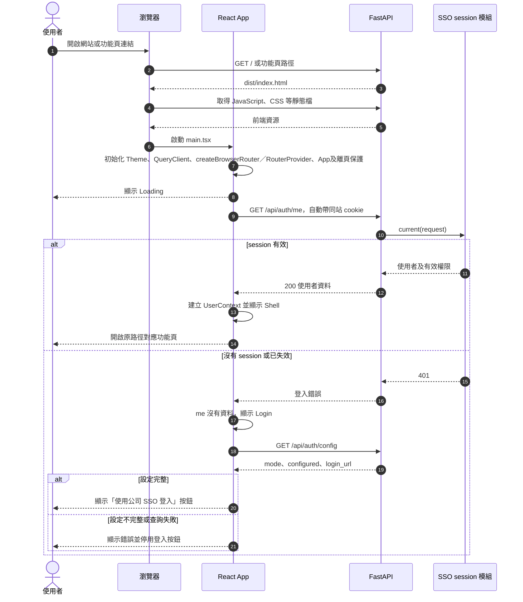

`App` 以 me.data 是否存在決定畫面：已有有效 cookie 就直接進入；初次身分查詢因其他錯誤而沒有資料時，也會呈現 Login。若 dist/index.html 尚未建置，正式服務會回傳 503。

<a id="flow-02"></a>

### 02｜按下「使用公司 SSO 登入」

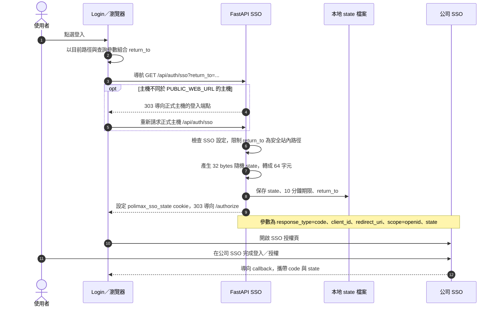

POLIMAX 登入頁不收集公司密碼。若頁面網址已有 sso_error，前端會顯示錯誤，重新登入時不將這段查詢帶入 return_to。SSO 設定不完整時，登入端點回傳 503。

<a id="flow-03"></a>

### 03｜SSO 回呼：驗證、交換 token、載入權限、建立 session

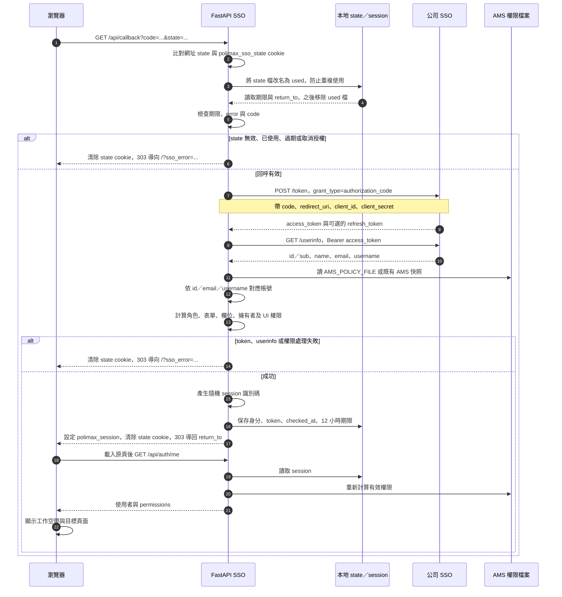

預設快照模式會檢查帳號與角色是否啟用；帳號未在 AMS 啟用、含尚未對應的個別資料限制，都會拒絕登入。自訂 AMS_POLICY_FILE 則使用該政策的帳號角色對應。

cookie 為 HttpOnly、SameSite=Lax、Path=/，正式網址為 HTTPS 時加 Secure。access/refresh token 留在後端 .data/sso/，瀏覽器只持有隨機 session 識別碼。

<a id="flow-04"></a>

### 04｜登入後每個受保護 API 的身分檢查與刷新

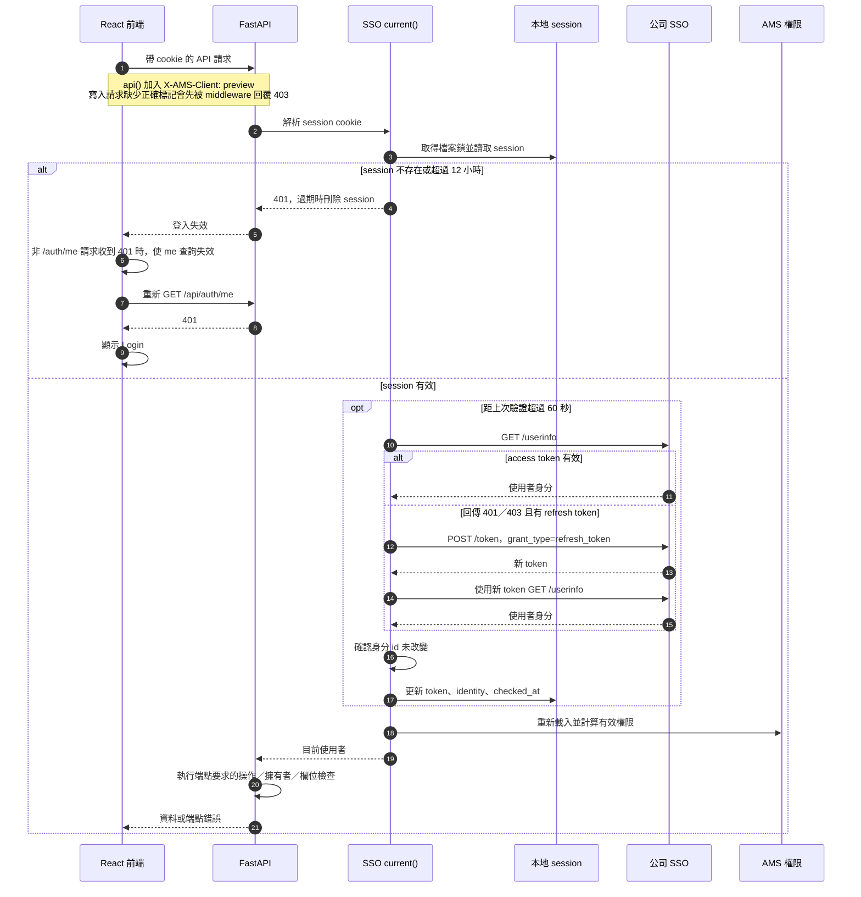

刷新失敗、無 refresh token 或身分改變時，登入失效；SSO 暫時無法連線可能回傳 502。60 秒是有請求時的重新驗證門檻，不是背景計時器。刷新不延長原本 12 小時期限。React Query 預設不自動重試、staleTime 15 秒、視窗聚焦不重新查詢。

<a id="flow-05"></a>

### 05｜登入後的預約日曆首頁

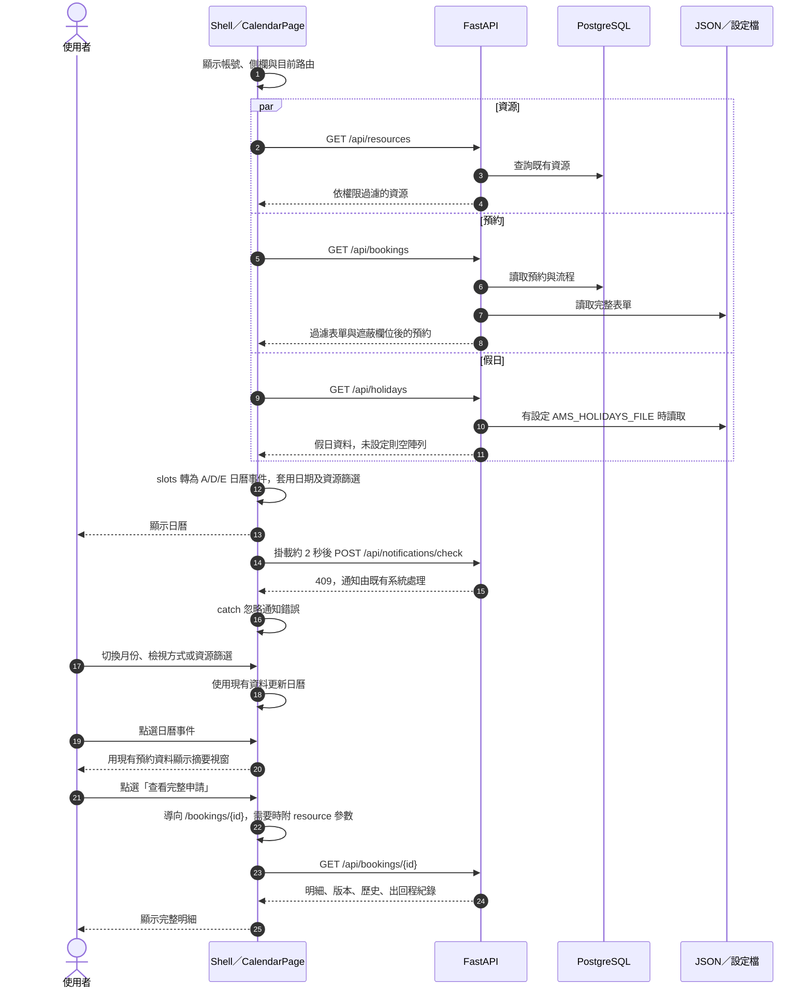

功能頁依各自 Guard／表單檢查 read 或 create 權限，欄位另依權限控制；後端仍獨立驗證。首頁通知呼叫不代表新版發送通知。

首頁是主日曆加右側小日曆、車牌清單、作業區與儀器篩選；手機由右下按鈕開右側篩選抽屜。月／週／資源日／活動列表切換保持日期與篩選，小日曆選日切到資源日；點選或拖選時段帶入新增表單。主頁已移除統計與近期安排卡。側欄依權限顯示來源群組及巢狀資產清單，底部料件管理與登出固定；手機導覽後關閉抽屜。

<a id="flow-06"></a>

### 06｜選擇預約類型與載入新增表單

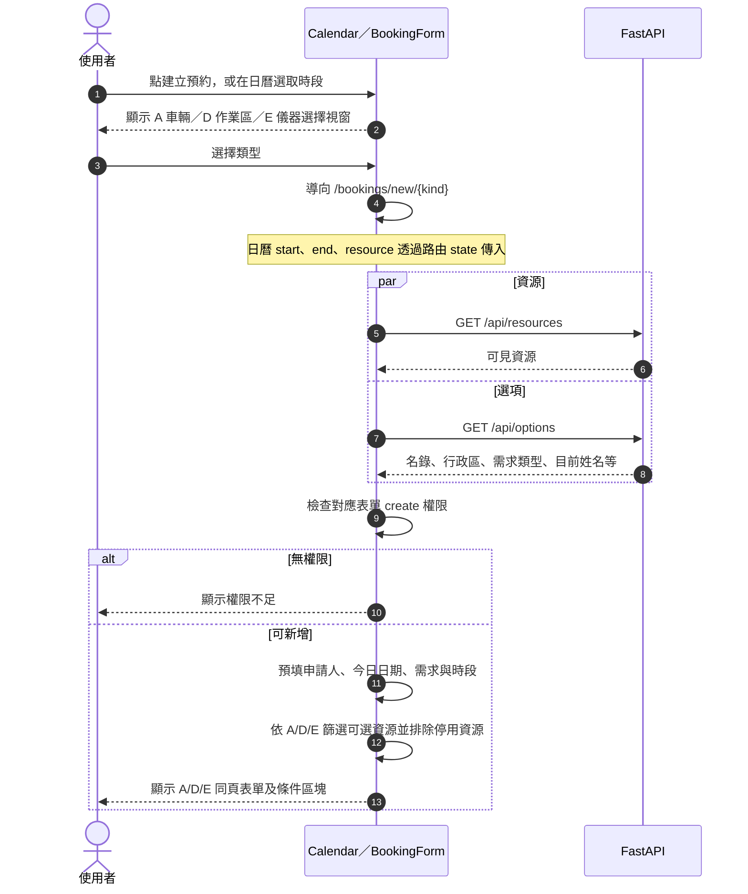

側欄可直接進入 `/bookings/new/A`、`/bookings/new/D`、`/bookings/new/E`，不必先開類型選擇視窗。未帶入時段時，預設今日 09:00 到 17:00；A 可預選日曆選定車輛。人員初始包含目前使用者；現行人員欄可手動輸入。修改模式另查詢 GET /api/bookings/{id}，以原內容、revision與台北時間回填。

<a id="flow-07"></a>

### 07｜同頁表單：條件區塊、資料列與整表驗證

目前 A/D/E 使用 `BorrowingForms.tsx` 自行實作 React／HTML／CSS，同頁排列，沒有五步 wizard 或確認摘要步驟，不使用 Form.io／完整 Schema renderer。

| 種類 | 由上到下的操作 |
| --- | --- |
| A 車輛 | 預約基本資訊 → 車輛借用用途及七種條件明細 → 使用人員與借用時段 → 需求選項清單 → 補充資訊 → 送出 |
| D 作業區 | 申請人 → 開始／結束時間 → 樓層／區域／條件編號 → 送出；不套用 A 的用途與明細 |
| E 儀器 | 借用人資料 → 七類外借需求與設備名稱／編碼／位置 → 使用時段登記 → 備註 → 送出；沒有車輛 B/C 流程 |

A/E 不顯示額外「申請緣由」輸入。新增送出時以使用需求／類別補 `content.title`；修改保留舊單已保存的非空 title。查詢頁的「申請緣由」欄仍用既有需求類別，不代表重新加回輸入欄。

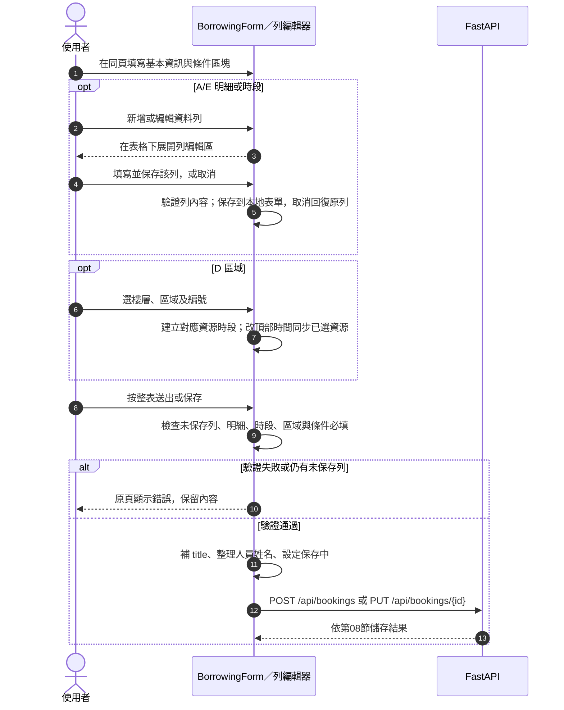

列保存只改本地內容，整表送出才寫入伺服器。A 一筆明細可對應多時段，多筆明細需與時段一對一；切換需求保存各類本地草稿，縣市變更清空行政區。D 每個已選樓層須有區域，每區须選適用編號；改頂部時間前保留舊單原有各時段。E 必須選外借設備並保存明細與時段。前端檢查與後端驗證都要通過，才算保存成功。

新增 A/E 分別檢查 create／submit；D 前端送出按鈕檢查 create，正式後端新增仍會要求 create／submit。修改檢查 write、owner與revision。唯讀表單停用輸入及保存；欄位另依 read/write 權限處理。離頁與上傳保護見第18節，完整布局見 [FORM_LAYOUT_SPEC](docs/reconstruction/FORM_LAYOUT_SPEC.md)。

<a id="flow-08"></a>

### 08｜送出到儲存完成：鎖、衝突、SQL、JSON 與錯誤回復

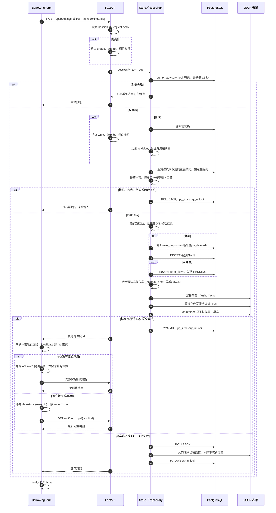

修改 A 產生新編號及 previous_id；已發車的 A 不可重新安排。D/E 修改沿用編號。前端沒有先呼叫 /bookings/check；儲存內的衝突判斷包含相接時間邊界。SQL 與檔案系統不是同一個原子交易，回復處理適用於程式能捕捉的錯誤。

<a id="flow-09"></a>

### 09｜A/D/E 使用查詢、歷史紀錄、查看與修改

側欄「借用中」分別進入 `/bookings?kind=A`、`?kind=D`、`?kind=E`。重複的「借用紀錄／出回程紀錄」整合側欄入口已移除，原 `/bookings`、`/stages` 直達路由仍保留。

| 查詢 | 表格及操作 |
| --- | --- |
| A 車輛 | 11欄；動態文字／日期／需求／狀態篩選，同單多時段合併編號、狀態與操作；編輯、刪除、下一階段、軌跡 |
| D 作業區 | 8欄，標題旁新增；同單合併編號與操作；查看、編輯、刪除 |
| E 儀器 | 10欄，沿用D灰色表頭／框線；同單合併編號、狀態與操作；查看、編輯、刪除，沒有上方類型分類列 |
| 車輛歷史 | `/bookings?history=1`，只列已完成A；11欄、跨B/C總里程、主表／B／C查看及軌跡 |

車輛／設備詳情的使用紀錄以 `resource=ID` 篩選對應資源。表格每時段一列，篩選後重新計算合併列；窄畫面在表內橫捲。A筆數計不同表單，D/E計展開時段列數。

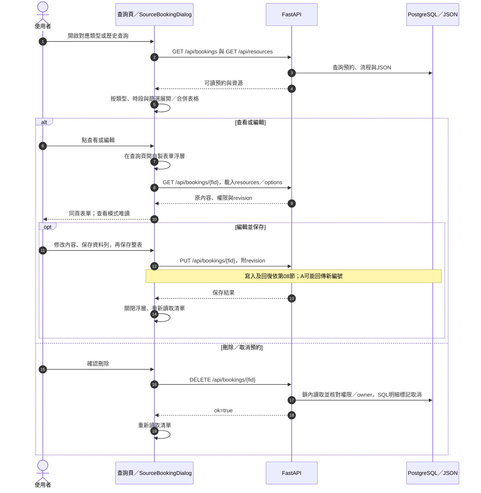

保存失敗保留輸入與錯誤，刪除失敗保留原紀錄；取消確認不寫資料。正常點擊使用浮層，深層 `/bookings/{id}`、`/bookings/{id}/edit` 仍可直接開啟與刷新。摘要 `detail_allowed=false` 不提供完整內容與編輯操作。A只有PENDING可重新安排；軌跡帶入資源及起訖時間。取消預約不物理刪除JSON。`incomplete` 標示流程與出回程檔案不完整的情況。

最新欄序與操作依 [QUERY_LAYOUT_SPEC](docs/reconstruction/QUERY_LAYOUT_SPEC.md) 與 [SITE_PARITY_LAYOUT_SPEC](docs/reconstruction/SITE_PARITY_LAYOUT_SPEC.md)。

<a id="flow-10"></a>

### 10｜車輛出回程：四次獨立送出

| 次序 | 目前狀態 | 操作 | JSON 動作 | 成功後狀態 |
| --- | --- | --- | --- | --- |
| 1 | PENDING | 填寫發車表 | 建立 B 的 start | DEPARTURE |
| 2 | DEPARTURE | 填寫發車抵達 | 補 B 的 arrival | DEPARTURE_ARRIVED |
| 3 | DEPARTURE_ARRIVED | 填寫還車表 | 建立 C 的 start | RETURN |
| 4 | RETURN | 填寫還車抵達 | 補 C 的 arrival | RETURN_ARRIVED |

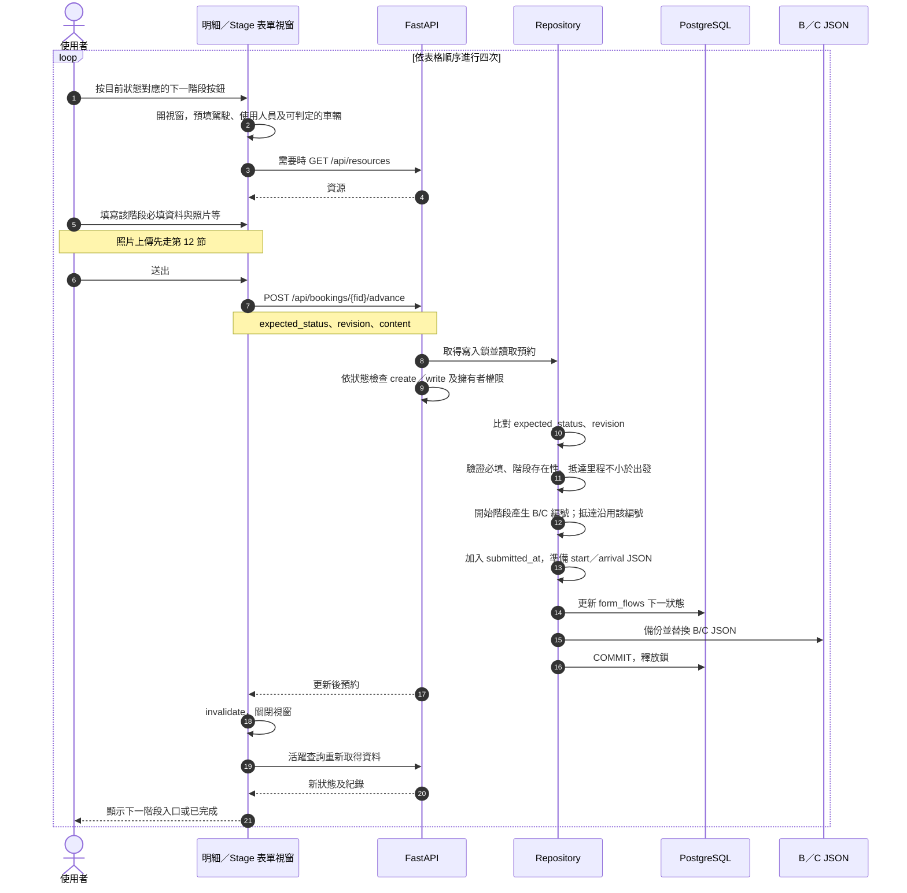

只適用 A 車輛。驗證失敗不推進狀態，前端保留視窗並顯示錯誤；寫入回復同第 08 節。車輛預選使用 resource 查詢參數，或預約中唯一資源。

<a id="flow-11"></a>

### 11｜查詢、編輯與刪除出回程紀錄

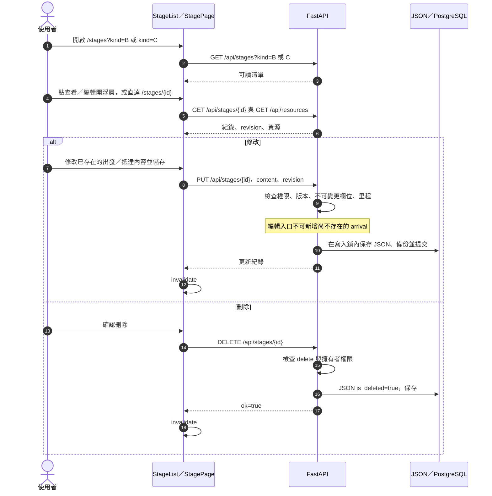

此刪除端點不會自動將父預約狀態退回前一階段；父單以incomplete顯示缺必要階段，不能盲目繼續推進。

側欄分別進入 `/stages?kind=B`、`/stages?kind=C`，使用五欄表格及日期／車牌／駕駛篩選。點查看或編輯在查詢頁開 `SourceStageDialog`，同時呈現已保存出發與抵達區塊；不存在的抵達只顯示尚未填寫，不由修訂補造。保存後關閉浮層、重讀清單；深層 `/stages/{id}` 仍可直達。

新增B/C先選有效A父單：B需PENDING，C需DEPARTURE_ARRIVED，且須有相應權限／明細存取；選定後重新讀最新父單再開StageForm，依第10節advance。B另檢查申請人／代填資格，不建立無父單的孤立紀錄。

<a id="flow-12"></a>

### 12｜附件上傳、預覽與下載

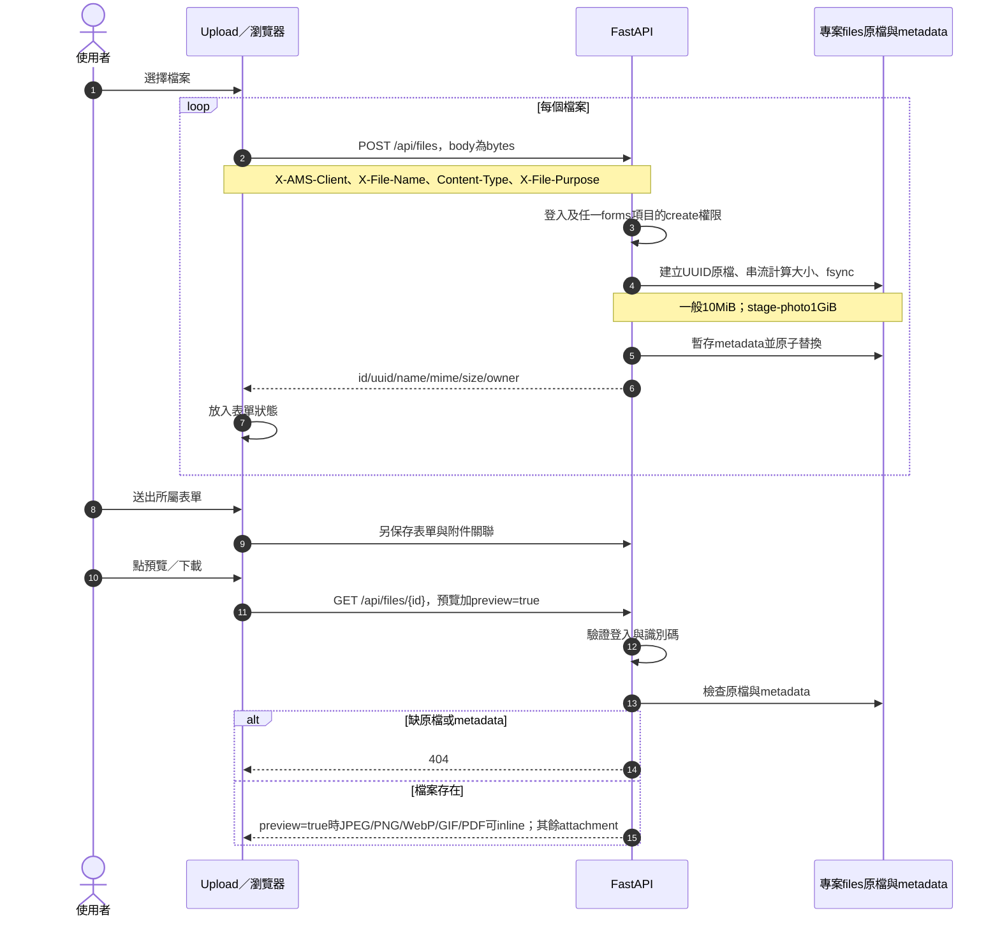

附件可於頁內預覽圖片／PDF或下載。C包含內部、車體外部異狀、設備異狀、停放地四類照片；上傳完成後提交表單才保存引用，再開可回填。本地移除只移除表單引用，不物理刪除伺服器檔案。上傳中禁止提交，取消移除／取消編輯不改已保存引用。

上傳與表單提交是兩個操作。超限413，I/O錯誤503；失敗清理原檔。讀檔目前只檢查登入，沒有逐附件owner授權。沒有外部upload或重新導向舊檔案服務。

<a id="flow-13"></a>

### 13｜車輛／儀器與附屬紀錄管理

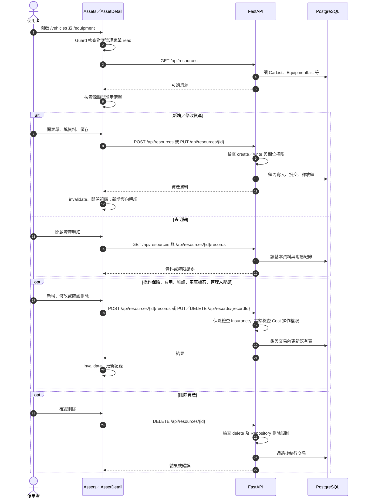

車輛／儀器採資料表與資訊卡。車輛詳情五分頁依序為基本資料、保險、成本、保養維護、使用紀錄；維護頁同時包含保養廠檔案與管理人員。清單 `?create=1` 可開新增浮層，取消清除此參數；表單提供未保存與上傳保護。

儀器三类文件是使用手冊、保固書、採購文件；保存於既有SQL文件欄位，缺欄位時使用 `AMS_DATA_DIR/equipment-files` 的關聯JSON。備份須包含資料庫、上傳檔與關聯JSON。保險／成本／維護支持多附件圖片與PDF預覽。

目前附屬紀錄讀取端點固定檢查 VehicleManagement.read，即使由儀器明細觸發也是如此。

<a id="flow-14"></a>

### 14｜最新位置、軌跡、場內掃描、Beacon 位置

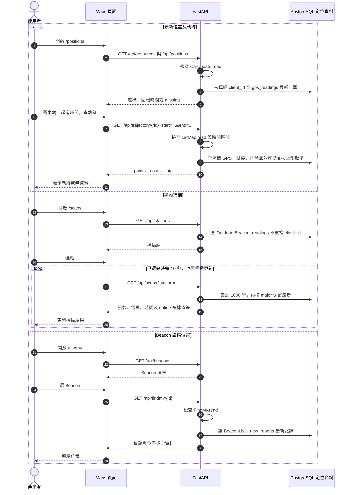

四入口為即時 `/positions`、軌跡 `/positions?view=history`、設備 `/findmy`、場內 `/scans`，各自呈現用途，沒有共用分類tabs。桌面左350px面板，手機由右下查詢鈕開右側抽屜。即時位置每10秒刷新；FindMy選設備後、場內選站後每10秒刷新。軌跡由查詢觸發，預設台北今日00:00:00～23:59:59，保留30／60／90天快捷與深層起訖帶入。API最多90天，以數值座標查詢／抽樣；無座標不畫點、不跨缺值連假線。

GPS／掃描資料來自外部PMXAgent接收器；FindMy由專案integrations/findmy匯入。沒有資料回傳空值／空清單，查詢不會產生新座標。

<a id="flow-15"></a>

### 15｜Beacon 管理、權限同步與資料來源

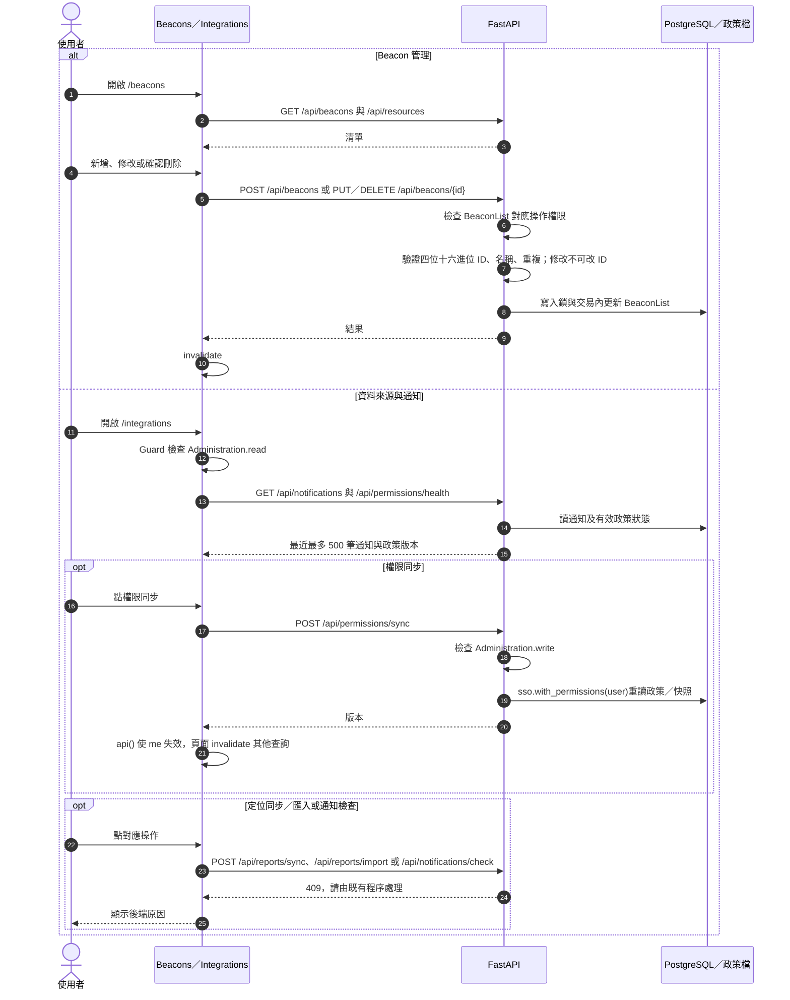

「資料來源與通知」與「歷史封存」已移除側欄入口，但 `/integrations`、`/archive` 路由與既有權限檢查仍保留；需知道網址並具有權限才能直接進入。Shell不再為側欄載入archive/status。

SSO 有效權限仍由 sso.with_permissions() 讀政策／快照；同步按鈕不向外部 AMS 拉取新快照。管理頁有部分測試模式文案，本圖依正式 API 實作記錄。

<a id="flow-16"></a>

### 16｜登出，回到登入頁

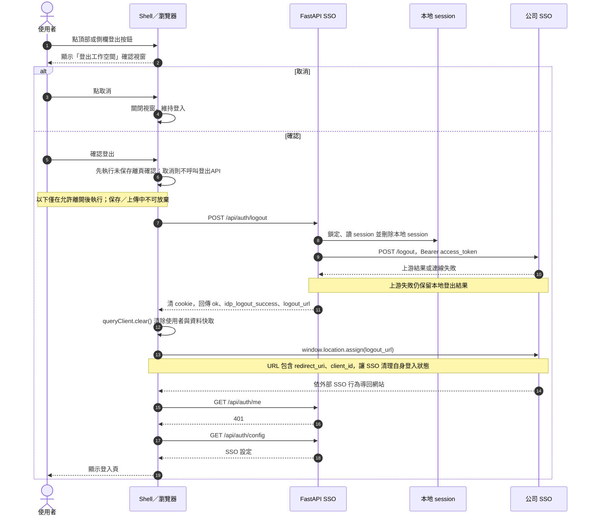

若登出 API 本身失敗，前端保留確認視窗、顯示錯誤，不清快取或跳轉。外部 SSO 最後是否完成導回取決於該服務當下回應。

### 程式對照與驗證範圍

| 流程 | 原始碼 |
| --- | --- |
| 啟動、登入頁、路由、登出 | src/main.tsx、src/App.tsx |
| API、錯誤、快取 | src/api.ts |
| 前端權限 | src/Access.tsx |
| SSO、token、session、角色 | backend/sso.py |
| 日曆、同頁A/D/E表單與查詢 | src/Calendar.tsx、src/Bookings.tsx、src/BorrowingForms.tsx、src/FormLayout.tsx、src/BookingQueries.tsx |
| 出回程、草稿、階段查詢及浮層 | src/Stages.tsx、src/StageFields.tsx、src/StageQueries.tsx、src/SourceEditors.tsx |
| 資產、定位、管理 | src/Assets.tsx、src/AssetPresentation.tsx、src/SourceFiles.tsx、src/SourceEditors.tsx、src/LocationPages.tsx、src/MapLayout.tsx、src/Admin.tsx |
| 側欄與離頁保護 | src/Sidebar.tsx、src/NavigationGuard.tsx |
| 附件 UI | src/ui.tsx |
| 正式 API、授權與本機附件保存與下載 | backend/legacy_api.py |
| SQL、JSON、鎖、交易、狀態 | backend/legacy_store.py |
| 定位、Beacon、通知、匯入 | backend/legacy_integrations.py |

這些圖依原始碼靜態分析，不代表已操作真實公司帳號完成端到端驗證。外部 IdP、Apple與定位接收器只呈現本專案可確認的邊界；附件由本專案本地保存。隔離 demo／test 的角色選擇登入不屬於本文件的正式流程。

<a id="flow-17"></a>

### 17｜歷史封存與完成登記

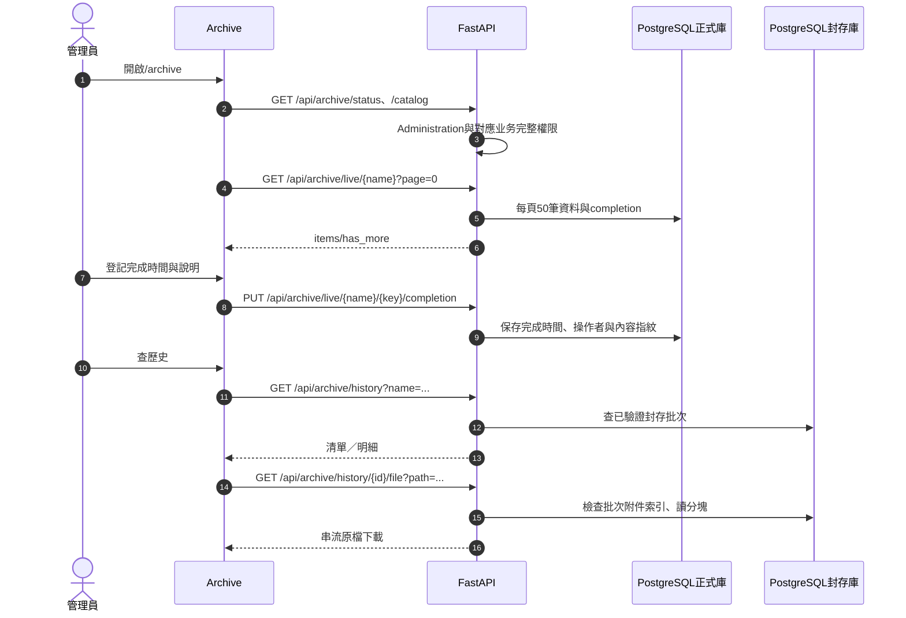

頁面只做查詢與完成登記，實際搬移／清理由archive_maintenance背景作業執行。原始封存資料對欄位、owner或allow_list受限帳號拒絕存取；取消完成登記用DELETE同路徑。詳細保留條件見[封存規格](deploy/ARCHIVE_RETENTION.md)。

<a id="flow-18"></a>

### 18｜未保存離頁、關閉浮層與B/C草稿

`NavigationGuardProvider` 使用單一router blocker及beforeunload，處理A/D/E、B/C與資產編輯的未保存內容。側欄跳頁、返回／前進、取消、Esc、遮罩、關閉浮層及登出都經各編輯器的保護；手機側欄先關閉並解除主內容inert，再顯示離頁確認。

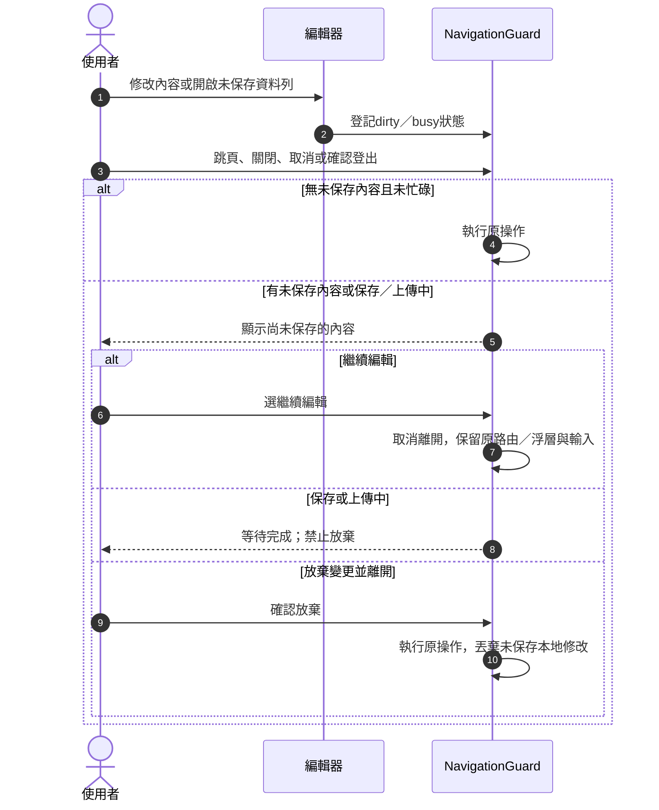

B/C「儲存草稿」只寫目前分頁sessionStorage，以登入者、父單ID、狀態與revision隔離，24小時有效；重開符合基準時載入，不跨裝置、不送通知、不推進流程。手動存草稿後以該內容作離頁比較基準；再修改才需確認，放棄修改仍保留原草稿。階段提交成功清除草稿並解除離頁保護，保存失敗保留輸入與保護。

刷新或關閉分頁使用瀏覽器原生提示，文字及是否彈出受瀏覽器政策限制。離頁確認不自動保存，也不物理刪除已上傳附件。操作與隔離驗收證據見 [NAVIGATION_SAFETY_ACCEPTANCE](docs/reconstruction/NAVIGATION_SAFETY_ACCEPTANCE.md)。

最新布局與歷史驗收請分別閱讀各LAYOUT_SPEC與ACCEPTANCE文件，不能把歷史測試結果當成本次重跑。

<a id="operations"></a>

## 3. 部署、搬機與回復

此章處理現行PostgreSQL系統的維運操作。流程圖中的SQL／JSON錯誤回復是應用程式行為；本章的失敗回復則是部署人員對版本、資料庫及持久檔案的整體處置。

### 3.1 操作前確認

- 記錄版本、服務帳號、網站入口、SSO公開網址與callback、正式／封存庫、持久資料路徑及備份位置。
- 列出所有寫入者：網站、外部PMXAgent MQTT接收器、FindMy匯入、權限更新、封存與其他上游。網站advisory lock不能保證阻止所有外部寫入。
- 新主機準備PG16/PostGIS、Python/Node、pg_dump/pg_restore、Nginx/systemd及有效SSO配置，先在隔離環境還原演練。
- 確認備份包含正式庫、啟用封存時的封存庫、JSON、附件、權限、FindMy資料及私密設定；自訂路徑額外核對。參見[搬機清單](deploy/STANDALONE.md)。

### 3.2 一致停寫與備份

安排維護窗口後停止實際網站、PMX接收器與FindMy寫入，暫停封存timer及會改權限檔的程序；暫停timer不會停止已執行的oneshot，須確認相關作業已結束。保留PostgreSQL運行。

在專案根執行現行備份：

```bash
.venv/bin/python scripts/backup_postgresql.py
```

確認輸出BACKUP_COMPLETE、manifest與postgresql.dump、expired.dump（封存啟用時）、persistent.tar。用SHA-256對manifest核對檔案，pg_restore --list檢查dump可讀、tar清單檢查業務子目錄。備份內容含密鑰，不進Git。

### 3.3 還原與切換

1. 在目標建立不同名稱的隔離驗證庫／正式與封存庫，啟用PostGIS；從有效dump還原完整schema與資料，不能拿測試schema替代。
2. 使用`pg_restore --no-owner --no-acl`，密碼透過本機互動或私密PGPASSFILE，不放命令列／文件。已還原PostGIS欄位與trigger時不要重跑add_location.sql。
3. 還原persistent.tar並確認設定與data路徑指向目標；自訂路徑另行搬入。可不搬sso/session讓使用者重新登入；FindMy須搬session/cache或重新Apple登入。
4. 核對表筆數、主鍵、序列、view、正式與封存schema、表單關聯、附件雜湊與權限manifest；既有缺失記錄仍保留，不標成已修復。
5. 明確設定AMS_DATABASE_MODE=postgresql及目標POSTGRES_*，設定封存庫與旗標；更新SSO公開網址／callback及Nginx／服務路徑。
6. 重建venv、npm ci、npm run build，先啟網站只讀驗收，再啟接收器與FindMy；同一時間只允許一套正式寫入者。
7. 兩網站health應回PostgreSQL；真SSO、角色、表單、附件、定位與封存查詢通過後，恢復備份與清理排程並核對輸出。

讀取API驗收可使用scripts/verify_postgresql_api.py；完整寫入流程在隔離庫執行，不以demo成功代替正式驗收。

### 3.4 發版與失敗回復

程式更新先隔離檢查、保存目前版本與一致備份、build、restart所用實例。若未改schema且新版本未產生不相容資料，可回原程式與dist；若有schema或資料格式變更，需依遷移計畫處理，不能只降版程式。

切換後已有新表單／附件／定位資料時，先停寫、備份失敗現況，再決定重放或保留新增資料；回復資料庫與持久檔案必須配對版本。對封存前後資料也須同時考慮兩庫，不單獨覆蓋其中一庫。完成回復後再核對SSO、附件、health與上游，才恢復排程。

<a id="history"></a>

## 4. 歷史紀錄與操作留存

每次維運保存版本、時間、備份manifest、核對結果、失敗／缺檔、操作人與回復決定。下表是歷史遷移與驗證紀錄，舊筆數及服務結果不是目前資料量或本次操作的驗收證據。

### 已記錄的里程碑

| 日期 | 事件與驗證範圍 |
| --- | --- |
| 2026-09-21 | 隔離匯入舊庫23表、85索引，轉換3view；當時測試快照不作現行一致備份 |
| 2026-09-22 | 正式停寫並遷移；23表442列逐表雜湊一致。修正CHAR(1)空值補空白差異為VARCHAR(1) |
| 2026-09-22 | 新.env明確啟用PostgreSQL；兩入口health回PostgreSQL，SSO跳轉303、Nginx200、接收器連MQTT；當時尚未代表完整真帳號與硬體寫入驗收 |
| 2026-09-22 | PostgreSQL自訂格式與持久檔案備份完成，pg-backup timer啟用；原切換備份保存在migration_backups私有目錄 |
| 2026-09-24 | 封存庫初始化與啟用、雙庫備份、隔離封存測試；首次清理0筆，39份缺JSON或附件保留 |
| 2026-09-30 | 獨立依賴盤點、FindMy環境與讀取測試；未在另一台機器完成整套還原 |

曾保留的MySQL與舊切換點備份只是歷史回復材料，不代表仍使用，也不能直接恢復成目前最新資料。本文不提供重新執行MySQL切換的操作步驟。
